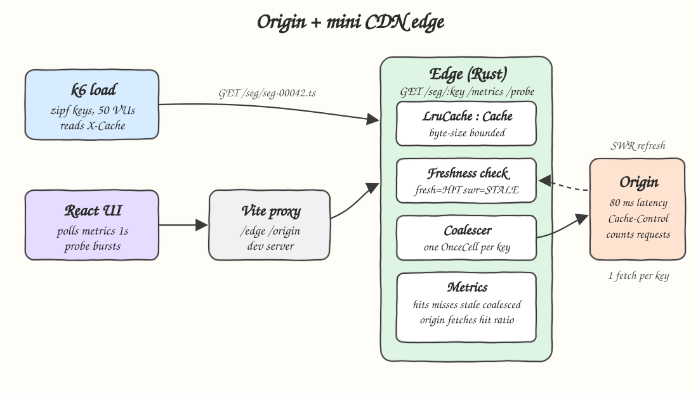
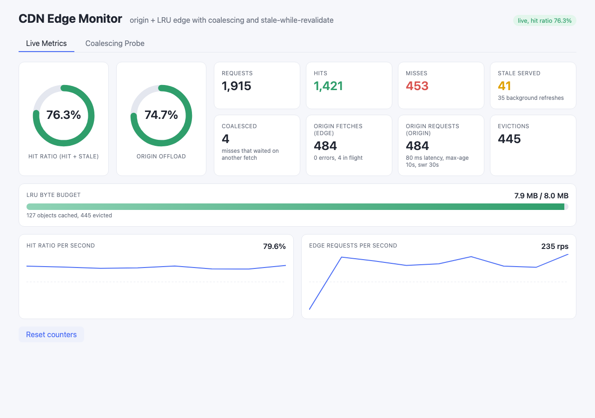
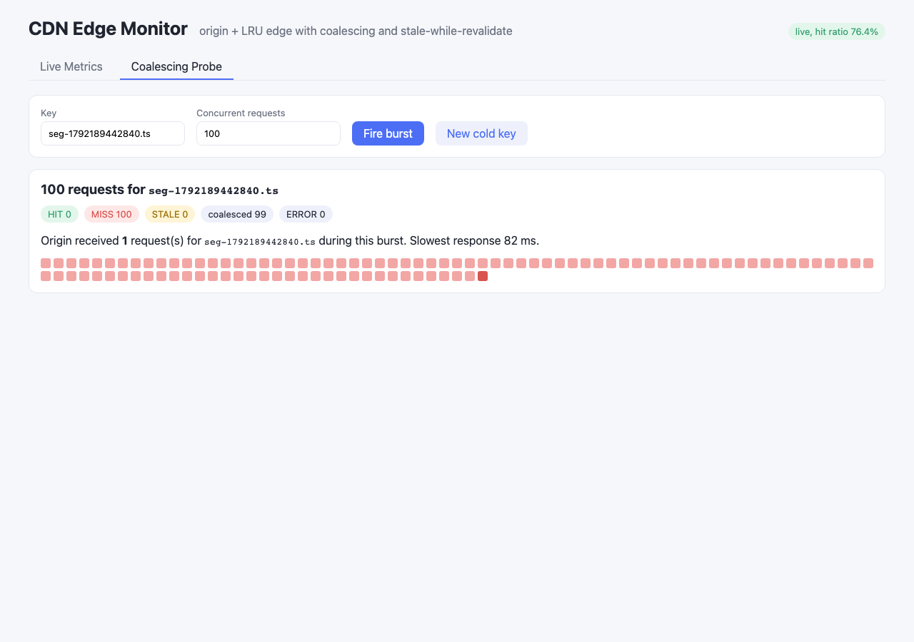
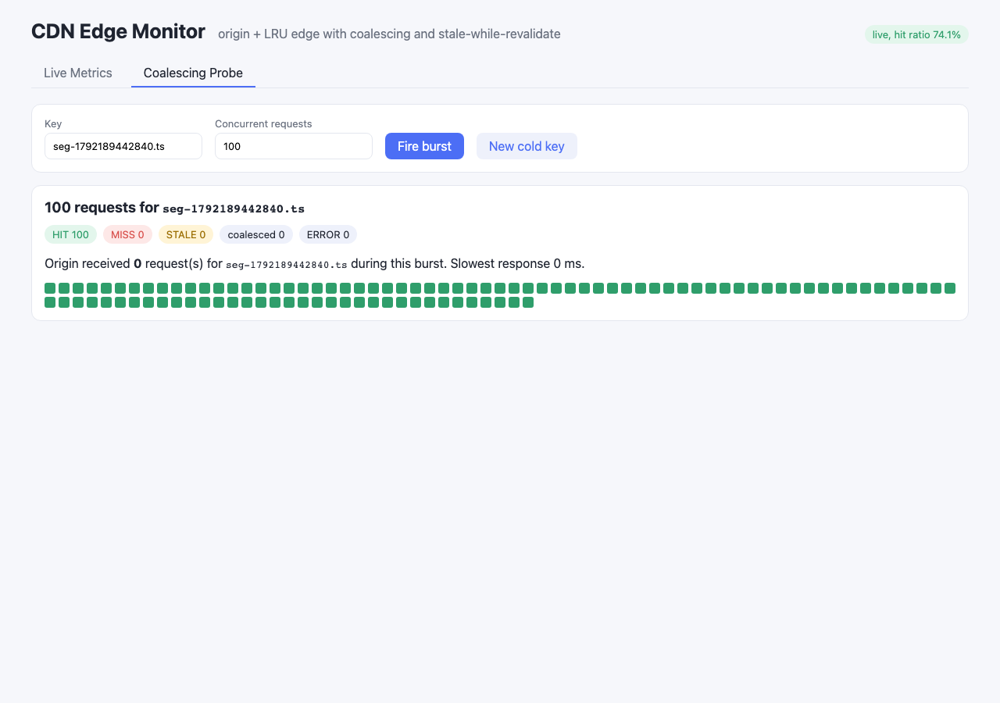
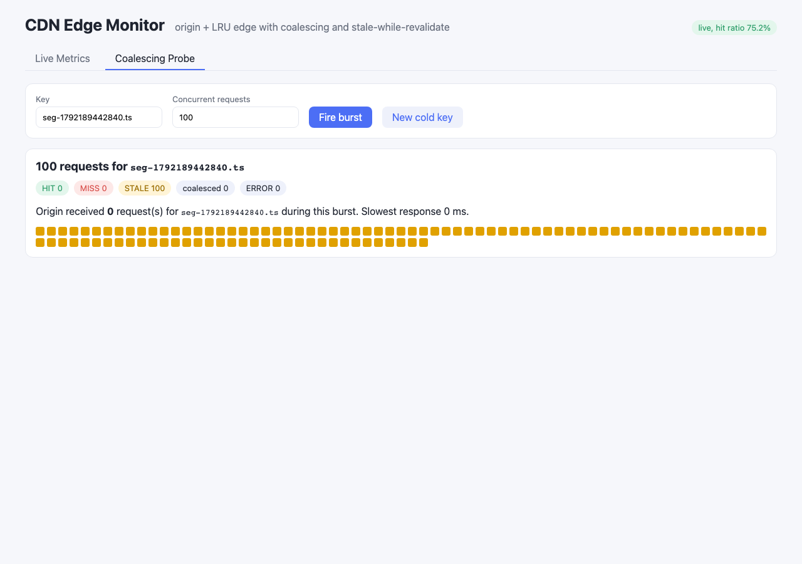

# 03 - Origin + mini CDN edge

A small origin server that serves segment-like objects (`seg-00042.ts`) with artificial latency, and a separate Rust edge cache in front of it. The edge has a hand-written byte-bounded LRU, request coalescing, stale-while-revalidate, Cache-Control handling, `X-Cache` headers and a metrics endpoint. A k6 script drives it with a zipf key distribution, and a React UI shows live metrics and lets you fire coalescing bursts.

## How it Works

1. A client asks the edge for `GET /seg/{key}`.
2. The edge looks the key up in `LruCache` (behind the `Cache` trait). The entry is **fresh** when `age < max-age`, **stale** when `age < max-age + stale-while-revalidate`, otherwise **expired**.
3. Fresh: answered from memory with `X-Cache: HIT`.
4. Stale: answered from memory right away with `X-Cache: STALE`, and one background task refreshes the key (a `HashSet` makes sure only one refresh runs per key).
5. Expired or missing: `X-Cache: MISS`. The request goes through the `Coalescer`: the first caller for a key creates a `tokio::sync::OnceCell` and fetches from the origin, every other concurrent caller for the same key awaits that same cell. N concurrent misses become one origin fetch.
6. The response `Cache-Control` decides if and how long the object is stored (`s-maxage` wins over `max-age`; `no-store`, `no-cache`, `private` and no TTL at all mean it is not stored).
7. Storing evicts least recently used objects until the new object fits the byte budget.
8. Every step updates atomic counters exposed at `GET /metrics`.

## Architecture



## Features

- **Byte-bounded LRU behind a `Cache` trait**: video segments vary in size, so the budget is in bytes, not entries. The trait lets you swap the policy without touching the edge.
- **Request coalescing**: a cold popular segment (a live edge after a new segment shows up) costs one origin fetch instead of N.
- **Stale-while-revalidate**: viewers never wait for the origin while the object is inside the SWR window. The refresh runs in the background.
- **Cache-Control/TTL handling**: the origin decides cacheability. The edge does not guess a TTL.
- **`X-Cache` HIT/MISS/STALE, `Age` and `X-Coalesced` headers**: the client can see how each response was served.
- **Metrics endpoint**: hits, misses, stale, coalesced, origin fetches, origin errors, revalidations, evictions, hit ratio, origin offload, cache bytes, requests in flight.
- **Origin errors are not cached**: followers share the leader's error (no stampede of retries), and the next request tries again.
- **Probe endpoint**: the edge fires N concurrent requests for one key itself, so the UI can show coalescing without hitting the browser's 6 connections per host limit.
- **k6 zipf load test**: a realistic popularity skew where a few segments are hot and many are cold.
- **React live dashboard**: polls every second and shows the hit ratio gauge, the per second hit ratio, rps, and the LRU budget.

## Stack

- **Rust 1.99 (edition 2024)**: no GC pauses, predictable tail latency in the cache path.
- **axum 0.8 + tokio**: async HTTP. `tokio::sync::OnceCell` is the coalescing primitive, and paused tokio time makes the SWR tests deterministic.
- **reqwest (no default features)**: plain HTTP client from the edge to the origin.
- **thiserror / anyhow**: the `CdnError` enum in the library, `anyhow` only in the binaries' `main`.
- **React 19.3 + TypeScript 7 + Vite 8.3 + Bun 1.4**: UI with no UI libraries. The Vite dev proxy forwards `/edge` and `/origin`, so no CORS code is needed.
- **k6 1.5**: load test with custom `Rate` and `Trend` metrics split by `X-Cache`.

## Contracts / APIs

Origin (`:8103`)

| Method | Path | Description |
|---|---|---|
| GET | `/seg/{key}` | Segment bytes (`video/mp2t`) after `ORIGIN_LATENCY_MS`. Sends `Cache-Control: public, max-age=X, stale-while-revalidate=Y` and `X-Origin-Version` (per-key fetch number) |
| GET | `/stats` | `{requests, unique_keys, config}` |
| GET | `/stats/key/{key}` | `{key, requests}` origin fetches for one key |
| POST | `/stats/reset` | Reset the counters |
| GET | `/health` | `ok` |

Edge (`:6103`)

| Method | Path | Description |
|---|---|---|
| GET | `/seg/{key}` | Object from the cache or the origin. Headers: `X-Cache: HIT\|MISS\|STALE`, `Age`, `Cache-Control`, `X-Coalesced: 1` when the request waited on another fetch. `502` on an origin error |
| GET | `/metrics` | `MetricsSnapshot` JSON (below) |
| POST | `/metrics/reset` | Reset the counters (cache contents are kept) |
| POST | `/probe/{key}?n=100` | Fires `n` concurrent `get`s inside the edge, returns `{key, results:[{status, coalesced, millis}]}` |
| GET | `/health` | `ok` |

```json
{"requests":114482,"hits":87945,"misses":26105,"stale":432,"coalesced":5109,
 "origin_fetches":21030,"origin_errors":0,"revalidations":34,"evictions":20870,
 "hit_ratio":0.772,"origin_offload":0.816,"cache_entries":127,
 "cache_bytes":8324342,"cache_capacity_bytes":8388608,"in_flight":0}
```

`hit_ratio = (hits + stale) / requests`, `origin_offload = 1 - origin_fetches / requests`.

Configuration (env vars, set from `scripts/ports.env` by `start-all.sh`): `ORIGIN_PORT`, `ORIGIN_LATENCY_MS` (80), `ORIGIN_SEGMENT_BYTES` (65536), `ORIGIN_MAX_AGE` (10), `ORIGIN_SWR` (30), `EDGE_PORT`, `ORIGIN_URL`, `EDGE_CACHE_BYTES` (8 MiB).

## Key data structures and design decisions

- **`LruCache`** (`backend/src/cache.rs`): `HashMap<String, Slot{entry, tick}>` plus `BTreeMap<tick, key>` as the recency order. `get` moves the key to a new tick and `pop_first` gives the LRU victim. Each operation is O(log n), there is no `unsafe` and no linked list. An object larger than the whole budget is skipped instead of flushing the cache.
- **`Coalescer`** (`backend/src/coalescer.rs`): `Mutex<HashMap<key, Arc<OnceCell<Result<Entry>>>>>`. The caller whose closure runs is the leader and the others are followers. The leader stores the entry in the cache **before** it removes the flight, so a late request finds the cache warm instead of starting a second fetch. If a leader is cancelled (client disconnect), `OnceCell` lets a waiting follower take over.
- **`Edge<C: Cache, O: OriginClient>`** (`backend/src/edge.rs`): generic over the cache and the origin client, so tests use a `MockOrigin` with a fetch counter and simulated latency. The std `Mutex` is never held across an `.await`.
- **`CachePolicy`** (`backend/src/cache_control.rs`): parses `max-age`, `s-maxage`, `stale-while-revalidate`, `no-store`/`no-cache`/`private`. `no-cache` is treated as "do not store" for simplicity (a full CDN would revalidate with ETags).
- **Freshness uses `tokio::time::Instant`**, so the SWR tests run with paused time and use `advance`, with no real sleeps and no flakiness.
- **The edge and the origin are separate binaries** (`src/bin/edge.rs`, `src/bin/origin.rs`) over one library crate, so integration tests can start both in process on ephemeral ports.

## How to run

```bash
./scripts/setup.sh
./scripts/start-all.sh
./scripts/ui.sh
./k6/run.sh
./scripts/test-all.sh
./scripts/stop-all.sh
```

`./k6/run.sh` accepts k6 flags and env, e.g. `./k6/run.sh -e VUS=100 -e DURATION=60s -e KEYS=1000 -e SKEW=1.2`.

Tests:

- `cargo test` (in `backend/`): 26 tests (21 unit, 5 HTTP integration). They include:
  - `hundred_concurrent_misses_for_one_key_cost_exactly_one_origin_fetch`: 100 concurrent misses, then origin fetches == 1, coalesced == 99, and every caller gets the same body.
  - `coalescing_is_per_key_so_distinct_objects_are_not_merged`: 10 keys x 10 callers make exactly 10 fetches.
  - `origin_failure_is_shared_by_followers_and_not_cached`
  - `stale_within_window_is_served_instantly_and_refreshed_in_background`: STALE with the old body in zero (paused) time, then a HIT with the new version.
  - `many_stale_reads_trigger_a_single_background_refresh`
  - `past_the_swr_window_the_client_waits_for_a_fresh_copy`
  - `evicts_least_recently_used_not_least_recently_inserted`, `bound_is_bytes_not_entry_count...`, `object_larger_than_capacity_is_skipped...`, `never_exceeds_capacity_under_churn`, `byte_budget_evicts_cold_keys_and_forces_refetch`
  - `fifty_concurrent_http_misses_reach_origin_once` and `stale_header_then_refreshed_body_over_http`: the same guarantees over real HTTP against the real origin binary router.
- Mutation check: replacing the shared `Coalescer` with a fresh one per call makes 3 coalescing tests fail, so the tests do catch a coalescing regression.
- `bun test` (in `frontend/`): 8 tests for formatting, the bounded history, the per-interval hit ratio (and that a counter reset gives no negative ratio), and the probe status grouping.

## Results (measured)

k6, 50 VUs, 40 s, 500 keys, zipf skew 1.1, 64 KiB objects, origin latency 80 ms, `max-age=10, stale-while-revalidate=30`, release build, all on one laptop. The raw outputs are in `k6/results/cache-8mb/` and `k6/results/cache-40mb/`.

| Edge cache | Requests | RPS | Hit ratio (HIT+STALE) | Origin offload | Coalesced | Evictions | Origin requests |
|---|---|---|---|---|---|---|---|
| 8 MiB (127 objects, 25% of the key space) | 114,482 | 2,857 | **77.2%** | 81.6% | 5,109 | 20,870 | 21,030 |
| 40 MiB (all 500 objects fit) | 1,744,470 | 43,567 | **99.96%** | 99.89% | 182 | 0 | 2,000 |

Latency seen by k6 (ms):

| Edge cache | Class | avg | p50 | p95 | p99 | max |
|---|---|---|---|---|---|---|
| 8 MiB | all | 17.42 | 0.20 | 82.33 | 85.07 | 119.80 |
| 8 MiB | HIT | 0.38 | 0.14 | 1.31 | 4.66 | 39.87 |
| 8 MiB | STALE | 0.34 | 0.13 | 1.22 | 4.19 | 7.11 |
| 8 MiB | MISS | 75.12 | 81.44 | 84.77 | 90.11 | 119.80 |
| 40 MiB | all | 0.94 | 0.49 | 2.76 | 7.45 | 129.66 |
| 40 MiB | HIT | 0.92 | 0.49 | 2.75 | 7.29 | 129.66 |
| 40 MiB | STALE | 0.95 | 0.49 | 2.69 | 7.91 | 109.69 |
| 40 MiB | MISS | 76.35 | 82.37 | 95.00 | 112.01 | 126.83 |

Observations:

- STALE responses cost the same as HITs (sub-millisecond p50). Stale-while-revalidate hides the 80 ms origin round trip completely.
- With 8 MiB the long zipf tail keeps evicting (20,870 evictions), so the p95 is the origin latency. The cache size, not the edge code, is the limit, and rps is low because each VU waits 80 ms on every miss.
- With 40 MiB the origin saw exactly 2,000 requests in 40 s: 500 cold fetches plus 1,500 background refreshes (`revalidations` = 1,500). That is 500 keys refreshed every ~10 s TTL period. The origin never sees more than one request per key per TTL, and that does not depend on the request rate.
- Edge `origin_fetches` matched the origin's own request counter exactly in both runs (21,030 and 2,000), so the edge metrics are consistent with the origin.

## Printscreens

**Live Metrics**: the dashboard polls `/edge/metrics` and `/origin/stats` every second during a small k6 run (4 VUs, 8 MiB cache). The gauges show the hit ratio (HIT + STALE) and the origin offload. The cards show every counter. The edge "origin fetches" and the origin's own request count match. The LRU bar shows the byte budget nearly full (127 objects) with evictions running. The sparklines show the per-second hit ratio and the edge rps.



**Coalescing Probe, cold key**: 100 concurrent requests for a key never seen before. All 100 are MISS, 99 of them are coalesced (light red), and the origin's per-key counter shows exactly **1** request. The slowest response is about one origin latency (82 ms).



**Coalescing Probe, warm key**: the same burst right after. All 100 are HIT and the origin receives 0 requests.



**Coalescing Probe, stale key**: the same burst 11 s later (after `max-age=10`, inside the 30 s SWR window). All 100 are served STALE instantly, the origin gets 0 requests during the burst, and a single background refresh follows.



## Scripts

All scripts live in `scripts/` and run from any directory of the repository.

| Script | What it does |
|---|---|
| `./scripts/setup.sh` | Installs dependencies and prepares the app |
| `./scripts/start-all.sh` | Starts every service and prints the full link of each one |
| `./scripts/status.sh` | Shows every service port as UP or DOWN |
| `./scripts/test-all.sh` | Runs every test suite |
| `./scripts/ui.sh` | Opens the UI in the browser |
| `./scripts/stop-all.sh` | Stops every service |

Ports are declared in `scripts/ports.env` (origin 8103, edge 6103, frontend 5103). There is no `sql-console.sh` because there is no database. The cache lives in the edge process.

```bash
./scripts/setup.sh
./scripts/start-all.sh
./scripts/status.sh
./scripts/ui.sh
./scripts/stop-all.sh
```
