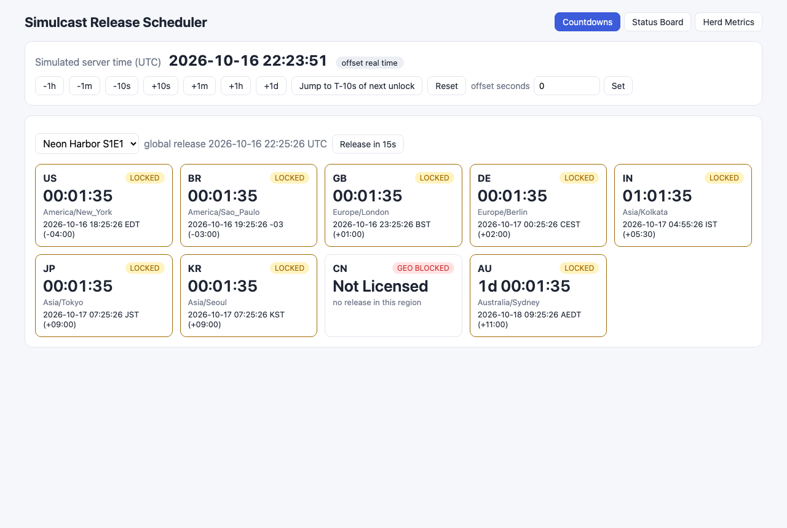
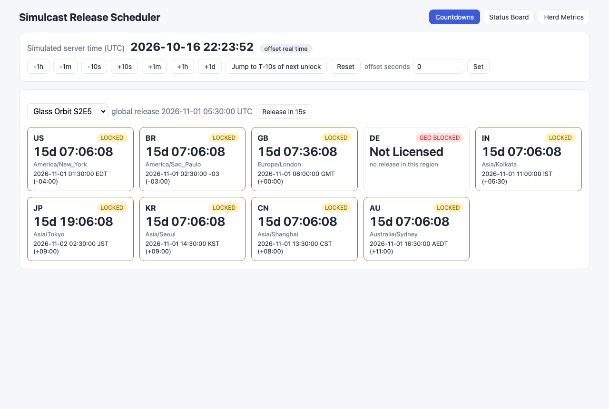
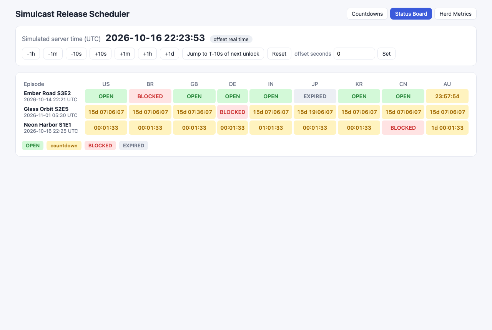
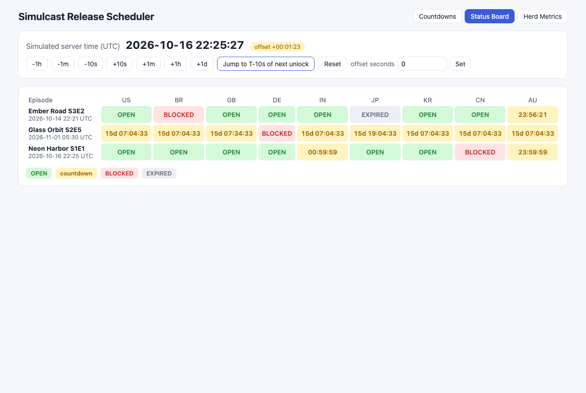
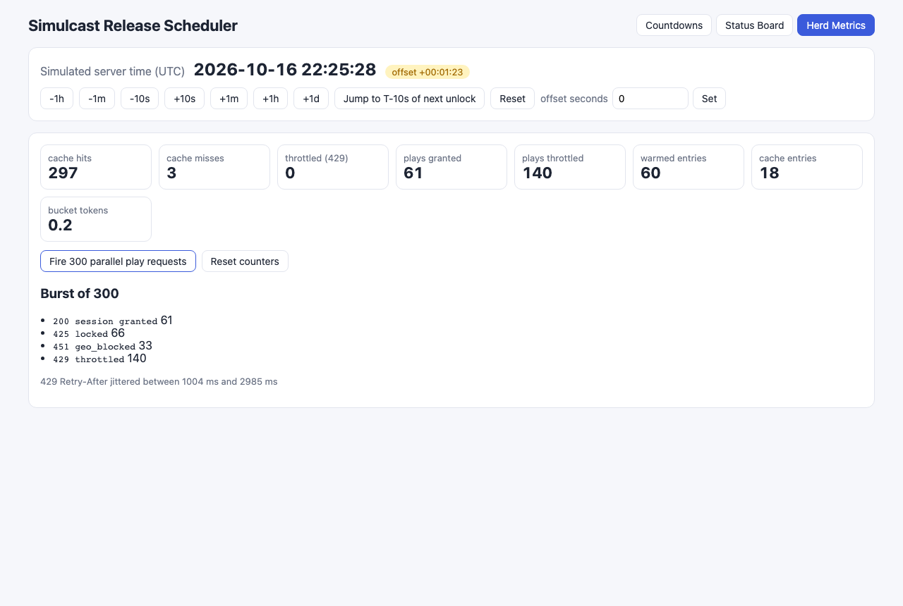

# 07 Simulcast Release Scheduler

A Rust service that decides, per viewer region, whether an episode is **available**, **locked with a countdown**, or **geo-blocked**, at the exact release instant (UTC). It also protects itself from the thundering herd of viewers who all hit refresh at the unlock second. A React UI shows per-region countdowns, a simulated clock offset control and a live status board.

## How it Works

1. Each episode has a global `release_utc` plus per-region rules: open at release, delayed by N seconds, open with a license end (`until`), or blocked. Regions with no rule open at release.
2. When an episode is stored, the schedule store builds an `UnlockPlan` once, mapping each country to an absolute access window (`from`, `until`). Requests never parse rules again.
3. A request is resolved to a country by the `X-Country` header (edge geo). If the header is missing or malformed, the IP (`X-Forwarded-For` or peer) is looked up in an IP-range table behind the `GeoResolver` trait. Clients that cannot be resolved are blocked as `unknown_region`.
4. Entitlement is a pure function of `(access window, now)`. `now` comes from an injectable `Clock` trait, so tests use a manual clock and the UI can shift server time with an offset.
5. Responses are cached per `(episode, country)` with a jittered TTL. The TTL is capped at the next transition, so a cached `locked` answer can never be served after the unlock instant.
6. A warmer task runs every 200 ms and pre-fills the cache with the status that will be true at any unlock coming in the next 2 s (`valid_from = unlock`). The first wave at the unlock second is served from cache.
7. Cache misses and play-session creation go through a token bucket. When the bucket is empty the client gets `429` with a jittered `Retry-After`. Locked responses carry `Retry-After = countdown + random(0..3s)`, so clients spread their retries after the unlock instead of all coming back on the same millisecond.
8. Local release time is rendered with `chrono-tz`, with the zone abbreviation and UTC offset. This keeps repeated DST hours unambiguous.

## Architecture


## Features

- **Per-region windows**: simulcast, delayed (IN +1h, AU +24h), license expiry and blocked regions, all checked against the same precomputed plan.
- **Exact-boundary unlock**: the window is `[from, until)`. It unlocks inclusively at the release millisecond, and the last millisecond before the license end is still playable.
- **Geo resolution**: the `X-Country` header first, then an IPv4 range table, then `ZZ` (blocked). All of it sits behind the `GeoResolver` trait so a MaxMind-style resolver can be plugged in.
- **Time zone display**: local release time per region with the abbreviation and offset (EDT/EST, AEDT/AEST, IST +05:30).
- **Thundering herd handling**: precomputed unlock plan, a warmer that fills the cache ahead of unlock, a jittered cache TTL capped at the next transition, a token bucket for admission, and a jittered `Retry-After`.
- **Simulated clock**: `POST /api/clock` shifts server time, so you can jump to T-10s before any unlock and watch it flip live.
- **Live UI**: per-region countdown cards, an episodes x regions status board, herd metrics and a 300-request play burst.

## Stack

- **Rust 1.99 (edition 2024) + axum 0.8 + tokio**: a small, fast HTTP service that can take tens of thousands of requests per second on one box.
- **chrono + chrono-tz**: correct IANA time zone math, including DST gaps and overlaps.
- **thiserror**: a typed `AppError` that maps to HTTP status codes. `anyhow` is used only in `main`.
- **React 19.3 + Vite 8.3 + TypeScript 7 + Bun 1.4**: the UI, with no UI libraries.
- **k6 1.5**: load test aimed at the unlock instant.

No random-number crate is used. Jitter comes from a small xorshift generator that can be seeded in tests.

## Contracts / APIs

| Method | Path | Description |
|---|---|---|
| GET | `/api/health` | liveness |
| GET | `/api/clock` | `{server_now, offset_ms}` |
| POST | `/api/clock` | body `{offset_ms}` shifts simulated server time |
| GET | `/api/board` | every episode x every region with status, countdown and local release |
| GET | `/api/episodes` | raw schedule (episodes and region rules) |
| GET | `/api/episodes/{id}/entitlement` | entitlement for the caller's region. Headers: `X-Country` or `X-Forwarded-For` |
| POST | `/api/episodes/{id}/play` | creates a play session if entitled and admitted |
| POST | `/api/episodes/{id}/release` | body `{in_secs}` reschedules the release relative to now and invalidates the cache |
| GET | `/api/metrics` | cache hits/misses, throttled, plays, warmed, bucket tokens |
| POST | `/api/metrics/reset` | resets counters |

Entitlement response (`200`):

```json
{
  "episode_id": "neon-harbor-s1e1",
  "country": "US",
  "status": "locked",
  "unlock_at": "2026-10-16T22:23:47Z",
  "available_until": null,
  "countdown_ms": 109571,
  "reason": null,
  "local_release": { "timezone": "America/New_York", "local": "2026-10-16 18:23:47", "abbrev": "EDT", "utc_offset": "-04:00" },
  "server_now": "2026-10-16T22:21:58Z"
}
```

Status codes and headers:

| Case | Entitlement | Play |
|---|---|---|
| available | `200` | `200 {session_id}` |
| locked | `200` + `Retry-After` (countdown + jitter) | `425 Too Early` + `Retry-After` |
| geo-blocked (`not_licensed`, `license_expired`, `unknown_region`) | `200` with `reason` | `451` |
| admission rejected | `429` + `Retry-After` 1-3 s jittered | `429` + `Retry-After` |

Every jittered response also carries `X-Retry-After-Ms` (exact) and entitlement responses carry `X-Cache: HIT|MISS`.

## Key Data Structures and Design Decisions

- `Clock` trait (`SystemClock`, `ManualClock`, `OffsetClock`): everything that depends on time reads it from here. `OffsetClock` wraps any base clock, which gives the UI its time travel and the tests their determinism.
- `UnlockPlan`: per-country `Access::Window{from, until}` or `Access::Blocked`, built once when the episode is stored. Regional delays are **absolute durations**: a 24h delay that crosses a DST change shifts the local wall-clock hour (20:00 EST becomes 21:00 EDT). The tests lock this down on purpose.
- `evaluate(access, now) -> Status` and `next_transition(access, now)` are pure functions. The cache and the warmer are built on top of them.
- `ResponseCache`: `(episode, country) -> Vec<Entry{status, valid_from, expires_at}>`. Entries can start in the future, which is how precomputed unlocks sit next to the current `locked` entry without leaking early.
- `TokenBucket` takes `now_ms` as an argument (no hidden clock). It ignores clock jumps backwards instead of minting tokens.
- Cache hits bypass the bucket, so the bucket only guards origin work: cache misses and session creation.
- Countdown values are computed when the response is served, not when it is cached, so a cached `locked` entry still reports a correct countdown.

## Tests

`cargo test`: 35 tests, all passing.

- `tests/dst.rs` (6): US spring-forward gap, US fall-back repeated hour told apart by offset, Sydney DST ending in April, Kolkata +05:30 without DST, an absolute delay across DST, and an unknown zone returning an error.
- `tests/boundary.rs` (9): inclusive unlock and exclusive license end at the exact millisecond, a cached `locked` entry never outliving the unlock, warmer hits at the instant without leaking early, delayed regions, a locked `Retry-After` never earlier than the unlock, rescheduling invalidating the cache, and invalid windows being rejected.
- `tests/geo.rs` (8): header over IP, the IP range table, a malformed header falling through, unknown regions blocked, blocked regions with no countdown, license expiry, and no session issued when blocked.
- `tests/herd.rs` (6): bucket capacity and refill, clock going backwards, jitter bounds and spread, cache hits not consuming tokens, a stampede getting 429 with jittered retries, and jittered TTLs not expiring in lockstep.
- `tests/api.rs` (6): HTTP contract (status codes, `Retry-After`, local time, 404, 429, board shape).

`bun test`: 7 frontend tests (countdown rounding, offset formatting, next-unlock selection, expired vs blocked labels), all passing.

## Load Test Results (k6, unlock instant)

`k6/unlock-herd.js` reschedules `neon-harbor-s1e1` to unlock 10 s after the run starts. 300 VUs then loop with no think time for 25 s: each iteration calls entitlement with a random country (9 regions) and, unless the region is blocked, a play request. Requests are tagged `before_unlock`, `unlock_window` (+-1 s) and `after_unlock`.

Measured on a single laptop with the release build, backend and k6 on the same machine:

| Metric | Value |
|---|---|
| total HTTP requests | 1,275,400 (~50,900 req/s) |
| http_req_failed | 0.00% |
| p95 latency before unlock / unlock window / after unlock | 9.54 ms / 10.31 ms / 13.27 ms |
| max latency | 183 ms |
| **stale `locked` responses served after unlock** | **0** (threshold `count==0` passed) |
| entitlement responses: available / locked / geo_blocked / 429 | 260,095 / 339,998 / 74,526 / 684 |
| server cache hits / misses | 1,274,499 / 897 (99.93% hit ratio) |
| warmed (precomputed) entries | 60 |
| plays granted / throttled (429) / too early (425) | 3,223 / 257,008 / 339,862 |
| checks (`Retry-After` present on locked and 429) | 100% of 340,682 |

What this shows:

- Origin work stayed at about 900 cache misses for 1.27M requests, because the warmer pre-filled the unlock entries and the TTLs are jittered.
- Not a single `locked` response was served after the unlock instant, even under full load.
- The token bucket (capacity 50, refill 200/s) held session creation to about 129/s. Everything above that got a 429 with a 1-3 s jittered `Retry-After`. That is the intended behavior: the herd is pushed back and spread out instead of reaching the origin.
- Trade-off seen in the run: the bucket is shared by cache misses and plays, so while plays were draining it, 684 entitlement misses were also throttled. A separate bucket per path would remove that, at the cost of one more knob.

Run it:

```bash
./scripts/start-all.sh
k6 run k6/unlock-herd.js
```

`BASE_URL`, `VUS`, `DURATION` and `UNLOCK_IN_SECS` can be overridden with `-e`.

## How to Run

```bash
./scripts/setup.sh
./scripts/start-all.sh
./scripts/test-all.sh
./scripts/ui.sh
./scripts/stop-all.sh
```

UI: http://localhost:5107, API: http://localhost:8107/api

## Printscreens

### Countdowns: Neon Harbor S1E1



Per-region countdown cards for an episode releasing in about 95 s. Simulcast regions show the same countdown in their own local time (EDT, BRT -03, BST, CEST, JST, KST). India has a 1h delay, Australia has a 24h delay, and China is geo-blocked (`not_licensed`), so it gets no countdown.

### Countdowns: Glass Orbit S2E5 (DST edge)



This episode releases at 2026-11-01 05:30 UTC, which is **01:30 EDT** in New York. That wall-clock hour happens twice that night, and the `-04:00` offset shows which one. GB has a 30 min delay and is already back on GMT. JP has a 12h delay. DE is blocked.

### Status Board



Live matrix of every episode x region: green OPEN, amber countdown, red BLOCKED, grey EXPIRED (Ember Road's JP license ended an hour ago). The board polls every 500 ms.

### Status Board after "Jump to T-10s of next unlock"



The clock control shifted server time by +00:01:23 to 10 s before the next unlock. After waiting, Neon Harbor flipped to OPEN in all simulcast regions. IN still counts down its 1h delay, AU its 24h delay, and CN stays blocked.

### Herd Metrics



300 parallel play requests fired from the browser right after the unlock: 61 sessions granted (bucket capacity plus refill), 66 `425 locked` (IN/AU are still delayed), 33 `451` (CN), and 140 `429` with `Retry-After` jittered between about 1.0 and 3.0 s. The tiles show the cache-hit counter, the warmed entries and the bucket draining to 0.2 tokens.

## Scripts

All scripts live in `scripts/` and run from any directory of the repository.

| Script | What it does |
|---|---|
| `./scripts/setup.sh` | Installs dependencies and prepares the app |
| `./scripts/start-all.sh` | Starts every service and prints the full link of each one |
| `./scripts/status.sh` | Shows every service port as UP or DOWN |
| `./scripts/test-all.sh` | Runs every test suite |
| `./scripts/ui.sh` | Opens the UI in the browser |
| `./scripts/stop-all.sh` | Stops every service |

Ports are declared in `scripts/ports.env`.

```bash
./scripts/setup.sh
./scripts/start-all.sh
./scripts/status.sh
./scripts/ui.sh
./scripts/stop-all.sh
```
