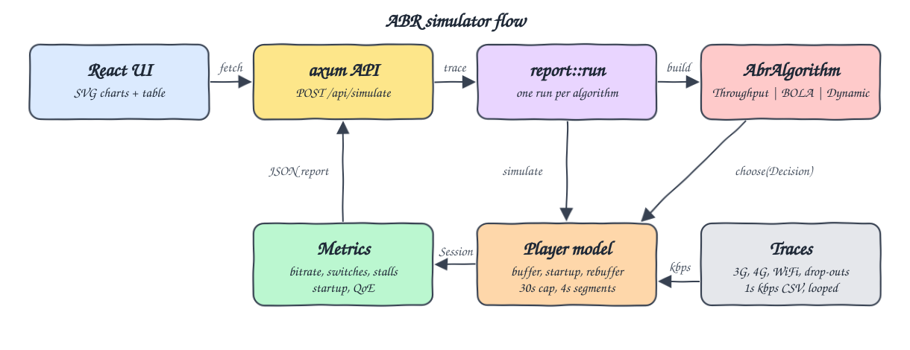
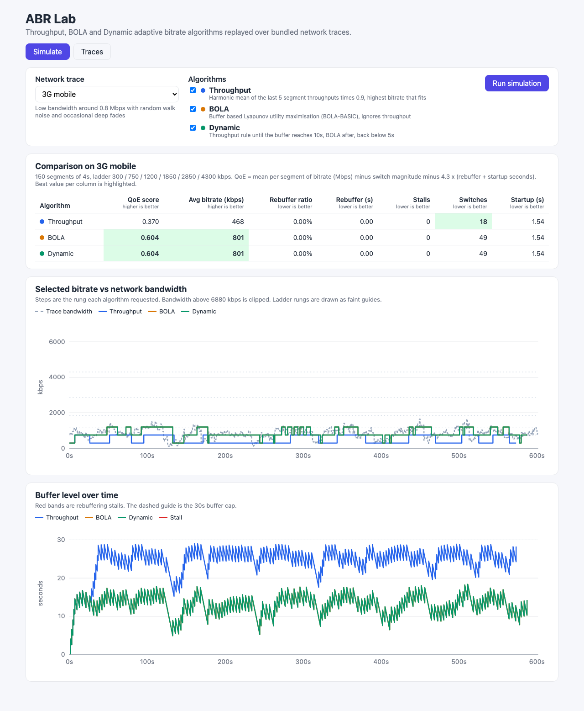
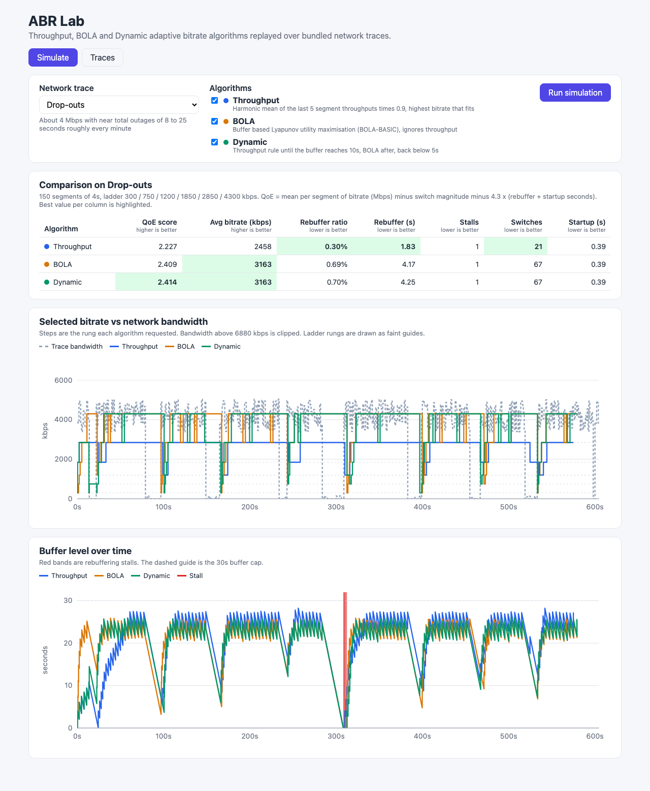
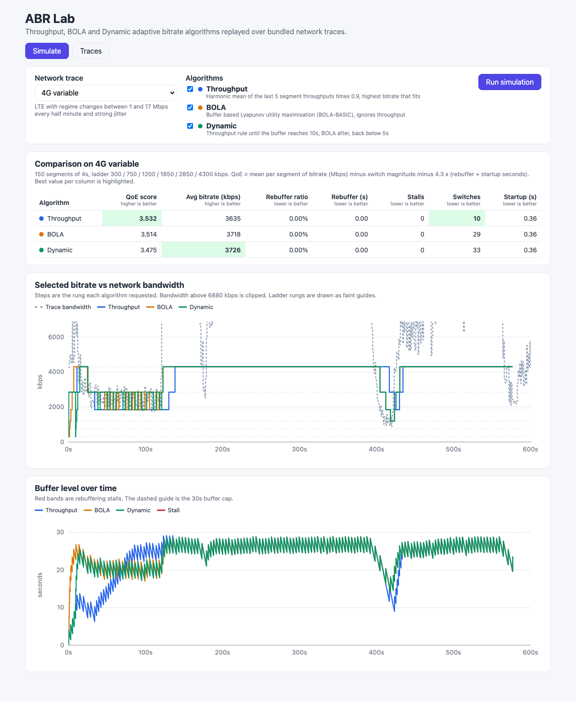
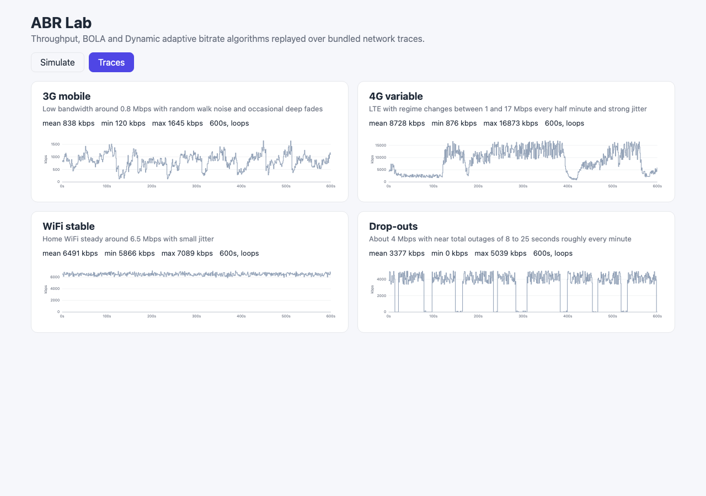

# 08 - ABR algorithms

A Rust simulator for adaptive bitrate (ABR) algorithms with a React UI. Three algorithms are put behind one `AbrAlgorithm` trait: a throughput rule (harmonic mean), buffer based BOLA (BOLA-BASIC, the Lyapunov utility rule from the paper), and Dynamic, a hybrid that works like dash.js `abrDynamic` (throughput at startup, BOLA at steady state). Each one is replayed through a player model over bundled network traces, and the simulator reports rebuffer ratio, average bitrate, switch count, startup delay and a QoE score.

## How it Works

1. Four synthetic network traces (`backend/traces/*.csv`, one kbps sample per second, 10 minutes each) are compiled into the binary and loop when a session runs longer than the trace.
2. The player asks the algorithm for a rung of the ladder `300 / 750 / 1200 / 1850 / 2850 / 4300 kbps` for each of 150 segments of 4 s.
3. Download time is the exact integral of the trace bandwidth from the request time plus an 80 ms RTT, so a zero kbps outage really blocks the download.
4. Playback starts when the first segment is buffered. After that the buffer drains in real time during downloads, and any time the buffer is empty while waiting counts as a stall.
5. When the buffer would go past 30 s, the player stops requesting until there is room.
6. The measured throughput of every segment goes into the history that the algorithms read.
7. `metrics::evaluate` turns a `Session` into QoE metrics. The API runs every requested algorithm on the same trace, and the UI plots bitrate and buffer over time as hand-written SVG.

## Architecture



## Features

- **Throughput rule**: harmonic mean of the last 5 segment throughputs times 0.9, picks the highest rung below that. The harmonic mean keeps a single fast sample from pushing the estimate up.
- **BOLA-BASIC**: score `(Vp * (v_m + gp) - Q) / S_m` with `v_m = ln(S_m/S_1) + 1`, `gp` and `Vp` taken from a 10 s minimum buffer and a 26 s target buffer. It uses only the buffer level and never looks at throughput.
- **Dynamic hybrid**: throughput rule until the buffer reaches 10 s, then BOLA, and back to throughput below 5 s. The gap between the two thresholds stops it from flipping back and forth.
- **Player model**: startup, buffer cap with idle wait, rebuffer accounting per segment, looping traces. The accounting check is that wall clock = startup + content + stalls.
- **QoE metrics**: average bitrate, switch count, rebuffer seconds, stall events, rebuffer ratio, startup delay and a linear QoE score.
- **Bundled traces**: 3G, variable 4G, stable WiFi and drop-outs, so all three algorithms are compared on the same network conditions.
- **UI**: pick a trace and any subset of algorithms. You get a comparison table with the best value per column highlighted, a bitrate vs bandwidth chart, a buffer chart with stall bands, and a Traces tab.
- **Report binary**: `cargo run --bin abr-report` prints the full results table in Markdown.

## Stack

- **Rust 1.99 (edition 2024)**: the simulator core, the algorithms and the metrics. It is deterministic and fast (12 full sessions run in milliseconds).
- **axum 0.8 + tokio**: a small HTTP API.
- **thiserror**: one `AbrError` enum. Every fallible function returns `Result`, and `anyhow` is used only in the binaries.
- **React 19.3 + TypeScript 7 + Vite 8.3 on Bun 1.4**: the UI. Charts are plain SVG paths with no chart library.

## Contracts / APIs

| Method | Path | Body / Response |
|---|---|---|
| GET | `/api/health` | `{"status":"ok"}` |
| GET | `/api/traces` | `[{id, name, description, duration_s, mean_kbps, min_kbps, max_kbps, bandwidth_kbps[]}]` |
| GET | `/api/algorithms` | `[{id, name, description}]` with ids `throughput`, `bola`, `dynamic` |
| GET | `/api/config` | player config: ladder, segment length, segment count, max buffer, startup buffer, rtt |
| POST | `/api/simulate` | body `{"trace":"dropouts","algorithms":["throughput","bola","dynamic"]}`, returns `{trace, config, runs:[{algorithm, name, metrics, session:{segments[], startup_delay_s, rebuffer_s, rebuffer_events, content_s, end_s}}]}` |

Errors are `{"error": "..."}`: 404 for an unknown trace, 400 for an unknown algorithm or an empty algorithm list.

## Key data structures and design decisions

- `trait AbrAlgorithm { fn id(&self) -> &'static str; fn choose(&mut self, decision: &Decision) -> usize; }`. `Decision` holds the ladder, segment length, buffer cap, current buffer, throughput history and last quality. An algorithm keeps its own state (Dynamic remembers which mode it is in) and returns an index into the ladder. The player rejects an index outside the ladder with `AbrError::InvalidQuality`.
- `SegmentRecord` stores for every segment the request time, the buffer at request time, the finish time, the measured throughput, the buffer after the segment, the stall and the idle wait. That is enough for the UI to redraw the exact buffer curve, including the drop to zero during a stall.
- Time spent before the first frame is startup delay, not rebuffering. A stall is only counted after playback has started.
- BOLA's target buffer is `max_buffer - segment` (26 s). With a 30 s cap the buffer is never above 26 s when a decision is made, so using the full 30 s would make the top rung unreachable.
- QoE follows the linear model from Yin et al. (SIGCOMM 2015), averaged per segment: `mean(bitrate Mbps) - mean(|bitrate change| Mbps) - 4.3 x (rebuffer s + startup s) / segments`. 4.3 is the top rung in Mbps, so one second of stall costs as much as one segment at top quality.
- The traces are synthetic and deterministic (seeded generator). The CSVs are committed (32 KB in total).

## How to run

```bash
./scripts/setup.sh
./scripts/start-all.sh
./scripts/ui.sh
./scripts/test-all.sh
./scripts/stop-all.sh
```

Results table on its own: `cd backend && cargo run --bin abr-report`.

Tests: 37 Rust tests (28 unit, 5 API, 4 simulation integration) and 10 Bun tests. `test-all.sh` also runs `cargo clippy -D warnings` and the frontend build, and calls the live API when the backend is up. The tests check behavior that matters:

- BOLA never picks above the lowest rung while the buffer is below 10 s, even with a 50 Mbps throughput history.
- BOLA quality never goes down as the buffer grows, and BOLA ignores throughput.
- The harmonic mean is not inflated by a single 100 Mbps spike.
- On a link at exactly half the bitrate, every segment after the first stalls exactly 4 s (36 s and 9 stalls over 10 segments).
- Startup wait is not counted as rebuffering. A 40 s outage counts as one stall.
- For every trace and every algorithm, session length = startup + content + stalls.
- Dynamic ramps up faster than pure BOLA at startup.
- In the UI, the buffer curve goes flat at zero during a stall, and in the table the best cell is the higher one for QoE and the lower one for stalls.

## Results

Measured with `cargo run --bin abr-report` (150 x 4 s segments, 30 s buffer cap, 80 ms RTT):

| Trace | Algorithm | Avg bitrate (kbps) | Switches | Rebuffer (s) | Rebuffer events | Rebuffer ratio | Startup (s) | QoE |
|---|---|---|---|---|---|---|---|---|
| 3G mobile | Throughput | 468 | 18 | 0.00 | 0 | 0.00% | 1.54 | 0.370 |
| 3G mobile | BOLA | 801 | 49 | 0.00 | 0 | 0.00% | 1.54 | 0.604 |
| 3G mobile | Dynamic | 801 | 49 | 0.00 | 0 | 0.00% | 1.54 | 0.604 |
| 4G variable | Throughput | 3635 | 10 | 0.00 | 0 | 0.00% | 0.36 | 3.532 |
| 4G variable | BOLA | 3718 | 29 | 0.00 | 0 | 0.00% | 0.36 | 3.514 |
| 4G variable | Dynamic | 3726 | 33 | 0.00 | 0 | 0.00% | 0.36 | 3.475 |
| WiFi stable | Throughput | 4264 | 2 | 0.00 | 0 | 0.00% | 0.26 | 4.229 |
| WiFi stable | BOLA | 4123 | 5 | 0.00 | 0 | 0.00% | 0.26 | 4.089 |
| WiFi stable | Dynamic | 4167 | 8 | 0.00 | 0 | 0.00% | 0.26 | 4.079 |
| Drop-outs | Throughput | 2458 | 21 | 1.83 | 1 | 0.30% | 0.39 | 2.227 |
| Drop-outs | BOLA | 3163 | 67 | 4.17 | 1 | 0.69% | 0.39 | 2.409 |
| Drop-outs | Dynamic | 3163 | 67 | 4.25 | 1 | 0.70% | 0.39 | 2.414 |

What the numbers show:

- **Throughput is the smoothest and the most conservative.** It has the fewest switches on every trace and the least rebuffering on drop-outs. On 3G, though, the 0.9 safety factor and the harmonic mean hold it near 300 to 750 kbps on a link that averages about 840 kbps, so it gets the lowest QoE there.
- **BOLA uses the buffer, not the link.** It gets the most bitrate out of 3G and drop-outs, because its 20 to 26 s buffer rides through the dips. The cost is many switches (49 to 67) and a longer stall when an outage hits after it has climbed to a high rung.
- **Dynamic matches BOLA in steady state.** On 3G both stay identical for the whole session, because the throughput rule also picks the lowest rung during startup. Dynamic's advantage is the startup ramp: on WiFi it requests 300, 2850, 4300 kbps for the first three segments, while BOLA requests 300, 300, 300, 300, 750, 1200 because it is waiting for buffer. That gives it a higher average bitrate than BOLA on WiFi and 4G. There is one side effect to see: when Dynamic hands over to BOLA at 10 s of buffer, BOLA drops it back to 300 kbps for a moment, which is why it has more switches than BOLA. dash.js avoids this with a "placeholder buffer", and this simulator does not have one.
- Every algorithm survives the 3G, 4G and WiFi traces without a stall. Only the 25 s outage near 285 s in the drop-out trace drains every buffer: all three stall from about 308 s, Throughput for 1.8 s and BOLA and Dynamic for about 4.2 s, because they were downloading a higher rung when the link came back.

## Printscreens

**Simulate on 3G mobile**: the default view. BOLA and Dynamic overlap exactly (the green line covers the orange one). Their buffer stays at about 9 to 18 s while they stream around 800 kbps. Throughput fills the buffer to 17 to 29 s, close to the 30 s cap, but stays at 300 to 750 kbps.



**Simulate on drop-outs**: each outage is a vertical drop in the dashed bandwidth line. The buffer chart shows all three algorithms draining through each outage. The red band near 308 s is the stall where the 25 s outage outlasts every buffer.



**Simulate on 4G variable**: bandwidth above 6.9 Mbps is clipped. Throughput follows the regime changes and switches only 10 times. BOLA and Dynamic move along the ladder rungs as the buffer level changes.



**Traces tab**: the four bundled traces with mean, min and max bandwidth, each on its own scale.



## Scripts

All scripts live in `scripts/` and run from any directory of the repository.

| Script | What it does |
|---|---|
| `./scripts/setup.sh` | Installs dependencies and prepares the app |
| `./scripts/start-all.sh` | Starts every service and prints the full link of each one |
| `./scripts/status.sh` | Shows every service port as UP or DOWN |
| `./scripts/test-all.sh` | Runs every test suite |
| `./scripts/ui.sh` | Opens the UI in the browser |
| `./scripts/stop-all.sh` | Stops every service |

Ports are declared in `scripts/ports.env` (backend 8108, frontend 5108).

```bash
./scripts/setup.sh
./scripts/start-all.sh
./scripts/status.sh
./scripts/ui.sh
./scripts/stop-all.sh
```
