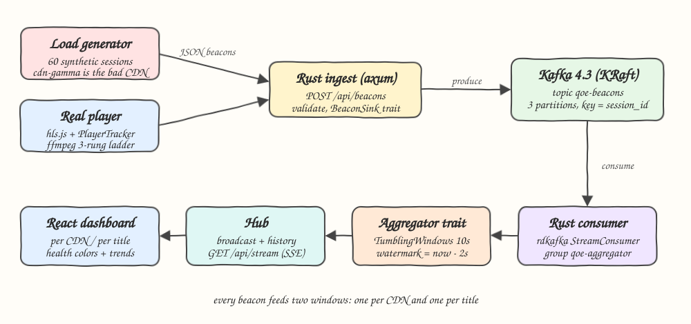
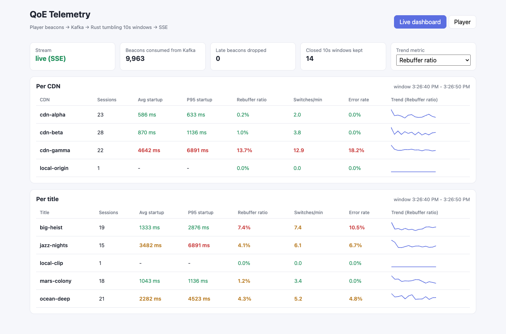
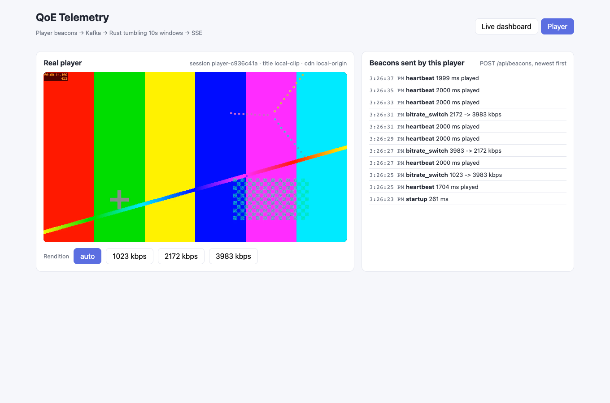

# 09 - QoE Telemetry

Player Quality of Experience (QoE) telemetry pipeline. Video players send beacons (startup time, rebuffer start/end, bitrate switch, error, heartbeat) to a Rust ingest service, which writes them to Kafka. A Rust stream consumer aggregates them in tumbling 10 second windows per CDN and per title, and pushes every closed window to a live React dashboard over Server-Sent Events. A load generator simulates 60 concurrent sessions where one CDN (`cdn-gamma`) is bad, and a real hls.js player sends its own beacons for a locally generated clip.

## How it Works

1. Players `POST /api/beacons` with a JSON array of beacons. The ingest validates the whole batch and rejects it if any beacon is invalid.
2. Valid beacons go to the Kafka topic `qoe-beacons` (3 partitions), keyed by `session_id` so one session's events stay ordered on one partition.
3. A Rust `StreamConsumer` (group `qoe-aggregator`) reads the topic and sends beacons to the aggregation task over a channel.
4. The `Aggregator` trait (implemented by `TumblingWindows`) puts each beacon into the 10s event-time window `[start, start+10s)` twice: once for its CDN and once for its title.
5. Every second the task moves the watermark to `now - 2s`. Windows whose end is at or before the watermark close and are emitted. Beacons for a window that is already closed are dropped and counted as late.
6. Closed windows go to a `Hub` (broadcast channel plus a bounded history). `GET /api/stream` streams them as SSE, and `GET /api/windows` returns the history so a dashboard that connects late can fill in.
7. The dashboard colors each metric green, amber or red and draws a sparkline over the last 30 windows.

## Architecture



## Why a Rust consumer instead of Flink or Kafka Streams

The usual production stack for this is Kafka Streams or Apache Flink. Here a small Rust consumer replaces both:

* Kafka Streams is a JVM-only library and Flink is a JVM cluster (JobManager plus TaskManagers). Both would add a second runtime and several containers next to a Rust backend.
* The job is small: one topic, two group-by keys, tumbling windows, and one watermark rule. That is under 200 lines of Rust behind the `Aggregator` trait, and plain `cargo test` covers it.
* Window state lives in memory in a `BTreeMap` ordered by window start, so closing windows is a range walk from the front.
* What you lose: no checkpointed state, no exactly-once, no rebalancing of window state between instances. A restart loses the open windows (at most about 12 seconds of data) and starts reading again from the latest offset. For a live QoE dashboard that is acceptable. For billing-grade numbers it is not. Because the code depends on the `Aggregator` trait, a Flink or Kafka Streams job can replace it without changing the ingest or the UI contract.

## Features

* **Beacon ingest with batch validation**: one bad beacon rejects the whole batch, so Kafka never stores a half-valid batch.
* **Kafka topic created at startup**: the backend creates `qoe-beacons` with the admin API, so there is no manual topic setup step.
* **Event-time tumbling windows with a watermark**: results do not depend on when Kafka delivers the beacon, and late beacons are counted on the dashboard.
* **Per CDN and per title views**: the same beacon feeds both views, so you can tell a bad CDN apart from a bad title.
* **Metrics**: average startup, p95 startup, rebuffer ratio, switches per played minute and error rate (sessions with an error divided by sessions).
* **Load generator with a bad CDN**: `cdn-gamma` has slow startups, frequent stalls, more downswitches and more errors.
* **Real player**: hls.js plays an ffmpeg-generated 3 rendition ladder (1.0, 2.2 and 4.0 Mbps). Its `PlayerTracker` turns video and hls.js events into beacons. You can force a rendition to cause real bitrate switches.
* **Live push over SSE**: the server sends one batch per second, with closed windows, the consumed count and the late count.

## Stack

* **Rust 1.99 (edition 2024), axum 0.8, tokio**: HTTP ingest, SSE and the async aggregation task.
* **rdkafka 0.39 (`cmake-build`)**: librdkafka is compiled from source with cmake, which builds reliably on macOS arm64 without a system librdkafka.
* **Apache Kafka 4.3.1 (KRaft, single node)** in podman-compose: no ZooKeeper, one container (`vp09-kafka`).
* **thiserror / anyhow**: typed `AppError` in the library, `anyhow` only in the binaries.
* **reqwest**: HTTP client for the load generator and the HTTP tests.
* **Bun 1.4, Vite 8.3, React 19.3, TypeScript 7.0**: the dashboard, no UI library.
* **hls.js 1.7**: HLS playback with ABR, used for the real player.
* **ffmpeg**: generates the HLS clip at setup time. The clip is gitignored.

## Contracts / APIs

| Method | Path | Body / Response |
|---|---|---|
| `POST` | `/api/beacons` | Body: JSON array of beacons. Response: `202 {"accepted": n}`, `400` on an invalid beacon, `503` if Kafka fails |
| `GET` | `/api/windows` | Last 2000 closed window results (`WindowResult[]`) |
| `GET` | `/api/stream` | SSE, event `windows`, data `{"results": WindowResult[], "consumed": n, "late_dropped": n}` once per second |
| `GET` | `/api/health` | `ok` |

Beacon (flat JSON with a `kind` tag):

```json
{"session_id": "player-1a2b", "title": "local-clip", "cdn": "local-origin", "ts": 1792189070000, "kind": "startup", "startup_ms": 314}
```

| kind | extra fields |
|---|---|
| `startup` | `startup_ms` |
| `rebuffer_start` | none |
| `rebuffer_end` | `rebuffer_ms` |
| `bitrate_switch` | `from_kbps`, `to_kbps` |
| `error` | `code` |
| `heartbeat` | `played_ms` (played time since the last heartbeat, stalls excluded) |

WindowResult:

```json
{"window_start": 1792189070000, "window_end": 1792189080000, "dimension": "cdn", "key": "cdn-gamma",
 "metrics": {"sessions": 21, "events": 205, "startups": 3, "avg_startup_ms": 4849.3, "p95_startup_ms": 5378,
             "rebuffer_ratio": 0.12, "switches_per_min": 11.18, "error_rate": 0.28, "played_ms": 107293, "rebuffer_ms": 14707}}
```

## Key data structures and design decisions

* `trait Aggregator { ingest(&Beacon) -> bool; advance(watermark) -> Vec<WindowResult>; late_dropped() }`: the stream task only uses this trait, and `TumblingWindows` is one implementation of it.
* `TumblingWindows.open: BTreeMap<(window_start, Dimension, key), Accumulator>`: because it is ordered by window start, `advance` takes closed windows from the front with `take_while`.
* `Accumulator` stores session ids in a `HashSet`, so each session counts once per window, and keeps sorted startup samples for a nearest-rank p95.
* Rebuffer ratio = `rebuffer_ms / (played_ms + rebuffer_ms)`. Heartbeats report played time with stalls already removed, so stall time is not counted twice. The player tracker splits a stall that spans a heartbeat across the two heartbeats.
* The watermark only moves forward, so a closed window never reopens and is never emitted twice.
* A window with no startup sample reports `startups: 0`, and the UI shows `-` for that window instead of a misleading `0 ms`.
* `BeaconSink` trait: `KafkaSink` in production and `MemorySink` in the HTTP tests, so the tests do not need a broker.
* The load generator uses its own xorshift RNG, so it needs no `rand` crate and runs are reproducible from a seed in tests.
* The frontend calls the backend through the Vite proxy on `/api`, so the backend needs no CORS setup.

## How to run

```bash
./scripts/setup.sh
./scripts/start-all.sh
./scripts/ui.sh
./scripts/test-all.sh
./scripts/stop-all.sh
```

Prerequisites: podman with podman-compose, Rust, cmake (for librdkafka), Bun and ffmpeg. `setup.sh` pulls `apache/kafka:4.3.1`, builds the backend binaries, runs `bun install` and generates the HLS clip into `frontend/public/media/clip` (about 24 MB, gitignored).

Tests:

* Backend: `cd backend && cargo test`. There are 19 tests. The window aggregation tests cover window boundaries, the watermark, late drops, rebuffer ratio, switches/min, error rate, p95 and the per-CDN split. The synthetic fleet tests check that the bad CDN stands out after aggregation. The HTTP contract tests run with `MemorySink`.
* Frontend: `cd frontend && bun test`. There are 12 tests for `PlayerTracker` (startup measured once, initial buffering is not a rebuffer, stalls split across heartbeats, the first level load is not a switch) and for the dashboard merge, health and formatting logic.

## Results (measured on this machine)

* Tests: 19 of 19 Rust tests passed and 12 of 12 Bun tests passed. `cargo clippy --all-targets` reported no warnings.
* The load generator sent about 70 beacons per second for 60 sessions. In about 2.5 minutes the consumer read about 10,000 beacons from Kafka. There were 0 late drops and 0 rejected batches.
* A typical closed window for the bad CDN compared with a good one (CDN view, one 10s window):

| CDN | avg startup | p95 startup | rebuffer ratio | switches/min | error rate |
|---|---|---|---|---|---|
| cdn-alpha | 586 ms | 633 ms | 0.2% | 2.0 | 0.0% |
| cdn-beta | 870 ms | 1136 ms | 1.0% | 3.8 | 0.0% |
| cdn-gamma | 4642 ms | 6891 ms | 13.7% | 12.9 | 18.2% |

* Real player: hls.js startup on the local clip was 314 ms. Forcing renditions sent real `bitrate_switch` beacons such as `1023 -> 3983 kbps`, and those beacons reached the dashboard through Kafka.
* By design, a window reaches the UI between 2 and 3 seconds after it ends: 2s allowed lateness plus a 1s close tick. This delay was not measured separately.

## Printscreens

### Live dashboard (rebuffer ratio trend)



The newest closed 10s window per CDN and per title. `cdn-gamma` (the bad CDN in the load generator) is red on startup, rebuffer ratio and switches/min, and the titles it serves turn amber. `local-origin` / `local-clip` is the real player session from the Player tab, running at the same time. The top row shows that the SSE stream is live, the number of beacons consumed from Kafka and the number of late beacons dropped.

### Live dashboard (average startup trend)


The same view with the trend metric set to average startup. Each sparkline shows the last 30 closed windows for that row. A `-` in a startup column means no session started in that window.

### Real player



hls.js plays the generated 3 rendition HLS ladder. The beacon log on the right shows the real beacons this player sent: startup time, a heartbeat every 2 seconds with played time, and the bitrate switches caused by ABR and by the rendition buttons.

## Scripts

All scripts live in `scripts/` and run from any directory of the repository.

| Script | What it does |
|---|---|
| `./scripts/setup.sh` | Pulls the Kafka image, builds the backend, installs frontend dependencies and generates the HLS clip |
| `./scripts/start-all.sh` | Starts Kafka, the backend, the load generator and the frontend, then prints the full link of each one |
| `./scripts/status.sh` | Shows every service port as UP or DOWN |
| `./scripts/test-all.sh` | Runs every test suite |
| `./scripts/ui.sh` | Opens the UI in the browser |
| `./scripts/stop-all.sh` | Stops every service |

Ports are declared in `scripts/ports.env` (backend 8109, frontend 5109, kafka 6109).

```bash
./scripts/setup.sh
./scripts/start-all.sh
./scripts/status.sh
./scripts/ui.sh
./scripts/stop-all.sh
```
