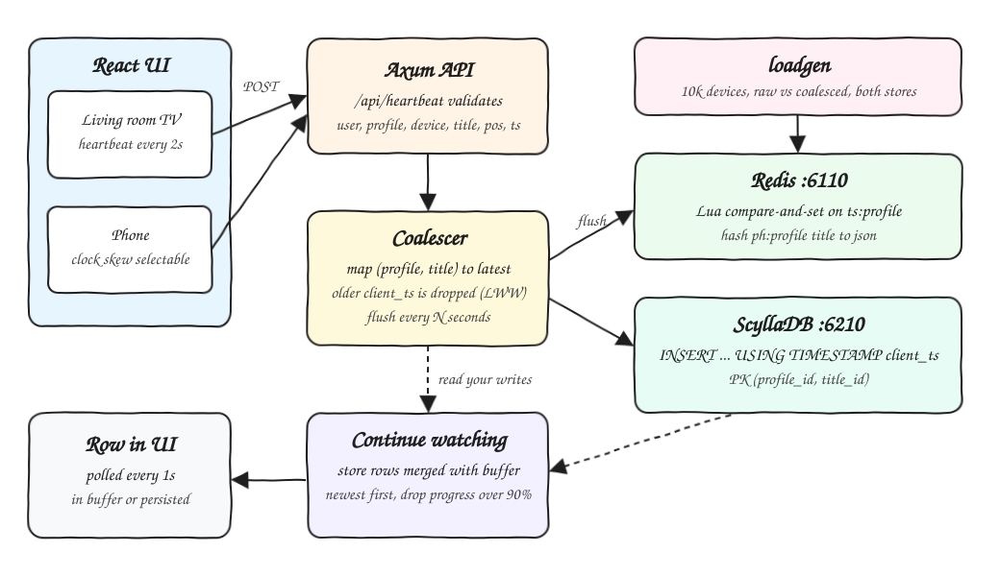
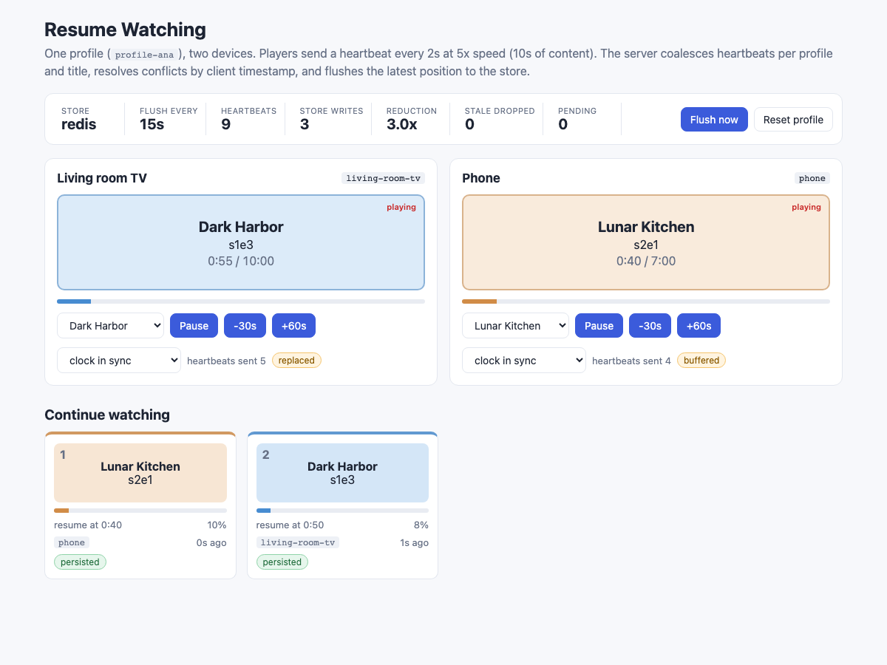
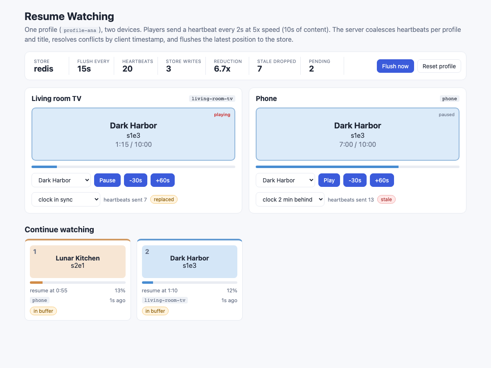
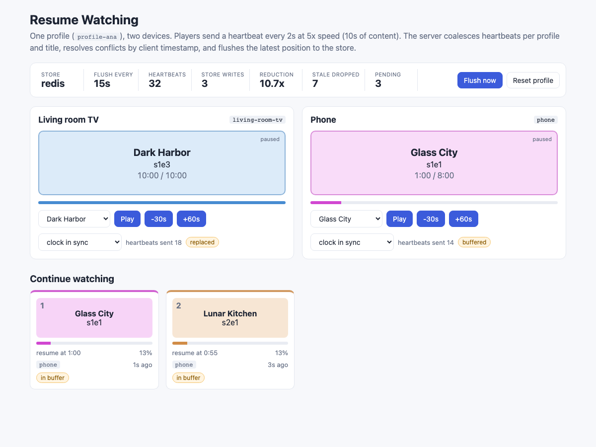

# 10 - Resume Watching

A continue-watching service. Players send playhead heartbeats (user, profile, device, title, episode, position, client timestamp) every few seconds. A Rust service coalesces them in memory, resolves conflicts between devices with last-write-wins on the client timestamp, flushes only the latest position per profile and title every N seconds, and serves a continue-watching row sorted by recency that hides titles already finished (over 90%). The storage is a `PlayheadStore` trait with a Redis and a ScyllaDB implementation, and a load generator compares both and measures how many writes coalescing removes.

## How it Works

1. A device posts a heartbeat to `POST /api/heartbeat`. The body is validated (ids present, `position <= duration`, positive timestamp).
2. The `Coalescer` keeps one entry per `(profile_id, title_id)`. A heartbeat with an older `client_ts_ms` than the buffered one is dropped as `stale`, a newer one replaces it.
3. A flush loop drains the buffer every `FLUSH_SECS` (15s by default) and calls `PlayheadStore::upsert` once per key. With 10s heartbeats and a 60s flush, six heartbeats become one write.
4. The stores enforce LWW again, because a stale heartbeat can arrive after the newer one was already flushed:
   Redis runs a Lua compare-and-set on a timestamp hash, ScyllaDB writes `INSERT ... USING TIMESTAMP client_ts_ms * 1000`, so the cell with the newest client timestamp wins on every replica.
5. If a flush fails, the unwritten entries go back to the buffer with the same LWW merge, so a store outage loses no position and never overwrites a newer heartbeat that arrived meanwhile.
6. `GET /api/profiles/{profile}/continue-watching` merges the store rows with the not-yet-flushed buffer (read your writes), keeps the newest per title, drops progress over 90% and sorts newest first.

## Architecture



## Features

- **Write coalescing**: one write per profile and title per flush window, measured at 8x fewer writes for 10s heartbeats and a 60s flush.
- **Last-write-wins across devices**: client timestamp decides, in the buffer, in Redis (Lua) and in ScyllaDB (`USING TIMESTAMP`).
- **Read your writes**: the row merges the in-memory buffer so a user switching devices sees the latest position before it is flushed.
- **Continue-watching row**: newest first, titles over 90% watched leave the row.
- **No lost positions on store failure**: failed flushes requeue without clobbering newer heartbeats.
- **Swappable store**: `PLAYHEAD_STORE=redis|scylla` picks the implementation at startup.
- **Load generator**: simulates 10,000 devices (5,000 profiles, half of them with two devices on the same title and skewed clocks) and checks that the final rows equal the LWW expectation.
- **Two-device UI**: a TV and a phone of one profile, with play, seek, title and clock-skew controls and a live row.

## Stack

- **Rust 1.99 (edition 2024), axum 0.8, tokio**: small async HTTP service and load generator in one crate.
- **redis 1.7 crate + Redis 8.10 (podman)**: in-memory store, Lua script gives an atomic compare-and-set.
- **scylla 1.9 crate + ScyllaDB 2026.3 (podman, `--smp 1 --memory 750M`)**: wide-column store with native timestamp-based LWW.
- **thiserror**: typed `StoreError`; `anyhow` only in the binaries.
- **React 19.3, TypeScript 7.0, Vite 8.3, Bun 1.4**: the UI, no UI libraries.
- **podman-compose**: runs Redis on 6110 and ScyllaDB on 6210.

## Contracts / APIs

| Method | Path | Body / Result |
|---|---|---|
| POST | `/api/heartbeat` | `Playhead` JSON, returns `{"result": "buffered" \| "replaced" \| "stale"}`, 400 on invalid input |
| GET | `/api/profiles/{profile}/continue-watching` | array of `Playhead` plus `progress` (0..1) and `source` (`buffer` or `store`) |
| DELETE | `/api/profiles/{profile}` | clears buffer and store for the profile, 204 |
| GET | `/api/stats` | `store`, `flush_secs`, `heartbeats`, `writes`, `stale`, `flushes`, `pending`, `reduction` |
| POST | `/api/flush` | forces a flush, returns `{"written": n}` |

```json
{
  "user_id": "account-42",
  "profile_id": "profile-ana",
  "device_id": "living-room-tv",
  "title_id": "dark-harbor",
  "episode_id": "s1e3",
  "position_secs": 420,
  "duration_secs": 600,
  "client_ts_ms": 1792189625382
}
```

## Key data structures and design decisions

- `Playhead` (`backend/src/model.rs`): the heartbeat and the stored row are the same struct. `wins_over` is the single LWW rule (strictly newer `client_ts_ms`).
- `PlayheadStore` trait (`backend/src/store/mod.rs`): `upsert`, `list`, `clear`, returning boxed futures so it can be used as `Arc<dyn PlayheadStore>`.
- `Coalescer` (`backend/src/coalescer.rs`): `Mutex<HashMap<(profile, title), Playhead>>` plus atomic counters. The lock is never held across an await.
- Redis layout: `ph:{profile}` hash of title to JSON and `ts:{profile}` hash of title to client timestamp. The Lua script updates both only if the incoming timestamp is newer, so a whole profile row is one `HGETALL`.
- ScyllaDB table `resume.playheads`, primary key `(profile_id, title_id)`: one partition per profile, one row per title, so the row is a single-partition read. The write timestamp is the client timestamp in microseconds.
- Tie on equal timestamps: Redis keeps the first write, Cassandra/Scylla break ties by comparing values. Timestamps in the load generator never tie on purpose.
- Clock skew is a real risk of client-timestamp LWW: a device with a clock in the future wins until real time catches up. ScyllaDB rejects timestamps more than 3 days in the future (`restrict_future_timestamp`), which the store tests hit when they first used a fixed far-future timestamp.
- Deleting in ScyllaDB is also LWW: a plain `DELETE` gets the server time and would not shadow rows written with a newer client timestamp. `clear` therefore deletes `USING TIMESTAMP max(newest row, now) + 1`. The flip side, found by the load generator: re-inserting a row with the same old timestamp after that delete is shadowed, so each load run uses fresh profile ids.
- ScyllaDB is started with `--native-transport-port 6210 --broadcast-rpc-address 127.0.0.1` so the driver's peer discovery points back to the host port instead of the container IP. ScyllaDB started fine on this machine, so the Cassandra fallback was not needed.

## How to run

```bash
./scripts/setup.sh
./scripts/start-all.sh
./scripts/ui.sh
./scripts/test-all.sh
./scripts/stop-all.sh
```

Use ScyllaDB as the store and a different flush window:

```bash
PLAYHEAD_STORE=scylla FLUSH_SECS=30 ./scripts/start-all.sh
```

Load generator (needs Redis and ScyllaDB running):

```bash
cd backend
cargo run --release --bin loadgen -- --devices 10000 --minutes 10 --heartbeat 10 --flush 60 --concurrency 64
```

Tests: `cargo test` runs 15 unit tests (coalescing, LWW in the buffer, requeue on failure, row ordering and the 90% rule, validation) and 6 store integration tests that run the same LWW and row scenarios against real Redis and ScyllaDB; they fail loudly if the stores are not running. `bun test` runs 6 frontend tests for the playback math.

## Results

Measured on a laptop, Redis and ScyllaDB in podman, 10,000 devices, 5,000 profiles, 10 minutes of playback, heartbeat every 10s, 64 concurrent writers.

Write amplification:

| flush window | heartbeats | stale dropped in buffer | writes after coalescing | reduction |
|---|---|---|---|---|
| 30s | 601,018 | 75,926 | 150,000 | 4.0x (75.0% fewer) |
| 60s | 601,018 | 79,586 | 75,000 | 8.0x (87.5% fewer) |
| 300s | 601,018 | 82,514 | 15,000 | 40.1x (97.5% fewer) |

The 60s flush gives 8x and not 6x because half of the profiles have two devices on the same title, so two devices also collapse into one key.

Redis vs ScyllaDB (60s flush run):

| store | mode | writes | seconds | writes/s | p50 ms | p99 ms | final rows match LWW |
|---|---|---|---|---|---|---|---|
| redis | raw | 601,018 | 4.15 | 144,945 | 0.420 | 0.915 | yes |
| redis | coalesced | 75,000 | 0.50 | 149,798 | 0.405 | 1.230 | yes |
| scylla | raw | 601,018 | 3.88 | 154,814 | 0.386 | 0.833 | yes |
| scylla | coalesced | 75,000 | 0.50 | 150,356 | 0.386 | 1.285 | yes |

Notes:
- Per-write latency and throughput are close for both stores at this scale; the client and the podman network are the bottleneck. Redis pays for a Lua compare-and-set per write; ScyllaDB writes are blind upserts with no read before write, which is why it keeps up with Redis on a single shard.
- Coalescing cuts total store time from about 4s to 0.5s for the same 10 minutes of viewing on both stores.
- In raw mode the 64 writers reorder heartbeats of the same key, and the final rows still match the LWW expectation on both stores, which is the store-side LWW doing its job.
- Run-to-run variance was around 20-30% for throughput; an earlier run had redis raw at 108k/s and scylla raw at 133k/s.

## Printscreens

**Two devices playing, positions still in the buffer.** TV plays Dark Harbor, the phone plays Lunar Kitchen. The row shows both titles newest first with the `in buffer` badge: they come from the coalescer, not yet flushed. The stats bar shows heartbeats vs store writes.


**After Flush now.** The buffer is empty (`pending 0`) and both cards are `persisted`, read back from Redis.



**Last-write-wins conflict.** The phone switches to Dark Harbor with its clock 2 minutes behind and seeks to 7:00. Its heartbeats come back `stale`; the row keeps the TV position (1:10) because the TV heartbeat has the newer client timestamp.



**Finished title leaves the row.** The TV seeks Dark Harbor to the end (over 90%), so it is dropped from the row; the phone started Glass City, which is now first.



**Same UI with ScyllaDB as the store** (`PLAYHEAD_STORE=scylla`). Dark Harbor was flushed to ScyllaDB (`persisted`) while the newer phone heartbeat is still in the buffer.


## Scripts

All scripts live in `scripts/` and run from any directory of the repository.

| Script | What it does |
|---|---|
| `./scripts/setup.sh` | Pulls the images, builds the backend in release, installs frontend dependencies |
| `./scripts/start-all.sh` | Starts Redis, ScyllaDB, backend and frontend and prints the full link of each one |
| `./scripts/status.sh` | Shows every service port as UP or DOWN |
| `./scripts/test-all.sh` | Runs the Rust tests (unit and store integration) and the frontend tests |
| `./scripts/ui.sh` | Opens the UI in the browser |
| `./scripts/stop-all.sh` | Stops every service |
| `./scripts/sql-console.sh` | `redis` opens redis-cli, `scylla` opens cqlsh, no argument opens redis-cli then cqlsh |

Ports are declared in `scripts/ports.env`: backend 8110, frontend 5110, Redis 6110, ScyllaDB 6210.

```bash
./scripts/setup.sh
./scripts/start-all.sh
./scripts/status.sh
./scripts/ui.sh
./scripts/stop-all.sh
```
