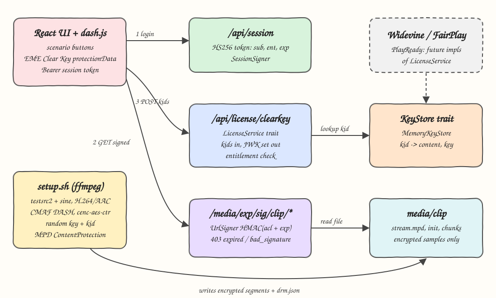
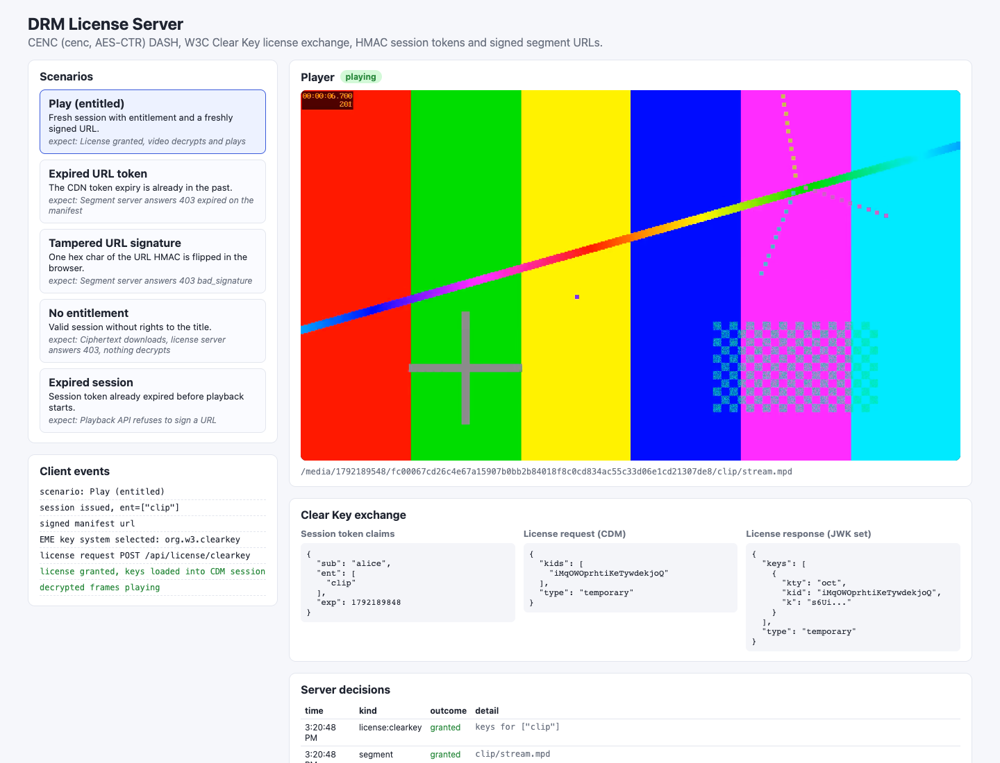
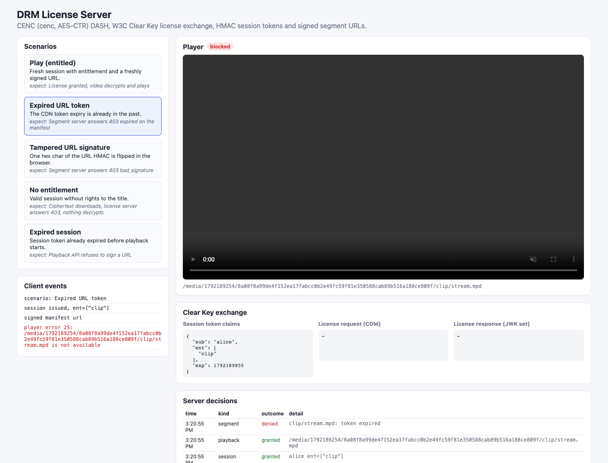
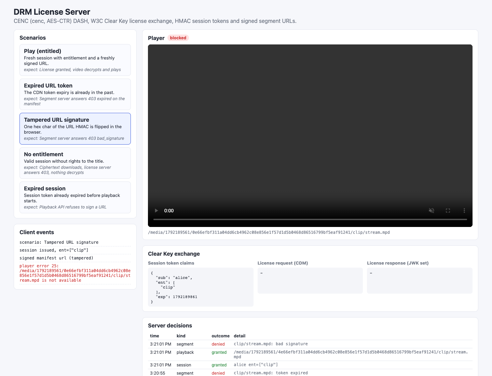
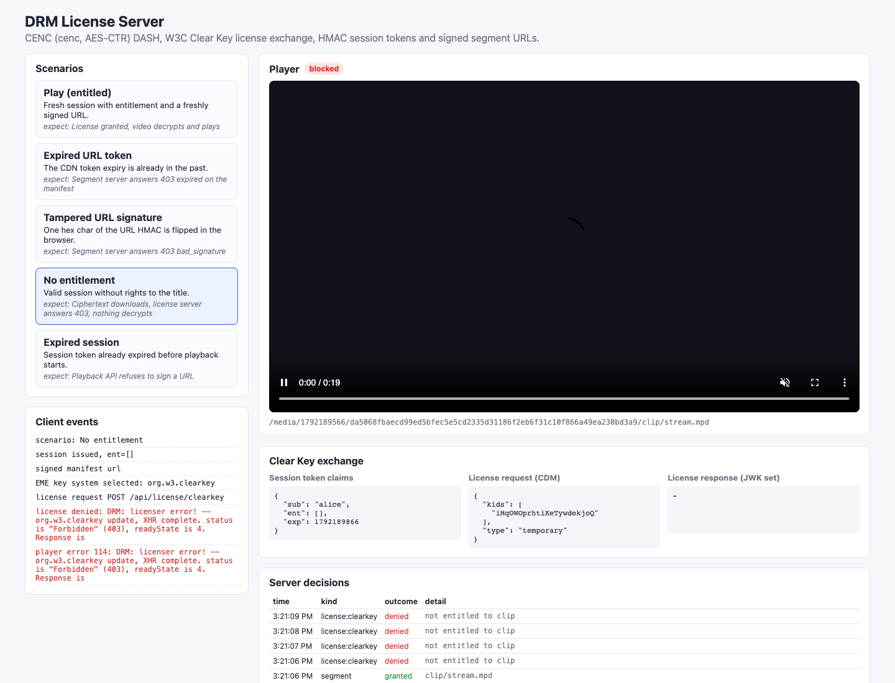
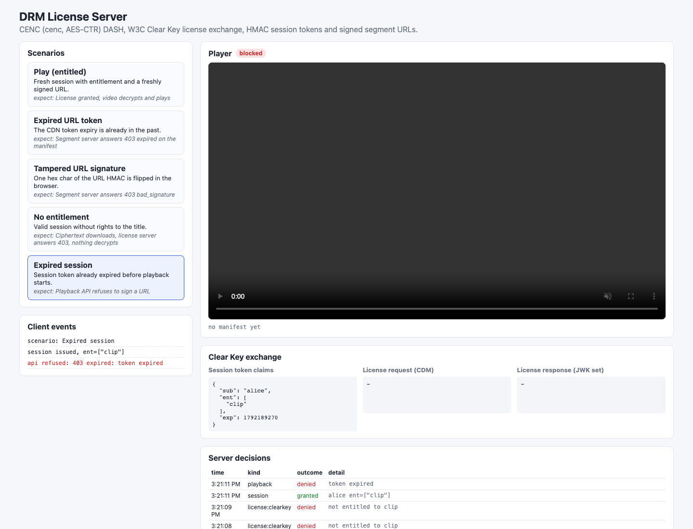

# 12 - DRM / License Server

A DRM license server simulation. `setup.sh` generates a clip and packages it as CMAF DASH encrypted with Common Encryption (`cenc` scheme, AES-128 CTR) using ffmpeg. A Rust server issues W3C Clear Key licenses behind a `LicenseService` trait, checks entitlement from an HMAC-signed session token, and serves segments only through HMAC-signed, expiring URLs (the CloudFront / Akamai token model). A React UI plays the stream with dash.js through real browser EME, and has buttons that break each control to show the failure.

## How it Works

1. `setup.sh` generates a random 128-bit content key and key id, encodes a 20s H.264/AAC clip and runs ffmpeg's DASH muxer with `encryption_scheme=cenc-aes-ctr` (samples encrypted, `encv`/`enca`/`tenc`/`senc` boxes written).
2. The MPD gets `ContentProtection` elements: `mp4protection:2011` with `cenc:default_KID`, and the Clear Key system id `e2719d58-...`.
3. The UI calls `POST /api/session` and gets an HS256 JWT-like token with `sub`, `ent` (entitled titles) and `exp`.
4. `POST /api/playback` (Bearer session) returns `/media/{exp}/{sig}/clip/stream.mpd` where `sig = HMAC-SHA256(url_secret, "acl=/media/clip/*~exp={exp}")`. Since the token lives in the path, every relative segment URL in the MPD inherits it.
5. dash.js fetches the manifest and segments. The server checks the signature in constant time and the expiry for every request.
6. The browser CDM sees encrypted init data and emits a Clear Key license request `{"kids":[...],"type":"temporary"}`; dash.js POSTs it to `/api/license/clearkey` with the session token.
7. The license server verifies the token, maps each kid to a title via the `KeyStore`, checks `ent`, and answers a JWK set `{"keys":[{"kty":"oct","kid":"...","k":"..."}],"type":"temporary"}` with base64url (no padding) values.
8. The CDM loads the key and decrypts. Every grant and denial lands in an audit log the UI displays.

## Architecture



## Features

- **Real CENC encryption** - ffmpeg encrypts samples with AES-CTR, so without the key the browser cannot decode a single frame.
- **W3C Clear Key license exchange** - the same EME flow commercial DRM uses, with the key exchange in readable JSON.
- **LicenseService trait** - Clear Key is one impl; Widevine, FairPlay and PlayReady would be other impls on the same route shape `/api/license/{system}`.
- **Entitlement via signed session token** - HS256 over `header.payload`, the license server trusts only signed `ent` claims.
- **Token-signed segment URLs** - HMAC over the path ACL and expiry; expired, extended or flipped tokens get 403.
- **Failure scenarios in the UI** - expired URL token, tampered signature, no entitlement, expired session.
- **Audit log** - every session, playback, license and segment decision, shown live in the UI.

## Stack

- **Rust 1.99 + axum 0.8 + tokio** - small, fast HTTP server; one binary.
- **hmac + sha2** - HMAC-SHA256 with constant-time verification for both token kinds.
- **base64** - base64url without padding, which JWK and Clear Key require.
- **ffmpeg 8.1** - generates the clip and does CMAF DASH packaging with CENC.
- **React 19 + Vite 8 + TypeScript 7 + Bun** - UI, dev server with proxy to the backend.
- **dash.js 5.2** - DASH player with EME `protectionData` for `org.w3.clearkey`.

## Contracts / APIs

| Method | Path | Auth | Body | Response |
|---|---|---|---|---|
| POST | `/api/session` | none | `{"user":"alice","entitled":true,"expired":false}` | `{"token":"h.p.s","claims":{"sub","ent","exp"}}` |
| POST | `/api/playback` | Bearer session | `{"content":"clip","expired":false}` | `{"manifestUrl":"/media/{exp}/{sig}/clip/stream.mpd","expires":...}` |
| POST | `/api/license/clearkey` | Bearer session | `{"kids":["base64url"],"type":"temporary"}` | `{"keys":[{"kty":"oct","kid":"...","k":"..."}],"type":"temporary"}` |
| GET | `/media/{exp}/{sig}/{content}/{file}` | URL token | - | MPD or m4s bytes |
| GET | `/api/audit` | none | - | last 50 decisions, newest first |
| GET | `/api/health` | none | - | `ok` |

The `expired` flags exist only so the UI can simulate stale credentials. Errors are JSON `{"error":"code","message":"..."}`:

| code | status | when |
|---|---|---|
| `unauthenticated` | 401 | no Bearer token |
| `expired` | 403 | session or URL token past `exp` |
| `bad_signature` | 403 | HMAC mismatch (tampered payload, signature, path or expiry) |
| `not_entitled` | 403 | kid belongs to a title not in `ent` |
| `unknown_key` / `not_found` | 404 | unknown kid, key system, title or file |
| `malformed` | 400 | invalid JSON, empty `kids`, non-temporary session type |

## Key data structures and design decisions

- `trait LicenseService { fn key_system(&self) -> &'static str; fn issue(&self, request: &[u8], claims: &Claims) -> Result<LicenseGrant, DrmError>; }` - takes opaque bytes and returns opaque bytes plus a content type, because Widevine and PlayReady messages are binary or SOAP, not JSON.
- `trait KeyStore { fn find(&self, kid: &[u8]) -> Option<ContentKey>; }` - `MemoryKeyStore` loaded from `media/drm.json`; a KMS or HSM backed store would be another impl.
- `Claims { sub, ent: Vec<String>, exp }` - the entitlement lives in the signed token, so the license server needs no database lookup.
- URL token in the path, not the query string: DASH resolves segment URLs relative to the MPD, so a path prefix covers all segments with one signature (same idea as Akamai `acl=/path/*`).
- Signature is checked before expiry, so a forged `exp` is reported as `bad_signature`, never trusted.
- A single license request with one unknown kid fails whole: no partial key sets.
- The UI masks `k` before rendering so the content key never shows on screen.
- No entitlement still downloads segments: they are ciphertext, the license is the real gate.

## Real commercial DRM flows (not implemented here)

These would be other `LicenseService` impls. Nothing here fakes them.

- **Widevine (Google)** - the browser CDM produces a signed, encrypted protobuf `SignedMessage` license challenge. A license proxy authenticates the user and checks entitlement, then forwards the challenge to the Widevine license service (or a self-hosted Widevine license SDK) with provider credentials and content key policy (HDCP, security level L1/L3, durations). The response is an opaque signed license the proxy returns unchanged to the CDM. The proxy never sees content keys in the clear unless it runs the SDK. Content uses `cenc` or `cbcs` with a Widevine PSSH (system id `edef8ba9-...`). An optional service certificate enables privacy mode.
- **FairPlay Streaming (Apple)** - Safari/AVFoundation, `cbcs` scheme with HLS `EXT-X-KEY` `skd://` URIs. The player first fetches the provider's FPS application certificate, then the CDM builds an SPC (Server Playback Context) encrypted with that certificate's public key. The Key Security Module on the server, using the FPS deployment package (private key + ASk from Apple), decrypts the SPC, checks entitlement and returns a CKC (Content Key Context) carrying the content key encrypted for that device session.
- **PlayReady (Microsoft)** - the CDM produces a SOAP XML `AcquireLicense` challenge with a WRMHEADER (KID, LA_URL) taken from the PlayReady PSSH or MPD `mspr:pro`. The license server (PlayReady Server SDK) validates the client certificate and revocation data, applies the policy (output protection, expiry, persistence, security level SL2000/SL3000) and returns a SOAP response with a license encrypted to the client's key.

Clear Key has none of that hardware/obfuscation protection: the key arrives in plain JSON over HTTPS, which is why it is only good for learning and testing the pipeline.

## How to run

```bash
./scripts/setup.sh
./scripts/start-all.sh
./scripts/ui.sh
./scripts/test-all.sh
./scripts/stop-all.sh
```

Open `http://localhost:5112` and click the scenario buttons. Tests only:

```bash
cd backend && cargo test
cd frontend && bun run test
```

## Results

Measured on the local machine with the server running (release build, 500 sequential requests each):

| What | Result |
|---|---|
| Rust tests | 27 passed (19 unit, 8 HTTP integration) |
| Frontend tests | 5 passed |
| Clear Key license issue latency | p50 0.11 ms, p95 0.37 ms, p99 1.09 ms |
| Signed segment fetch (~680 KB video chunk) | p50 0.98 ms, p95 5.36 ms |
| Tampered URL signature | 100 / 100 rejected with 403 |
| Packaged media | 24 files, 7.4 MB (20s, 720p H.264 + AAC) |
| Encryption check | right key decodes with ffmpeg `-decryption_key`, wrong key fails to decode |
| Browser (Chrome, headless) | entitled run decrypts and plays (`currentTime` > 6s after 7s); all 4 failure scenarios stay at 0s |

## Printscreens

### Play (entitled)

The session carries `ent: ["clip"]`. The CDM asks for the key id from the MPD, the server returns the JWK set (key masked in the UI), and the video decrypts and plays. The server decision log shows the manifest and license grants.

### Expired URL token

The playback API signed a URL whose `exp` is already in the past. The segment server answers 403 `expired` for the manifest, so dash.js never even gets to EME.

### Tampered URL signature

The browser flips one hex character of the HMAC. The segment server answers 403 `bad_signature`.

### No entitlement

The session is valid but `ent` is empty. Manifest and encrypted segments load, the CDM sends a license request, and the license server answers 403 `not entitled to clip`. The video stays black because the samples cannot be decrypted.

### Expired session

The session token is already past `exp`, so the playback API refuses to sign a URL and nothing is requested from the CDN.

## Scripts

All scripts live in `scripts/` and run from any directory of the repository.

| Script | What it does |
|---|---|
| `./scripts/setup.sh` | Generates and encrypts the media, builds the backend, installs frontend deps |
| `./scripts/start-all.sh` | Starts every service and prints the full link of each one |
| `./scripts/status.sh` | Shows every service port as UP or DOWN |
| `./scripts/test-all.sh` | Runs every test suite |
| `./scripts/ui.sh` | Opens the UI in the browser |
| `./scripts/stop-all.sh` | Stops every service |

Ports are declared in `scripts/ports.env` (backend 8112, frontend 5112).

```bash
./scripts/setup.sh
./scripts/start-all.sh
./scripts/status.sh
./scripts/ui.sh
./scripts/stop-all.sh
```
