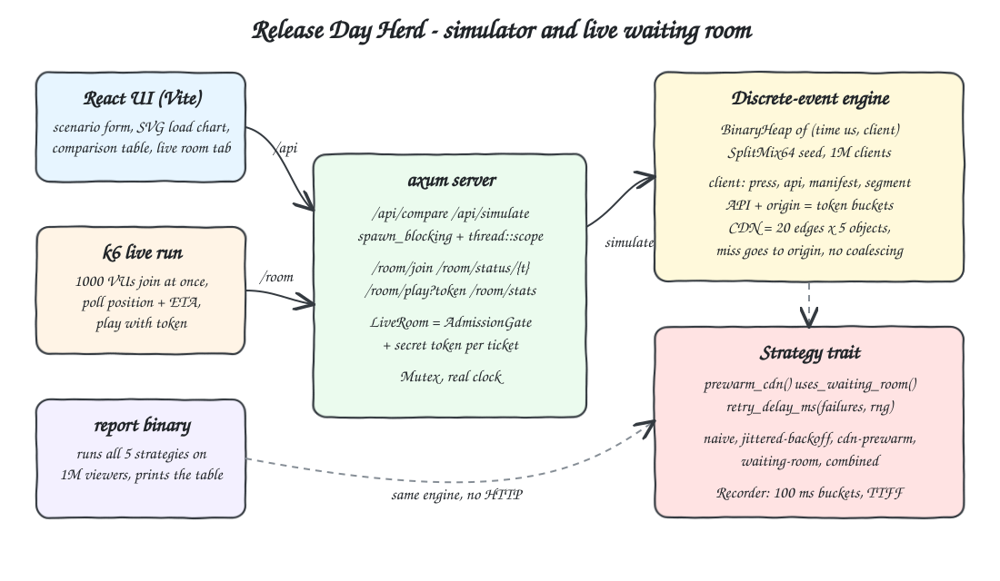
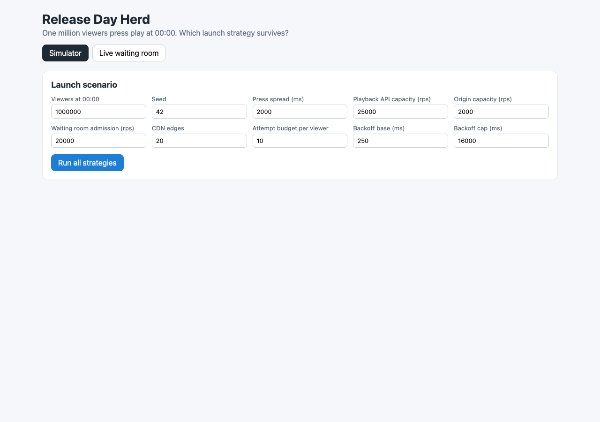
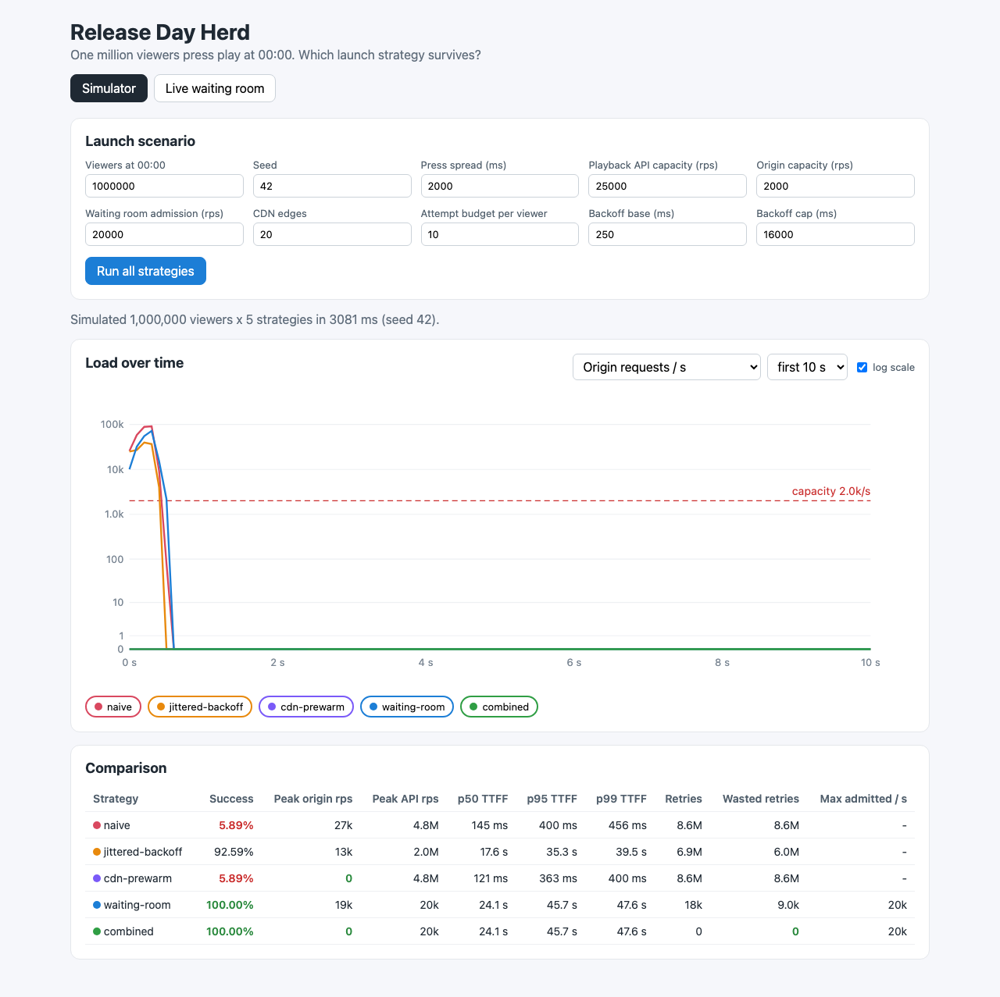
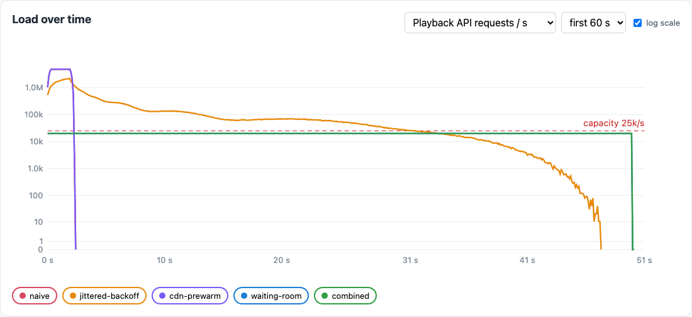
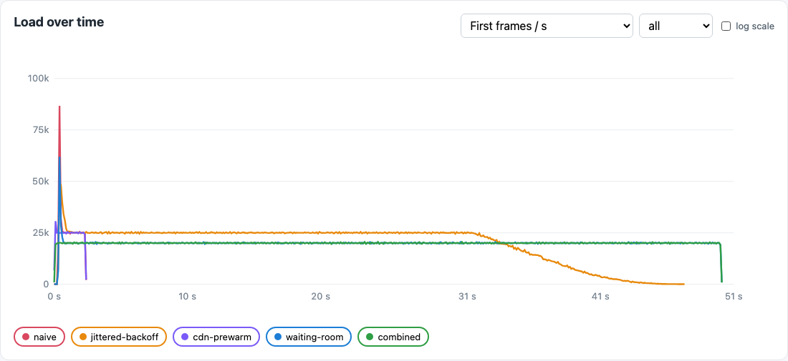
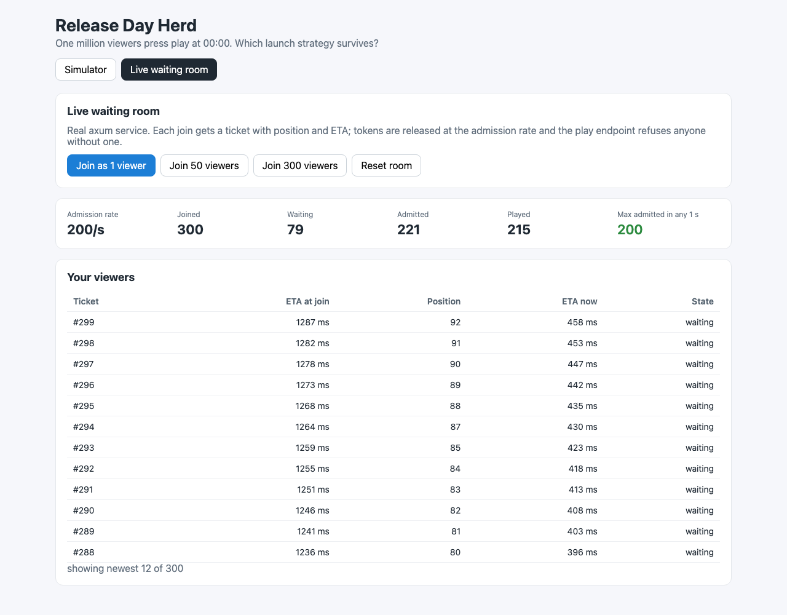
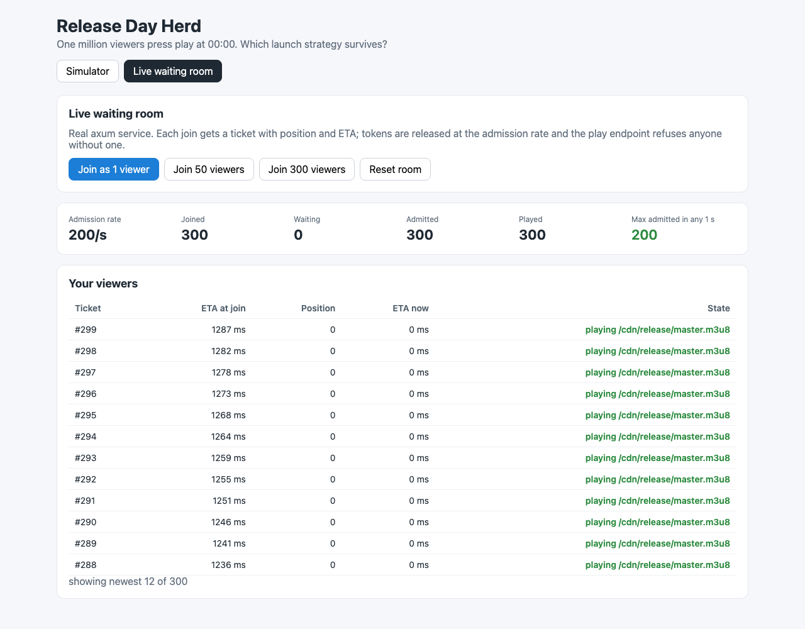

# 13 - Release Day Herd

A new season unlocks at 00:00 and **1,000,000 viewers press play in the same two seconds**. This POC is a deterministic discrete-event simulator written in Rust that replays that moment against a playback API with limited capacity, a CDN with cold edges and an origin behind it, and compares five launch strategies: naive, jittered exponential backoff, CDN pre-warming, an admission waiting room, and all of them combined. It also ships a real HTTP waiting room (axum) that you can hit live with k6 or from the React UI.

## How it Works

1. Every viewer is a client with a press time (uniform in a 2 s window), an edge PoP and a rendition, all drawn from a seeded SplitMix64.
2. A client must do three hops before the first frame: playback API call, manifest from its edge, first segment from its edge.
3. The playback API and the origin are token buckets (25k rps and 2k rps). Over capacity means a fast rejection, never a queue.
4. An edge serves from cache once the object has been filled; a miss goes to origin. There is no request coalescing, so a cold edge leaks every concurrent miss to origin, and a rejected origin fill leaves the edge cold.
5. On failure the `Strategy` decides the retry delay; every viewer has the same budget of 10 attempts and gives up after 300 s.
6. `cdn-prewarm` marks every manifest and first segment cached on every edge before 00:00. `waiting-room` sends each press to an `AdmissionGate` that issues tokens at 20k/s, FIFO, returning position and ETA.
7. A `BinaryHeap` of `(time_us, client)` drives the run; a `Recorder` keeps 100 ms load buckets and every time-to-first-frame for p50/p95/p99.
8. The live waiting room uses the same `AdmissionGate` with a real clock and hands out a secret token only once a ticket's admission time has passed; `/room/play` refuses everything else.

## Architecture



## Features

- **Five strategies behind one trait**: swap behaviour without touching the engine, and see what each one changes on its own.
- **1M viewers in about 2.5 s for all five strategies**: release build, one thread per strategy, so you can try settings in the UI right away.
- **Deterministic seed**: the same config gives the same report bit-for-bit, so a regression can't hide behind noise.
- **Cold-cache stampede model**: shows why a waiting room alone still burns the origin and why pre-warming matters.
- **Waiting room with position and ETA**: ETA is exact because the admission schedule is fixed when you join.
- **Live axum waiting room + k6**: shows that the rate guarantee holds with real HTTP and real clocks, not only in the model.
- **SVG load chart**: origin/API/first-frames/retries/admissions per second, log or linear, time windows, toggle strategies.
- **Comparison table**: success, peak origin rps, peak API rps, TTFF p50/p95/p99, retries, wasted retries, max admitted per second.

## Stack

- **Rust 1.99, edition 2024**: fast enough to push about 30M events per run on one core per strategy.
- **axum 0.8 + tokio**: small HTTP layer; simulations run in `spawn_blocking` so the runtime never stalls.
- **thiserror**: one `HerdError` enum, which also maps to HTTP status codes.
- **React 19.3 + Vite 8.3 + TypeScript 7 (Bun 1.4)**: strict types, no UI or chart libraries; the chart is hand-written SVG.
- **k6 1.5**: the live run against the real waiting room.

## Contracts / APIs

Backend on `http://localhost:8113`.

| Method | Path | Body / Query | Response |
|---|---|---|---|
| GET | `/api/health` | - | `ok` |
| GET | `/api/strategies` | - | `["naive","jittered-backoff","cdn-prewarm","waiting-room","combined"]` |
| GET | `/api/config/default` | - | `SimConfig` |
| POST | `/api/simulate` | `{ "strategy": "combined", "config": { ...partial SimConfig } }` | `SimReport` |
| POST | `/api/compare` | `{ "config": { ...partial SimConfig } }` | `SimReport[]` (all five) |
| POST | `/room/join` | - | `{ ticket, position, eta_ms }` |
| GET | `/room/status/{ticket}` | - | `{ ticket, position, eta_ms, admitted, token }` (`token` is null until admitted) |
| GET | `/room/play` | `?token=` | `200 { ticket, manifest }`, or `403` if the token is unknown or not yet admitted |
| GET | `/room/stats` | - | `{ rate_per_s, joined, admitted, waiting, played, max_admitted_in_any_second, max_plays_in_any_second }` |
| POST | `/room/reset` | - | fresh `RoomStats` |

Errors are `{ "error": "..." }` with 400 (bad strategy/config), 403 (not admitted), 404 (unknown ticket).

`SimReport` fields: `strategy, bucket_ms, users, succeeded, abandoned, success_rate, peak_origin_rps, peak_api_rps, max_admitted_per_s, origin_requests, api_requests, retries, wasted_retries, prewarmed_objects, ttff_p50_ms, ttff_p95_ms, ttff_p99_ms, series[{ t_ms, api_requests, api_rejected, origin_requests, origin_rejected, first_frames, admitted, retries }]`.

## Key data structures and design decisions

- `Strategy` trait (`backend/src/sim/strategy.rs`): `prewarm_cdn()`, `uses_waiting_room()`, `retry_delay_ms(failures, rng)`. `Combined` delegates to the other strategies instead of copying their logic.
- `AdmissionGate` (`backend/src/admission.rs`): `admit_at = max(now, next_free)`, `next_free += ceil(1e6 / rate)` µs. Admission times are spaced at least one interval apart, so any 1 s window holds at most `rate` admissions. Position is computed with a binary search over the sorted schedule.
- `TokenBucket` (`backend/src/sim/bucket.rs`): integer micro-token arithmetic, burst = rate/20, so capacity behaves the same in every run.
- Event queue: `BinaryHeap<Reverse<(u64, u32)>>`. Each client has at most one pending event, so ties are ordered by client id and every run is reproducible.
- Edge cache: `filled_at[edge * objects + object]`. A hit means `filled_at <= now`. A successful origin fill sets it to the completion time; a rejected fill leaves it cold.
- Metrics: a rejected request still counts as load (peak rps counts attempts, not successes). A wasted retry is a retry request that also failed. Peak rps sums 1 s from 100 ms buckets.
- Fair comparison: every strategy gets the same attempt budget (10) and the same 300 s patience.

## Results (measured)

`cargo run --release --bin report`, default config: 1,000,000 viewers, seed 42, 2 s press window, API 25k rps, origin 2k rps, admission 20k rps, 20 edges x (1 manifest + 4 renditions), 10 attempts. Wall time for all five strategies: about 2.4-2.6 s on the dev laptop.

| strategy | success | peak origin rps | peak api rps | p50 TTFF | p95 TTFF | p99 TTFF | retries | wasted retries | origin reqs |
|---|---|---|---|---|---|---|---|---|---|
| naive | 5.89% | 27,253 | 4,812,601 | 145 ms | 400 ms | 456 ms | 8,616,967 | 8,572,949 | 27,253 |
| jittered-backoff | 92.59% | 13,188 | 2,019,719 | 17.6 s | 35.3 s | 39.5 s | 6,890,221 | 5,985,854 | 13,188 |
| cdn-prewarm | 5.89% | 0 | 4,812,568 | 121 ms | 363 ms | 400 ms | 8,590,801 | 8,559,519 | 0 |
| waiting-room | 100.00% | 18,659 | 20,000 | 24.1 s | 45.7 s | 47.6 s | 17,538 | 9,029 | 18,659 |
| combined | 100.00% | 0 | 20,000 | 24.1 s | 45.7 s | 47.6 s | 0 | 0 | 0 |

What the numbers say:

- **Naive** sends 4.8M API requests in one second against 25k capacity. Every viewer burns all 10 attempts in about 300 ms, so 94% give up. The TTFF of the 6% who got in looks great, which is survivorship bias.
- **Jittered backoff** uses the same attempt budget but spreads it over about 40 s. Success goes from 5.9% to 92.6%, the API peak drops 2.4x, and the origin peak halves. It is still 6M wasted retries.
- **CDN pre-warm** removes the origin from the launch (0 origin requests) but does nothing for the API bottleneck, so success is the same as naive.
- **Waiting room** caps the API at exactly 20k/s and everyone plays, but the cold edges still stampede the origin at 18.7k rps (9x its capacity) in the first second.
- **Combined** gives 100% success, 0 origin requests, 0 retries, and the admission rate is never exceeded. The cost is honest queueing: p99 is about 1M / 20k = 50 s, and the viewer sees the ETA instead of a spinner.

Live waiting room with k6 (`k6/waiting-room.js`, 1,000 VUs pressing at once, room rate 200/s, run from `test-all.sh`):

| metric | value |
|---|---|
| viewers admitted / played | 1000 / 1000 |
| max admitted in any 1 s sliding window | 200 (rate 200/s) |
| wait time join -> play | med 2.53 s, p95 4.76 s, max 5.16 s |
| status polls | 4,084 (ETA-guided, about 4 per viewer) |
| HTTP requests | 6,087, 1 failed (the deliberate forged-token 403 check) |
| checks | 2,004 / 2,004 passed |

## How to run

```bash
./scripts/setup.sh
./scripts/start-all.sh
./scripts/ui.sh
./scripts/test-all.sh
./scripts/stop-all.sh
```

Other ways to run it:

```bash
cd backend && cargo run --release --bin report
cd backend && cargo test
cd frontend && bun test
k6 run -e BASE_URL=http://localhost:8113 -e VIEWERS=1000 k6/waiting-room.js
```

`ROOM_RATE=500 ./scripts/start-all.sh` changes the live admission rate (default 200/s).

Tests: 34 Rust tests (unit + integration + HTTP) and 7 Bun tests. They check the behaviour that matters for the launch: the waiting room never admits above its rate (per second, and smooth inside the second), every viewer either plays or gives up, naive floods the API, backoff turns wasted retries into plays, pre-warming keeps the origin out of the launch, a waiting room alone still stampedes a cold origin, combined plays for everyone without touching origin and with p99 bounded by queue drain time, the same seed gives the same report, and no one can play before admission (forged and early tokens get 403).

## Printscreens

**Launch scenario.** All model knobs: viewers, seed, press spread, API, origin and admission capacities, edges, attempt budget and backoff shape.



**Origin load, first 10 s (log scale), plus the comparison table.** Naive, backoff and waiting room all spike far above the dashed 2k/s origin capacity in the first half second, while the cold edges fill. The pre-warmed strategies (cdn-prewarm, combined) sit at 0 for the whole launch.



**Playback API load, first 60 s (log scale).** Naive and cdn-prewarm overlap: about 4.8M rps for 2 s, then nothing, because everyone has given up. Backoff starts at 2M rps and decays below the 25k capacity line by about 32 s. Waiting room and combined overlap: a flat 20k/s line under capacity until the queue drains at about 50 s.



**First frames per second, whole run (linear).** Backoff delivers at the API capacity (25k/s) for about 30 s, then tails off. The waiting room delivers a steady 20k/s until everyone is in. Naive and cdn-prewarm show a short burst and then stop.



**Live waiting room, 300 viewers joined at once.** The real axum service gives each ticket a position and an ETA (the newest ticket waits about 1.3 s at 200/s). Max admitted in any 1 s stays at 200, the configured rate.



**Live waiting room draining.** A few seconds later every ticket has been admitted, received its token and been allowed to play the manifest.



## Scripts

All scripts live in `scripts/` and run from any directory of the repository.

| Script | What it does |
|---|---|
| `./scripts/setup.sh` | Fetches crates, builds the release server, installs frontend dependencies |
| `./scripts/start-all.sh` | Starts backend and frontend and prints the full link of each one |
| `./scripts/status.sh` | Shows every service port as UP or DOWN |
| `./scripts/test-all.sh` | Runs cargo tests, bun tests and, when the backend is up, the k6 live run |
| `./scripts/ui.sh` | Opens the UI in the browser |
| `./scripts/stop-all.sh` | Stops every service |

Ports are declared in `scripts/ports.env` (backend 8113, frontend 5113).

```bash
./scripts/setup.sh
./scripts/start-all.sh
./scripts/status.sh
./scripts/ui.sh
./scripts/stop-all.sh
```
