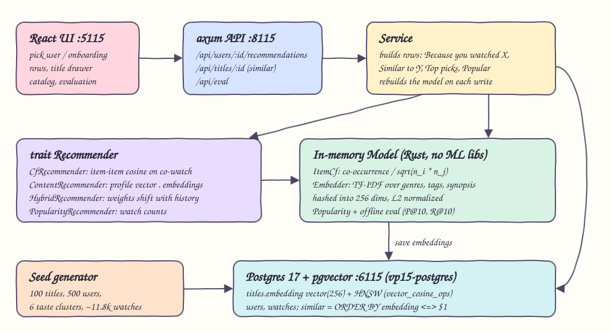
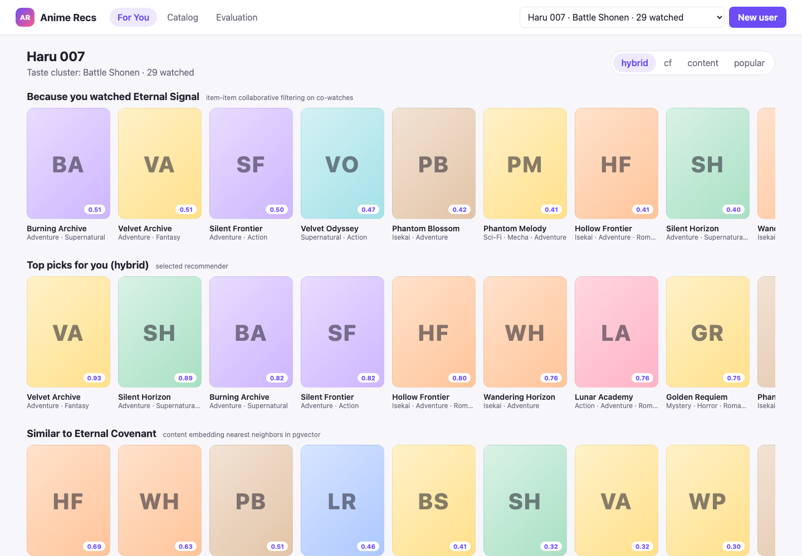
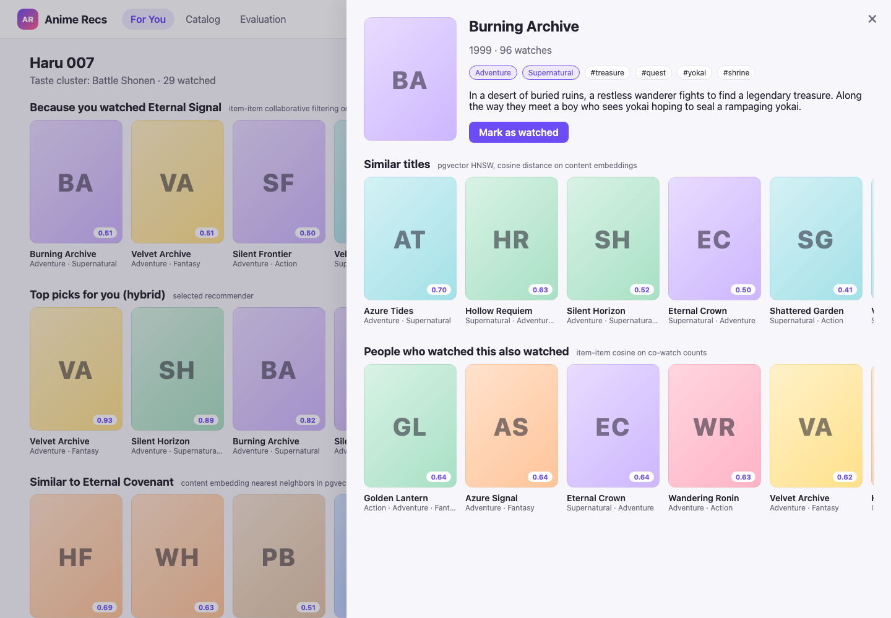
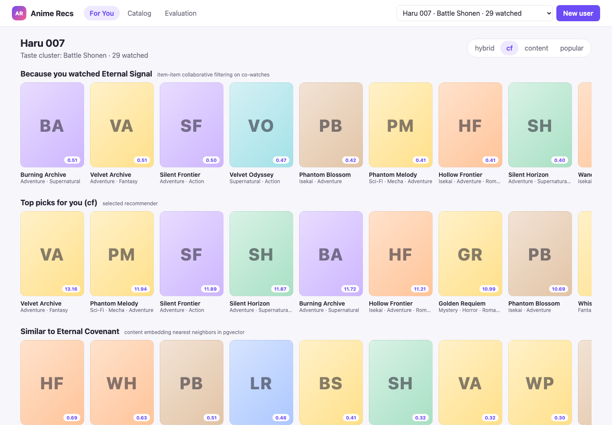
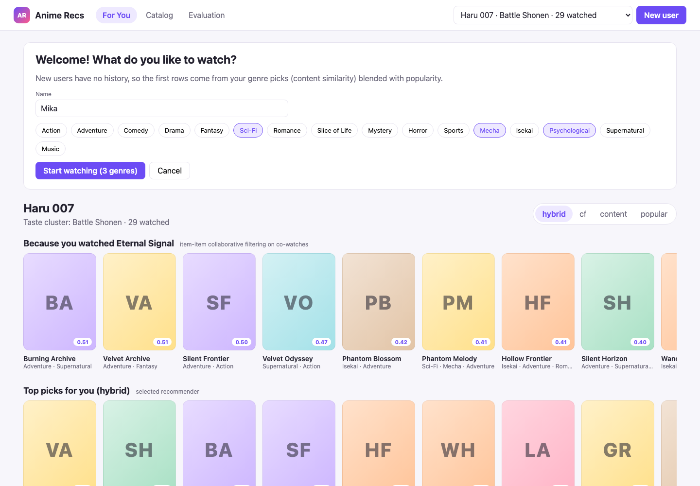
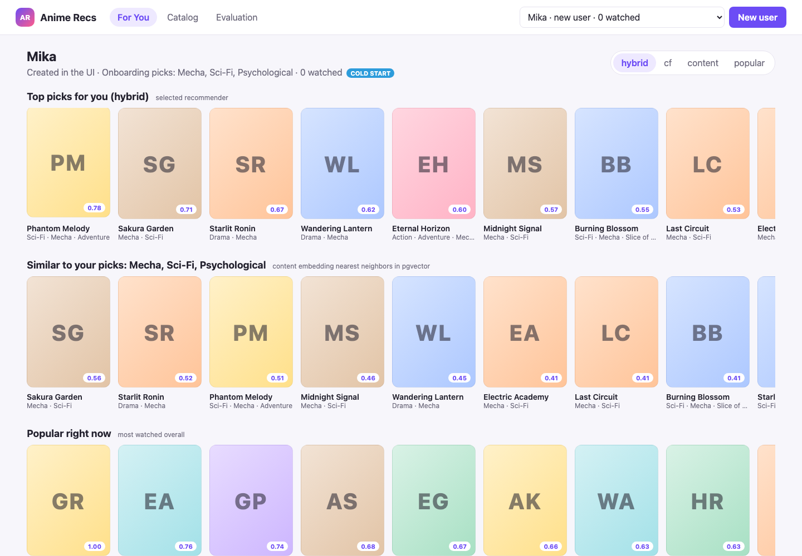
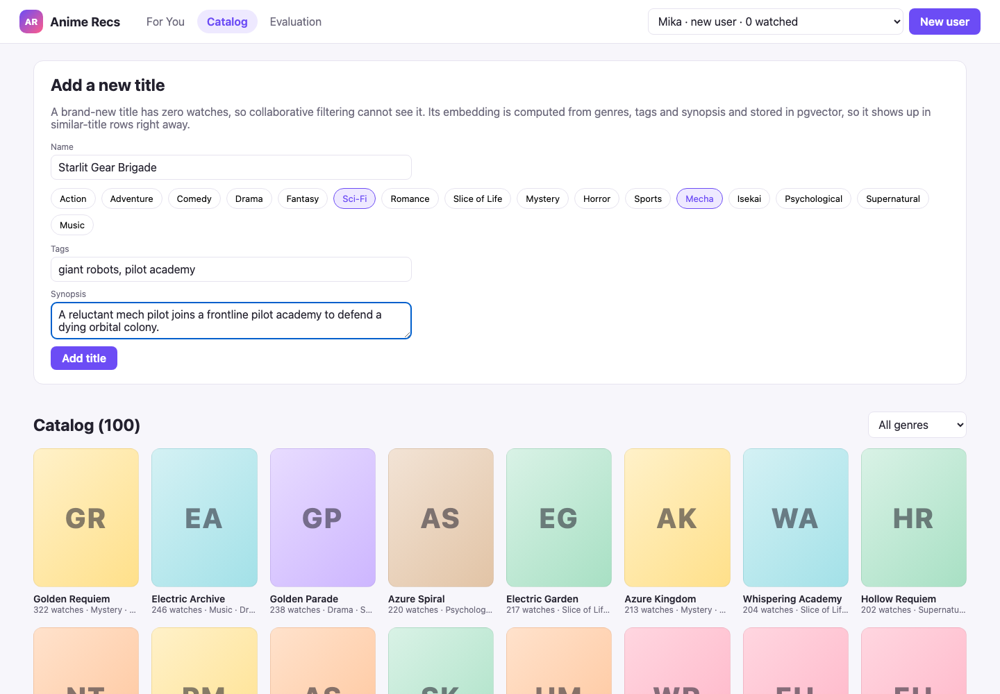
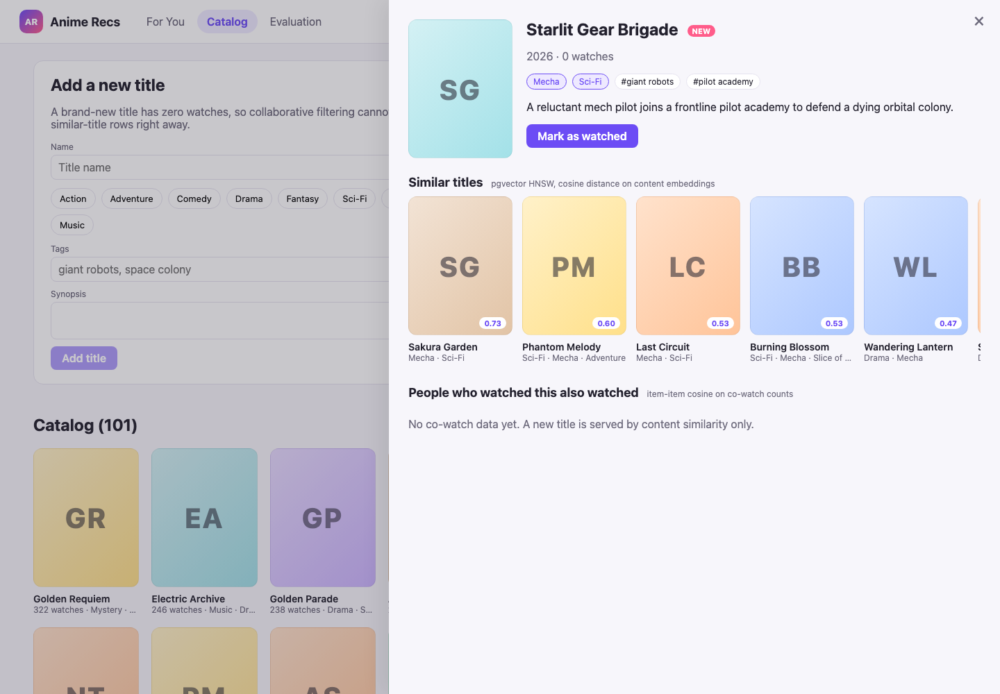
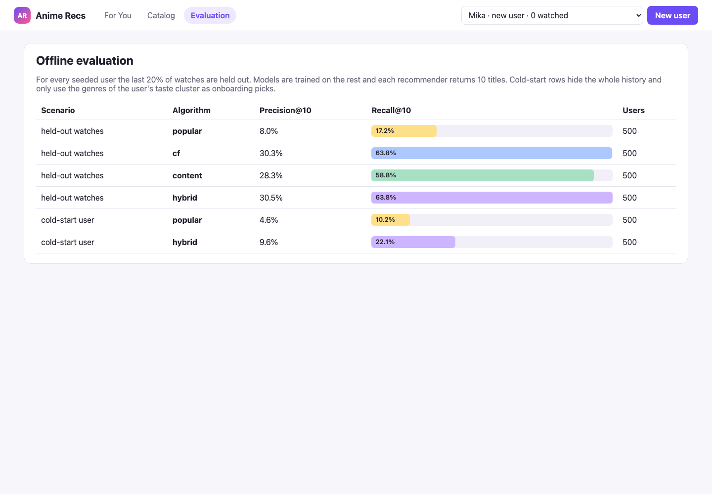

# 15 - Recommendations

A "what to watch next" engine for an anime-style catalog. It seeds 100 fictional titles and the watch history of 500 synthetic users grouped in taste clusters, then serves three kinds of recommendations from a Rust backend: item-item collaborative filtering on co-watches, content similarity on embeddings computed in Rust (no ML libraries) and stored in Postgres with pgvector, and a hybrid of both plus popularity. It handles cold start for new users (genre onboarding) and new titles (content only), and reports an offline evaluation (precision@10 and recall@10 on held-out watches). A React UI shows the "Because you watched X", "Similar to Y" and "Popular" rows.

## How it Works

1. On first boot the backend seeds Postgres with a deterministic dataset: 100 titles (genres, tags, synopsis), 500 users in 6 taste clusters and 11,799 watches.
2. It loads everything into an in-memory `Model`: item-item cosine similarity on co-watch counts, popularity counts, and a content embedding per title.
3. Embeddings are TF-IDF over genre, tag and synopsis tokens, hashed (FNV-1a, signed) into 256 dimensions and L2 normalized. They are written to `titles.embedding vector(256)` with an HNSW index.
4. "Similar titles" runs `ORDER BY embedding <=> $1` in pgvector. Recommendation rows mix CF, content and popularity through a `Recommender` trait.
5. A new user picks genres on onboarding. With no history the hybrid uses content similarity to the picked genres (60%) and popularity (40%).
6. A new title has zero watches, so CF cannot see it. Its embedding is computed at insert time, so it shows up in similar-title rows immediately.
7. Every new watch or title rebuilds the model (about 12k watches, milliseconds).
8. At boot the service runs the offline evaluation and exposes it at `/api/eval`.

## Architecture



## Features

- **Item-item collaborative filtering**: cosine on co-watch counts, `co(i,j) / sqrt(n_i * n_j)`, so a blockbuster that everyone watches does not dominate every list.
- **Content embeddings without ML libraries**: TF-IDF plus the hashing trick in plain Rust, so titles with no watches still get a vector.
- **pgvector similarity**: HNSW index with `vector_cosine_ops`. `EXPLAIN` confirms `Index Scan using titles_embedding_hnsw`.
- **Hybrid recommender**: weights move from content and popularity toward CF as history grows (0 watches: 0/0.6/0.4, 1-3: 0.4/0.4/0.2, more: 0.6/0.3/0.1 for cf/content/popular).
- **Cold-start user**: onboarding genre picks turn into a query vector, giving a "Similar to your picks" row plus hybrid top picks.
- **Cold-start title**: create a title in the Catalog tab. Its "People also watched" row is empty and its "Similar titles" row is filled from pgvector right away.
- **Offline evaluation**: temporal hold-out of the last 20% of each user's watches, precision@10 and recall@10 for every recommender, plus a cold-start scenario.
- **Swappable algorithms in the UI**: switch between hybrid, cf, content and popular and watch the top-picks row change.

## Stack

- **Rust 1.99 (edition 2024) + axum + tokio**: a fast HTTP API and all the recommendation math in one small binary.
- **tokio-postgres**: a thin async driver. Vectors go over the wire as `'[...]'::vector` text, so no pgvector crate is needed.
- **Postgres 17 + pgvector (podman)**: stores titles, users, watches and embeddings, with an HNSW index for nearest-neighbor search.
- **React 19.3 + Vite 8.3 + TypeScript 7 (Bun)**: a light-theme UI with no UI libraries.
- **podman-compose**: runs the `pgvector/pgvector:pg17` container `vp15-postgres` on port 6115.

## Contracts / APIs

| Method | Path | Body / Query | Returns |
|---|---|---|---|
| GET | `/api/health` | | `ok` |
| GET | `/api/genres` | | `{ genres: string[], clusters: [{ name, genres }] }` |
| GET | `/api/titles` | | `[{ title, watches }]` |
| POST | `/api/titles` | `{ name, genres, tags, synopsis, year }` | `201 Title` with `is_new: true` |
| GET | `/api/titles/{id}` | | `{ title, watches, similar_content: Item[], also_watched: Item[] }` |
| GET | `/api/users` | | `[{ user, watch_count }]` |
| POST | `/api/users` | `{ name, genres }` | `201 User` with the onboarding picks |
| GET | `/api/users/{id}` | | `{ user, watched: Title[] }`, newest first |
| POST | `/api/users/{id}/watches` | `{ title_id }` | `204` |
| GET | `/api/users/{id}/recommendations` | `?algo=hybrid\|cf\|content\|popular` | `{ algorithm, cold_start, rows: [{ kind, label, anchor, items }] }` |
| GET | `/api/eval` | | `[{ scenario, algorithm, precision_at_10, recall_at_10, users }]` |

`Item` is `{ title, score }`. The row kinds are `top`, `because` (CF neighbors of the latest watch), `similar` (pgvector neighbors of the previous watch, or of the onboarding genres) and `popular`. Errors return `{ "error": "..." }` with 400 or 404.

## Key data structures and design decisions

- `trait Recommender { fn name(&self) -> &'static str; fn recommend(&self, model: &Model, profile: &Profile, k: usize) -> Vec<Scored>; }`. The implementations hold no state, and the shared `Model` is passed in. This keeps the same code path for live traffic and for offline evaluation on a train split.
- `Model { titles, embeddings, embedder, cf: ItemCf, popularity }` is rebuilt from scratch on every write. With 100 titles and about 12k watches this is cheaper than incremental bookkeeping and can never drift.
- `ItemCf` keeps a full sorted neighbor list per title (`HashMap<i32, Vec<(i32, f32)>>`). With 100 titles there is no need to prune to top-k.
- `trait Store` has two implementations. `PgStore` is the real one. `MemStore` does brute-force cosine and runs the API tests without a database.
- Embeddings are recomputed and saved for every title on each rebuild, because a new title changes the IDF weights. The pgvector column and the Rust vectors always agree, and a test checks pgvector distances against Rust cosine to within 1e-3.
- Similar-title queries run `LIMIT k + |watched|` without a `WHERE` clause and filter watched titles in Rust. This keeps the HNSW index usable, since a filtered HNSW scan can return fewer than k rows.
- The seed generator uses its own SplitMix64 RNG with a fixed seed, so the dataset and the evaluation numbers are reproducible without a `rand` crate.

## How to run

```bash
./scripts/setup.sh
./scripts/start-all.sh
./scripts/ui.sh
./scripts/test-all.sh
./scripts/sql-console.sh
./scripts/stop-all.sh
```

Offline evaluation without a database:

```bash
cd backend && cargo run --release --bin eval
```

## Results

Seeded dataset: 100 titles, 500 users, 11,799 watches. Evaluation (`cargo run --release --bin eval`, the same numbers are served at `/api/eval`):

| Scenario | Algorithm | Precision@10 | Recall@10 | Users |
|---|---|---|---|---|
| held-out watches | popular | 0.0804 | 0.1724 | 500 |
| held-out watches | cf | 0.3032 | 0.6378 | 500 |
| held-out watches | content | 0.2826 | 0.5885 | 500 |
| held-out watches | hybrid | 0.3054 | 0.6384 | 500 |
| cold-start user | popular | 0.0456 | 0.1019 | 500 |
| cold-start user | hybrid | 0.0960 | 0.2215 | 500 |

- On warm users, personalized recommenders beat popularity by about 3.8x in precision@10. Hybrid is slightly ahead of CF, and content alone is close behind.
- For cold-start users (no history, only the genres of their cluster as onboarding picks), the hybrid doubles precision@10 compared with plain popularity.
- Recall is high because the catalog is small (100 titles) and the clusters are strong. These are synthetic numbers that show the relative ranking of the algorithms. They are not a claim about real-world accuracy.
- pgvector plan for the similar-titles query: `Limit -> Index Scan using titles_embedding_hnsw on titles, Order By: (embedding <=> ...)`.
- Tests: 23 Rust unit tests, 4 API integration tests (in-memory store), 2 Postgres integration tests, and 5 frontend `bun test` tests. All pass.

## Printscreens

**For You (warm user).** A Battle Shonen user. "Because you watched Eternal Signal" comes from CF neighbors of the latest watch, "Top picks" from the hybrid, and further down "Similar to" (pgvector) and "Popular".



**Title detail.** "Similar titles" comes from the pgvector HNSW cosine search on content embeddings. "People who watched this also watched" comes from item-item CF. Any title can be marked as watched, and the rows refresh.



**Algorithm switch.** The same user with the `cf` recommender selected for the top-picks row.



**Onboarding.** A new user picks genres (Mecha, Sci-Fi, Psychological).



**Cold-start user.** With zero watches there is no "Because you watched" row. The hybrid top picks blend genre similarity with popularity, "Similar to your picks" is a pgvector query on the genre vector, and "Popular" is global.



**Catalog and new title.** All titles sorted by watches, plus a form to add a brand-new title.



**Cold-start title.** The new title has 0 watches, so the CF row is empty. Content similarity still finds Mecha and Sci-Fi neighbors through pgvector.



**Evaluation.** Precision@10 and recall@10 for every recommender on held-out watches, plus the cold-start scenario.



## Scripts

All scripts live in `scripts/` and run from any directory of the repository.

| Script | What it does |
|---|---|
| `./scripts/setup.sh` | Installs dependencies and prepares the app |
| `./scripts/start-all.sh` | Starts every service and prints the full link of each one |
| `./scripts/status.sh` | Shows every service port as UP or DOWN |
| `./scripts/test-all.sh` | Runs every test suite |
| `./scripts/ui.sh` | Opens the UI in the browser |
| `./scripts/stop-all.sh` | Stops every service |
| `./scripts/sql-console.sh` | Opens a console on the database |

Ports are declared in `scripts/ports.env`: backend 8115, frontend 5115, postgres 6115.

```bash
./scripts/setup.sh
./scripts/start-all.sh
./scripts/status.sh
./scripts/ui.sh
./scripts/stop-all.sh
```
