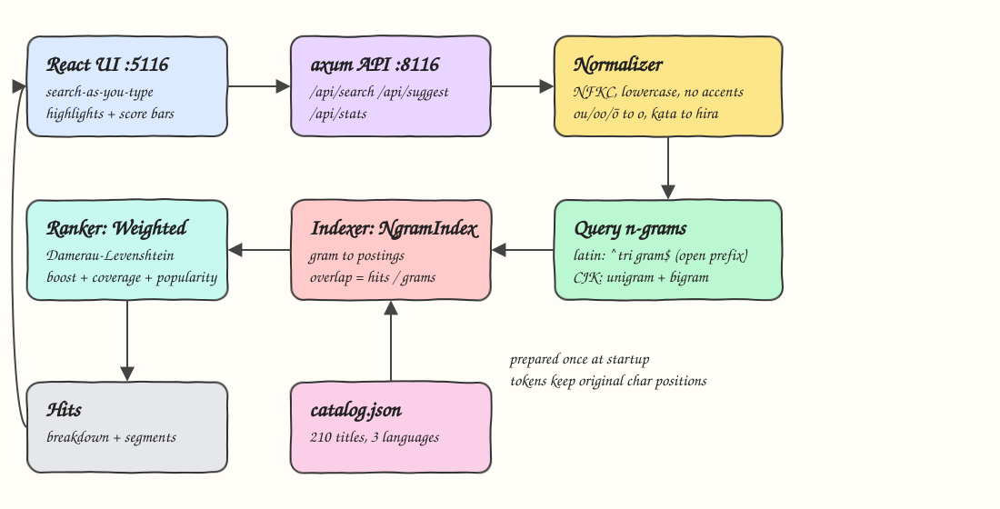
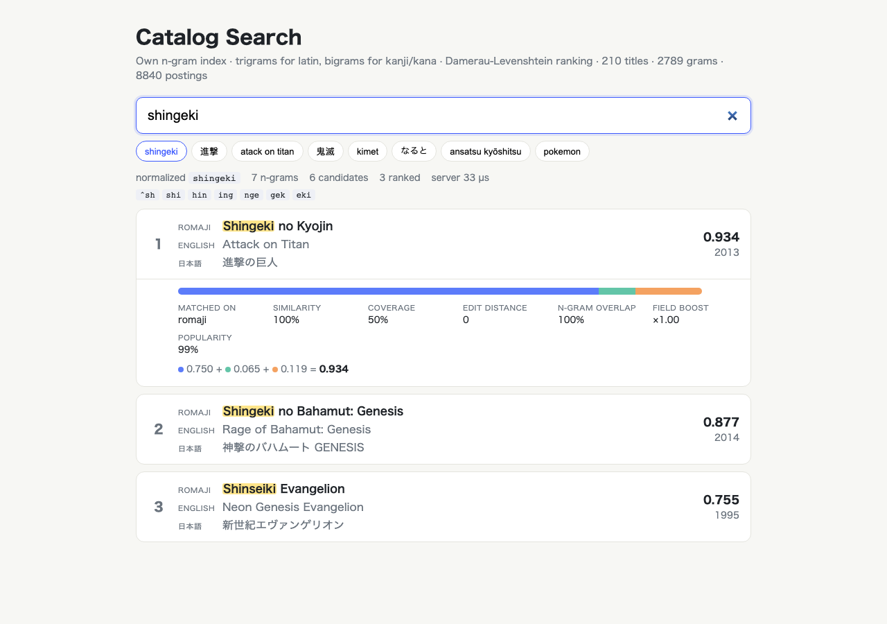
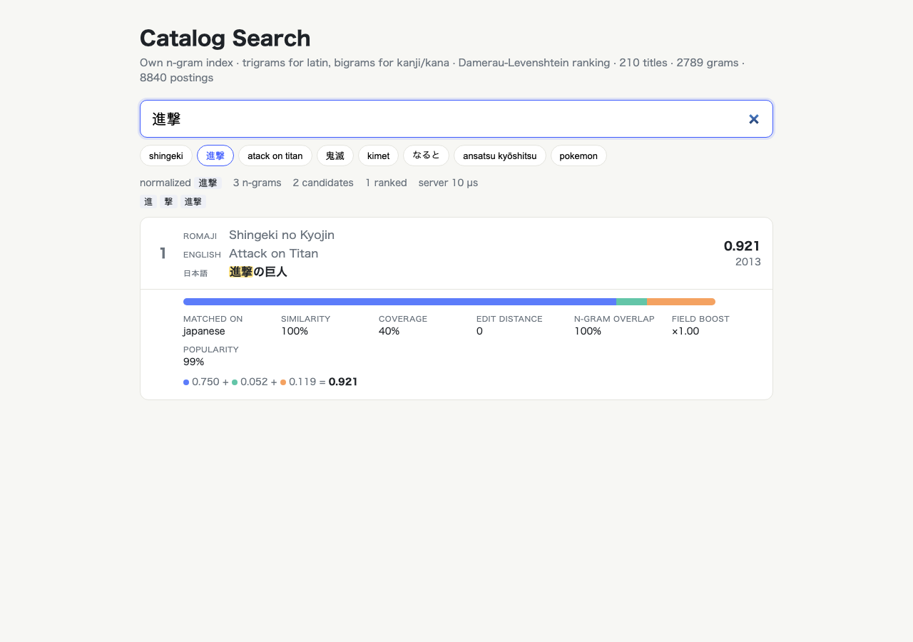
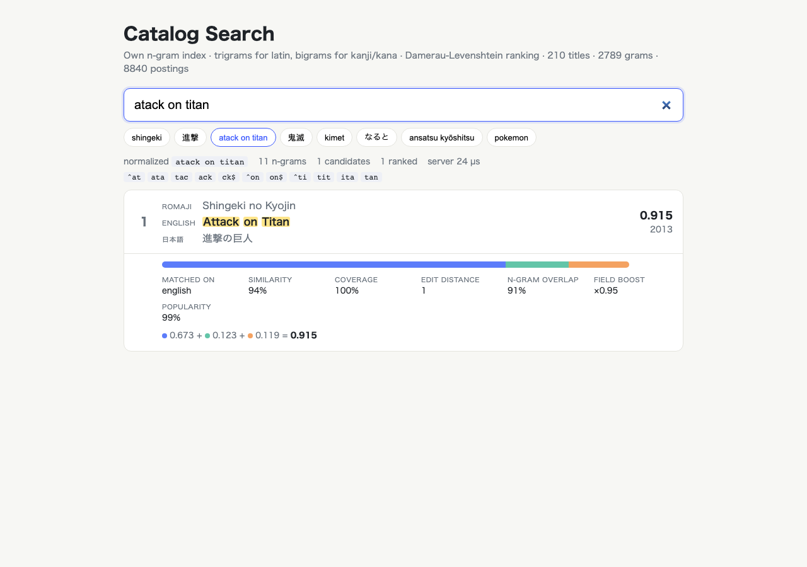
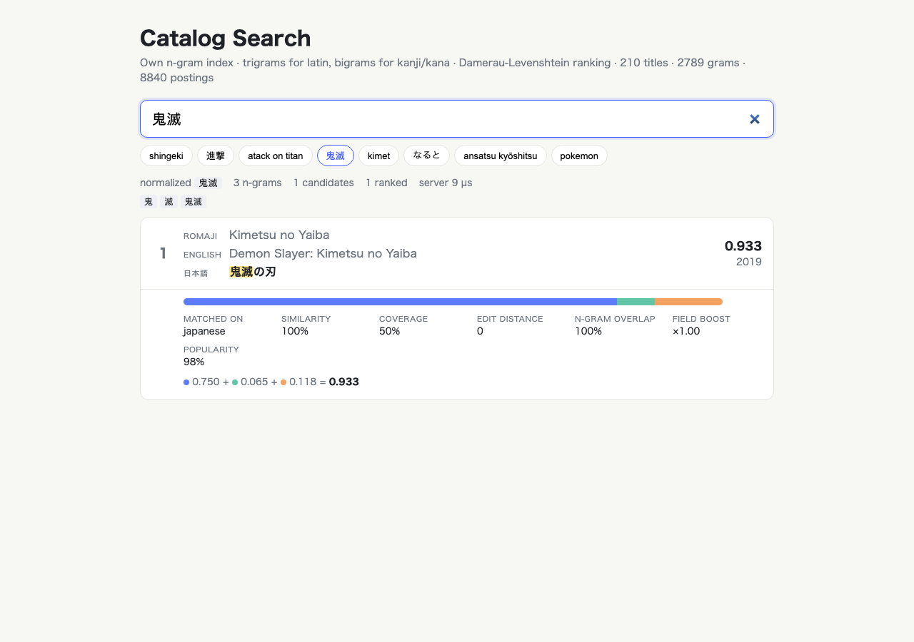
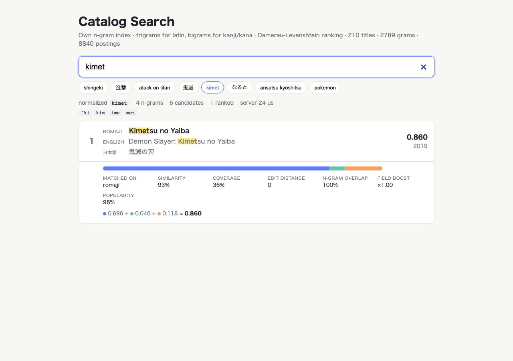
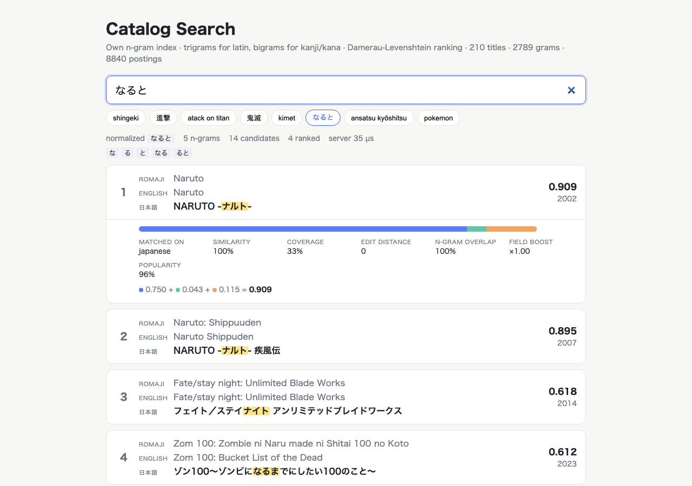

# Catalog Search

Multilingual anime catalog search built on a hand-written n-gram index in Rust (no Meilisearch, no Tantivy).
One query box finds titles by romaji (`shingeki`), kanji/kana (`進撃`, `なると`) or English (`atack on titan`, typo included),
ranks them with Damerau-Levenshtein + field boosts + popularity and shows a React search-as-you-type UI with
highlighting and a full score breakdown for every hit.

## How it Works

1. `data/catalog.json` holds 210 well-known anime titles, each with `romaji`, `english` and `japanese` names, year and popularity.
2. At startup every title field is normalized: NFKC (fullwidth to ASCII, halfwidth kana to fullwidth), lowercase, diacritics stripped (`Pokémon` to `pokemon`), long-vowel romaji collapsed (`ou`, `oo`, `uu`, `ō` to one vowel), katakana folded to hiragana, punctuation turned into word breaks.
3. Normalized text is split into tokens on spaces and on script changes; every normalized char remembers its original char position.
4. The `NgramIndex` stores padded character trigrams for latin tokens (`^na`, `nar`, ..., `to$`) and unigrams + bigrams for CJK tokens in a `gram -> postings(doc, field)` map.
5. A query is normalized the same way; its last token is "open" (no `$` end marker) so prefixes match while typing.
6. Candidate generation: count matching grams per (doc, field), overlap = hits / query grams, keep docs with overlap >= 0.3.
7. The `WeightedRanker` matches each query token against each field token: exact, prefix, or Damerau-Levenshtein within a typo budget (0 typos up to 3 chars, 1 up to 7, 2 above; CJK `len/3`).
8. Score = `boost x (0.75 x similarity + 0.13 x coverage) + 0.12 x popularity`; the best field wins and is reported with the breakdown and highlight segments mapped back to the original characters.

## Architecture



## Features

* Romaji, kanji/kana and English search in one box - users type whatever script they remember.
* NFKC + katakana to hiragana folding - `なると`, `ナルト` and `ﾅﾙﾄ` are the same query.
* Long-vowel romaji folding - `kyoushitsu`, `kyōshitsu`, `kyooshitsu` and `kyoshitsu` all find Assassination Classroom.
* Diacritic stripping - `pokemon` finds `Pokémon`, `nausicaa` finds `Nausicaä`.
* Typo tolerance with Damerau-Levenshtein - a swapped pair (`tiatn`) costs one edit, not two.
* Prefix / autocomplete - `kimet` already ranks Demon Slayer first; `/api/suggest` returns short titles.
* Field boosts + popularity tie-break - `shingeki` ranks Attack on Titan above Shingeki no Bahamut.
* Explainable ranking - every hit returns similarity, coverage, edit distance, n-gram overlap, boost and popularity.
* Highlighting in the original text - spans are tracked through normalization so kanji and macrons highlight correctly.
* Swappable parts - `Indexer` and `Ranker` are traits; `SearchEngine<I, R>` is generic over both.

## Stack

* Rust 1.99 (edition 2024) - fast, predictable latency for an in-memory index.
* axum + tokio - small HTTP layer for the JSON API.
* unicode-normalization - NFKC and canonical decomposition; the only text crate used.
* thiserror - typed `SearchError` for every fallible function; `anyhow` only in `main`.
* React 19.3 + TypeScript 7 + Vite 8.3 + Bun 1.4 - search-as-you-type UI with no UI libraries.

## Contracts / APIs

| Method | Path | Description |
|---|---|---|
| GET | `/api/search?q=<text>&limit=<1..50>` | Ranked hits with breakdown and highlight segments |
| GET | `/api/suggest?q=<text>&limit=<1..50>` | Autocomplete: `[{id, title}]` using the best matching field |
| GET | `/api/stats` | `{documents, grams, postings}` of the index |
| GET | `/api/health` | `ok` |

A blank query returns `400 {"error":"query is empty after normalization"}`.

```json
{
  "query": "atack on titan",
  "normalized": "atack on titan",
  "grams": ["^at","ata","tac","ack","ck$","^on","on$","^ti","tit","ita","tan"],
  "candidates": 1,
  "took_us": 24,
  "results": [{
    "id": 1, "romaji": "Shingeki no Kyojin", "english": "Attack on Titan", "japanese": "進撃の巨人",
    "year": 2013, "popularity": 99, "score": 0.915,
    "breakdown": {"field": "english", "similarity": 0.94, "coverage": 1.0, "edit_distance": 1,
                  "overlap": 0.91, "boost": 0.95, "popularity": 0.99,
                  "similarity_score": 0.673, "coverage_score": 0.123, "text_score": 0.796,
                  "popularity_score": 0.119, "total": 0.915},
    "highlights": [{"field": "english", "segments": [{"text": "Attack", "hit": true}, {"text": " ", "hit": false}]}]
  }]
}
```

## Key Data Structures and Design Decisions

* `Token { chars, positions, script }` - normalized chars plus the original char index of each one, so highlights survive NFKC, macron stripping and vowel folding.
* `NgramIndex { postings: HashMap<String, Vec<Posting{doc, field}>> }` - postings deduplicated per field; overlap is measured against the query, so long titles are not penalised for extra words.
* Latin trigrams are padded with `^`/`$` so word starts and ends weigh in; the open last query token drops `$`, which turns the same index into an autocomplete index.
* CJK has no spaces, so bigrams (plus unigrams for 1-char queries) replace word tokens; a 2-kanji query gets no typo budget (`進撃` must not match `神撃`).
* Candidate generation is cheap and recall-oriented (overlap >= 0.3, top 100); precision comes from the ranker's typo budget and `min_similarity = 0.6`.
* Coverage (matched chars / field chars) makes `naruto` prefer `Naruto` over `Naruto Shippuden`; popularity (12%) only breaks near ties.
* English gets boost 0.95 vs 1.0 for romaji/japanese: English titles share common words (`the`, `of`, `no`) across many unrelated titles.

## Results / Measurements

Index built from 210 titles: 2789 distinct grams, 8840 postings.

In-process latency (`cargo run --release --bin bench`, 40 mixed queries x 250 rounds = 10000 samples, including typos, kanji, kana, prefixes, stop-words and a gibberish query):

| p50 | p95 | p99 | max |
|---|---|---|---|
| 8-10 µs | 54-68 µs | 88-107 µs | 134-3359 µs |

End-to-end HTTP latency (500 sequential requests to the release backend on localhost): p50 0.07 ms, p95 0.16 ms, p99 0.20 ms.

The test `p99_latency_stays_within_the_search_as_you_type_budget` enforces p99 < 25 ms in debug builds and < 2 ms in release builds.

Tests: 29 Rust unit tests, 20 search integration tests, 4 API tests, 4 frontend `bun test` tests - all passing.

## How to Run

```bash
./scripts/setup.sh
./scripts/start-all.sh
./scripts/ui.sh
./scripts/test-all.sh
./scripts/stop-all.sh
```

Backend only: `cd backend && cargo test && cargo run --release`. Frontend only: `cd frontend && bun install && bun run dev`.

## Printscreens

Romaji fragment `shingeki`: Attack on Titan first, Shingeki no Bahamut second (same word, lower coverage and popularity), Evangelion via a 2-edit fuzzy match on `shinseiki`.



Kanji fragment `進撃`: the CJK bigram hits the Japanese field and the highlight lands on the two original kanji.



Typo `atack on titan`: one edit on `attack`, matched on the English field; the breakdown shows edit distance 1, 94% similarity and the stacked score bar.



Kanji `鬼滅`: Demon Slayer found through the Japanese title `鬼滅の刃`.



Prefix `kimet`: autocomplete; only the typed part `Kimet` is highlighted and the n-gram list shows no `$` end marker on the open token.



Hiragana `なると`: katakana folding matches `NARUTO -ナルト-`; Naruto ranks above Shippuden thanks to coverage, followed by weaker fuzzy CJK matches.



## Scripts

All scripts live in `scripts/` and run from any directory of the repository.

| Script | What it does |
|---|---|
| `./scripts/setup.sh` | Installs dependencies and prepares the app |
| `./scripts/start-all.sh` | Starts every service and prints the full link of each one |
| `./scripts/status.sh` | Shows every service port as UP or DOWN |
| `./scripts/test-all.sh` | Runs every test suite |
| `./scripts/ui.sh` | Opens the UI in the browser |
| `./scripts/stop-all.sh` | Stops every service |

Ports are declared in `scripts/ports.env`.

```bash
./scripts/setup.sh
./scripts/start-all.sh
./scripts/status.sh
./scripts/ui.sh
./scripts/stop-all.sh
```
