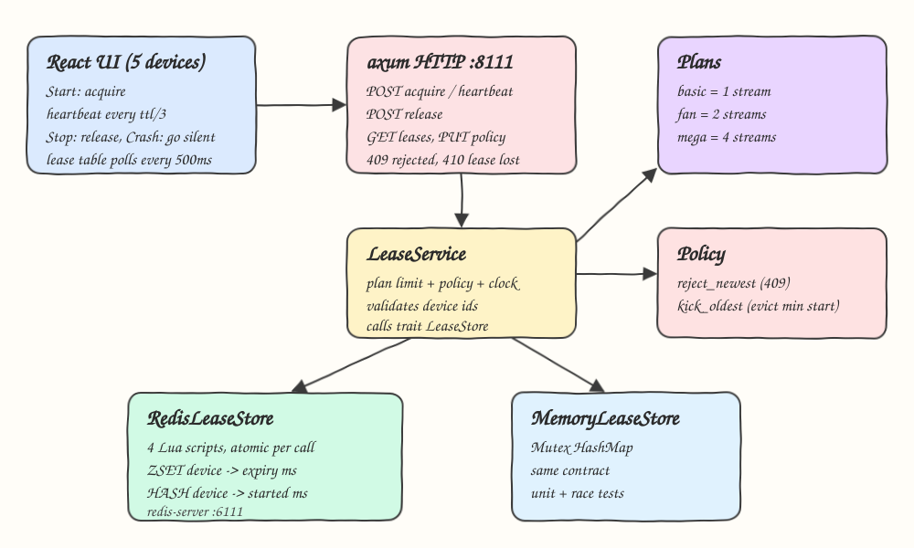
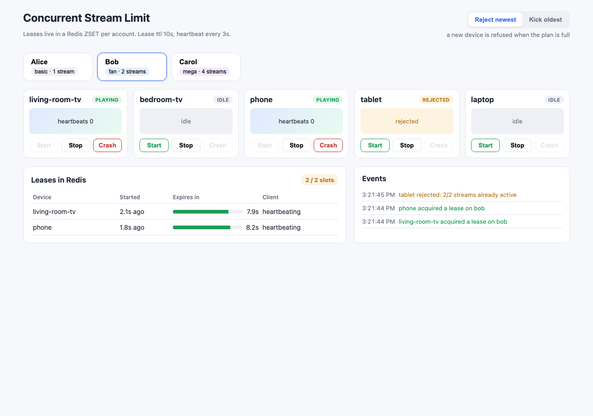
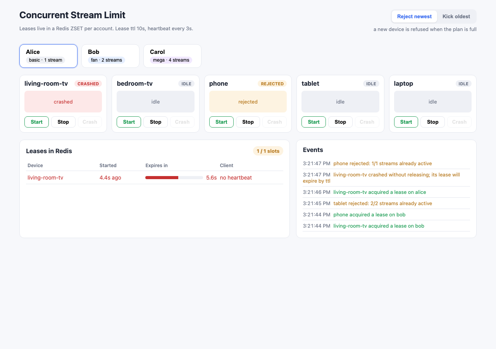
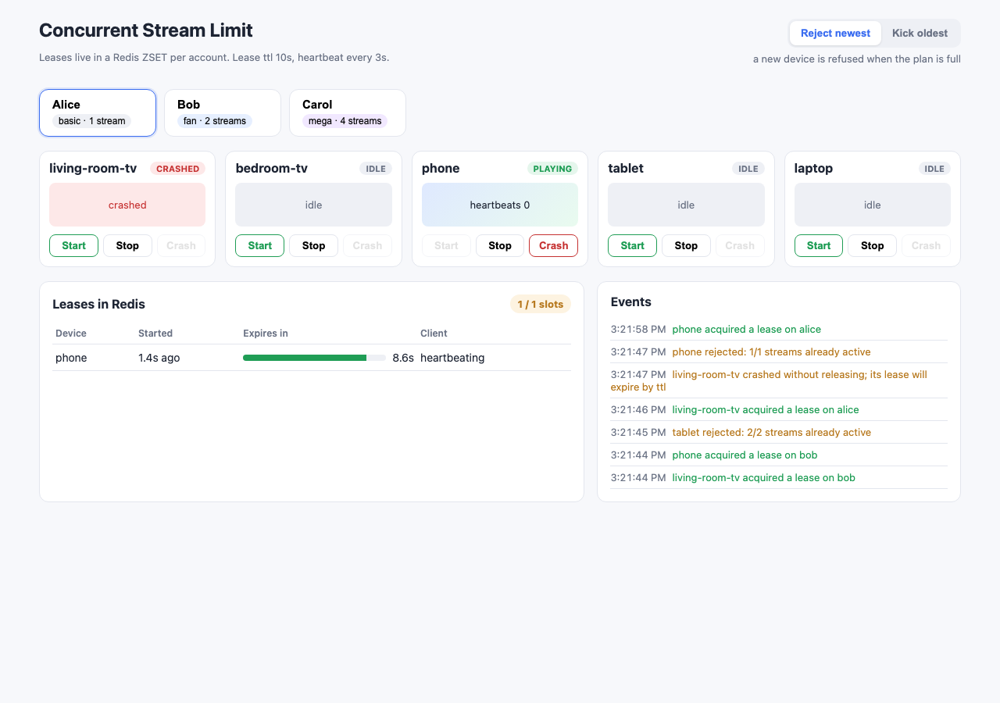
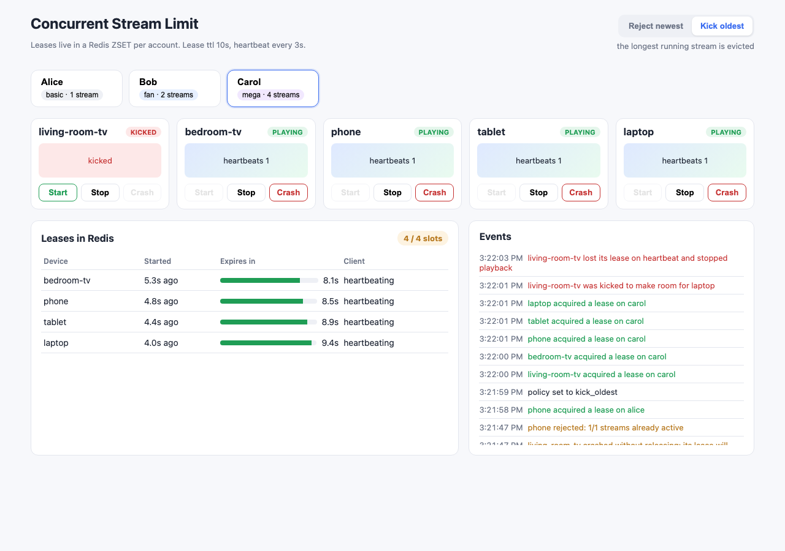

# Concurrent Stream Limit

Enforces "max N simultaneous streams per account" the way streaming services do: every playing device holds a short lease in Redis, keeps it alive with heartbeats, gives it back on stop, and loses it automatically when it crashes. Plans set N (basic 1, fan 2, mega 4) and an over-limit policy decides between refusing the newcomer or kicking the oldest stream. A React UI simulates devices so you can watch leases appear, count down, renew, expire and get evicted.

## How it Works

1. A device presses Start: the UI calls `POST /api/accounts/{account}/devices/{device}/acquire`.
2. The backend runs one Lua script in Redis: prune expired members of the account ZSET, renew if the device already holds a lease, otherwise check `ZCARD` against the plan limit and add `device -> now + ttl`.
3. Over the limit, `reject_newest` returns 409; `kick_oldest` removes the device with the smallest start time (kept in a side HASH) and admits the newcomer.
4. A playing device heartbeats every `ttl/3`; the heartbeat script renews the score with `ZADD XX`, or returns nothing so the API answers 410 and the player stops (kicked or expired).
5. Stop calls release (`ZREM` + `HDEL`), freeing the slot immediately.
6. Crash means the client goes silent: no release, no heartbeat. The lease score falls behind `now` and the next acquire, heartbeat or list prunes it, so the slot comes back after at most one TTL.
7. Because each operation is a single Lua script, Redis executes it atomically: no interleaving between "count" and "add", so N is never exceeded no matter how many devices race.

## Architecture



## Features

- Plan-based limits (basic 1, fan 2, mega 4): the commercial tier decides concurrency, not code paths.
- Atomic acquire via Lua: prune, renew, count and add in one step, so parallel devices cannot sneak past N.
- Heartbeat renewal: long sessions survive indefinitely while the client is alive.
- TTL crash recovery: a client that dies without releasing frees its slot within one TTL.
- Two over-limit policies, switchable at runtime: reject newest (409) or kick oldest (evicted device gets 410 on its next heartbeat).
- `LeaseStore` trait with Redis and in-memory implementations sharing one contract test suite.
- Server time drives the UI countdown, so a skewed browser clock does not misreport expiries.
- Device simulator with Start / Stop / Crash per device and a live lease table with countdown bars.

## Stack

- Rust 1.99 (edition 2024) + axum + tokio: small async HTTP service with typed errors (`thiserror`).
- redis-rs 1.7 with `ConnectionManager` and `Script` (EVALSHA with automatic load): atomic lease scripts.
- Redis 8.4 (`redis-server` on port 6111): ZSET scored by expiry is a natural lease table with range pruning.
- React 19.3 + Vite 8.3 + TypeScript 7.0 + Bun 1.4: simulator UI with no UI libraries.
- k6 1.5: HTTP churn load test that also samples the lease table for over-limit observations.

## Contracts / APIs

Base `http://localhost:8111/api` (the UI reaches it through the Vite proxy on 5111).

| Method | Path | Response |
|---|---|---|
| GET | `/health` | `{"status":"ok"}` |
| GET | `/accounts` | `{"accounts":[{"id","plan","limit"}],"ttl_ms"}` |
| GET | `/policy` | `{"policy":"reject_newest"\|"kick_oldest"}` |
| PUT | `/policy` | body `{"policy":"kick_oldest"}`; 400 on unknown policy |
| GET | `/accounts/{account}/leases` | `{"account","policy","ttl_ms","now_ms","leases":[{"device","started_at_ms","expires_at_ms"}]}` |
| POST | `/accounts/{account}/devices/{device}/acquire` | 200 `{"status":"granted","lease","evicted":[...]}` or 409 `{"status":"rejected","active","limit"}` |
| POST | `/accounts/{account}/devices/{device}/heartbeat` | 200 `{"status":"renewed","lease"}` or 410 `{"status":"lost"}` |
| POST | `/accounts/{account}/devices/{device}/release` | 200 `{"released":true\|false}` |

Unknown account is 404, invalid device id (not `[A-Za-z0-9_-]{1,64}`) is 400.

## Data structures and design decisions

- Redis keys per account: `sl:{account}:leases` (ZSET, member = device, score = expiry ms) and `sl:{account}:started` (HASH, device -> start ms). The hash tag `{account}` keeps both keys in one slot so the scripts stay valid on Redis Cluster.
- Scripts live in `backend/src/lua/` (`acquire`, `heartbeat`, `release`, `list`). Each prunes expired members first, so expiry needs no background job.
- Both keys get `PEXPIRE ttl` on every write, so an abandoned account disappears from Redis on its own.
- "Oldest" means earliest start, not earliest expiry: a heartbeating long session is still the one kicked, which matches what users expect ("the stream that has been running longest").
- Time is passed into the store (`now_ms` argument) by the service's `Clock`. That keeps the Redis and memory stores identical and lets unit tests use a `ManualClock` to test TTL recovery without sleeping. In production a single backend clock is the source of truth.
- Re-acquire by the same device renews instead of taking a second slot, so a player retrying after a network blip is safe.
- `LeaseStore` uses `impl Future + Send` return types; the service and router are generic over the store, so no boxing or `async-trait` crate is needed.

## How to run

```bash
./scripts/setup.sh
./scripts/start-all.sh
./scripts/ui.sh
./scripts/test-all.sh
./scripts/sql-console.sh
./scripts/stop-all.sh
```

Inside the console, `ZRANGE sl:{carol}:leases 0 -1 WITHSCORES` shows the live lease table.

Load test (with the app running): `k6 run k6/churn.js`.

## Tests

- 13 unit tests: plan limits, policy parsing, service behavior on the memory store (crash recovery after TTL, heartbeats keep sessions alive, late heartbeat refused, kick-oldest evicts by start time, release frees the slot, reacquire does not burn a slot, bad inputs), Redis reply parsing fails loud.
- 4 HTTP tests: 409 on a full basic plan, 410 for a kicked device, snapshot carries server time, 404/400 mapping.
- 9 race tests (`backend/tests/race.rs`), the same generic contract run against both stores:
  - stampede: 64 devices behind a barrier acquire at once for limits 1, 2, 4; reject grants exactly N, kick admits all 64 and evicts exactly 64 - N, final count never above N.
  - churn: 24 devices x 41 rounds of acquire/heartbeat/release with a watcher sampling the lease count.
  - crash recovery with a 300 ms TTL against real time.
  - raw Redis hammer: 8 separate connections x 8 devices x 60 rounds while a separate connection samples `ZCARD` directly.
- 6 frontend tests (`bun test`): server-time countdown, clamping, heartbeat cadence of three beats per TTL.

The race suite was checked against a broken script: changing `while count >= limit` to `while count > limit` in `acquire.lua` makes all 5 Redis race tests fail.

## Results

Measured on a laptop, local Redis 8.4, debug backend build.

| Measurement | Result |
|---|---|
| `cargo test` | 26 passed, 0 failed (13 unit, 4 HTTP, 9 race) |
| `bun test` | 6 passed, 0 failed |
| Raw `ZCARD` sampler during the Redis hammer (limit 4) | 70 samples, peak 4 |
| k6 churn: 64 VUs, 15 s, account `carol` (limit 4), reject policy | 202,630 requests, 13,506 req/s, 0 failed |
| k6 lease outcomes | 6,240 granted, 180,812 rejected |
| k6 watcher on the lease table | max active 4, over-limit observations 0 |
| k6 latency | avg 4.73 ms, p90 8.68 ms, p95 13.87 ms |

## Printscreens

### Reject newest on the fan plan



Bob has the fan plan (2 streams). The living-room TV and phone acquire leases and heartbeat; the tablet gets a 409 and shows "rejected". The lease table shows 2 / 2 slots with countdown bars refilling on each heartbeat.

### Crashed client keeps a zombie lease



Alice (basic, 1 stream) started the living-room TV and pressed Crash: no release was sent. The lease is still in Redis, marked "no heartbeat" in red and counting down, so the phone is rejected.

### TTL recovery



About 10 seconds later the crashed lease expired without anyone releasing it. The next acquire pruned it and the phone got the slot.

### Kick oldest on the mega plan



Policy switched to kick oldest. Carol (mega, 4 streams) starts four devices, then the laptop. The laptop is admitted, the living-room TV (earliest start) is evicted, and on its next heartbeat it receives 410 and switches to "kicked". The table never shows more than 4 / 4 slots.

## Scripts

All scripts live in `scripts/` and run from any directory of the repository.

| Script | What it does |
|---|---|
| `./scripts/setup.sh` | Installs dependencies and prepares the app |
| `./scripts/start-all.sh` | Starts every service and prints the full link of each one |
| `./scripts/status.sh` | Shows every service port as UP or DOWN |
| `./scripts/test-all.sh` | Runs every test suite |
| `./scripts/ui.sh` | Opens the UI in the browser |
| `./scripts/stop-all.sh` | Stops every service |
| `./scripts/sql-console.sh` | Opens redis-cli on the lease store |

Ports are declared in `scripts/ports.env` (backend 8111, frontend 5111, redis 6111).

```bash
./scripts/setup.sh
./scripts/start-all.sh
./scripts/status.sh
./scripts/ui.sh
./scripts/stop-all.sh
```
