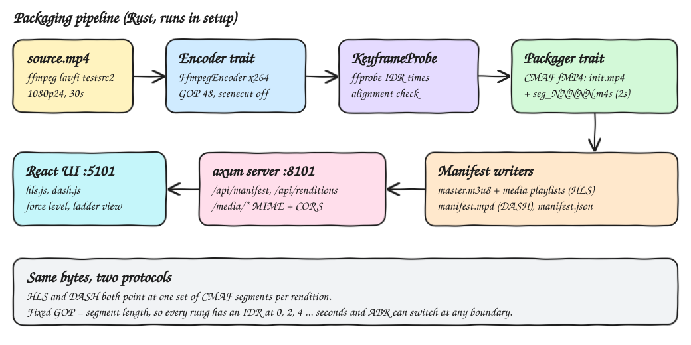
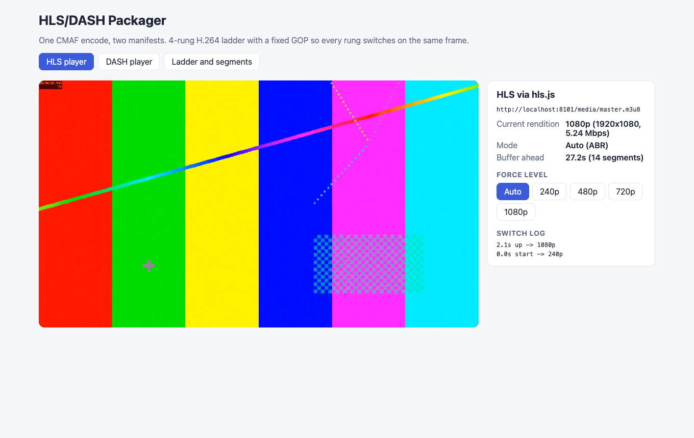
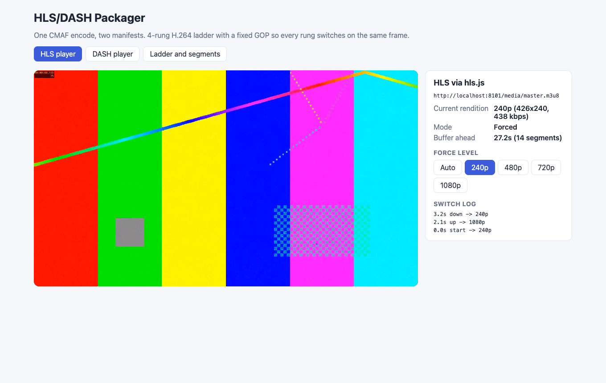
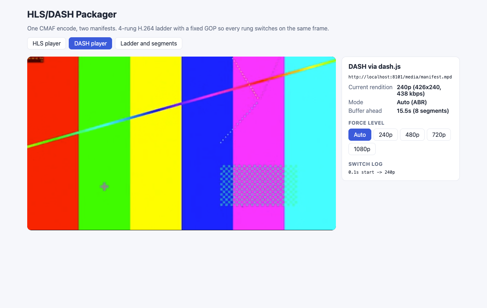
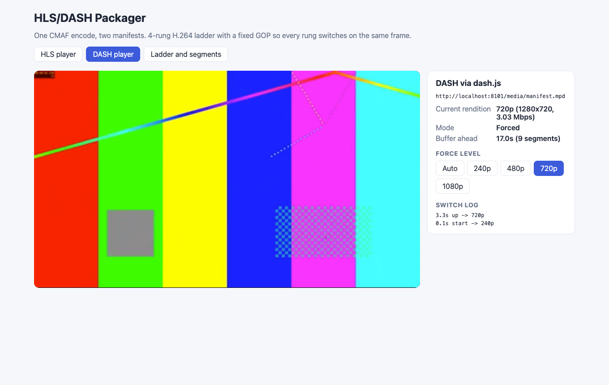
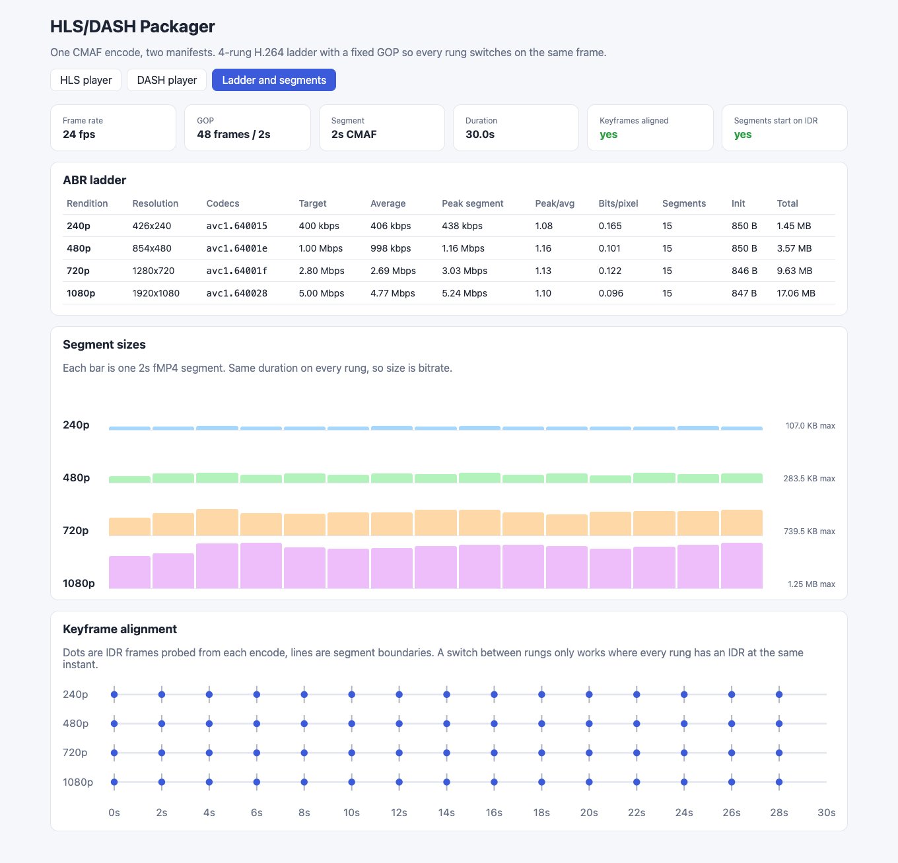

# HLS/DASH Packager

A Rust pipeline that turns one MP4 into a 4-rung H.264 ABR ladder (240p, 480p, 720p, 1080p) with aligned keyframes. It cuts the ladder into CMAF (fragmented MP4) segments and writes both an HLS master playlist with media playlists and a DASH MPD, all pointing at the same segment files. An axum server serves the output with the right MIME types and CORS headers, plus an API that lists renditions and segment details. A React UI plays the stream with hls.js and dash.js, shows the current rendition, lets you force a level, and charts the ladder, segment sizes and keyframe alignment.

## How it Works

1. `setup.sh` uses ffmpeg (`testsrc2` plus temporal noise) to generate a 30s 1080p24 source, so encoders get real work.
2. `packager package` validates the ladder. The segment length (2s at 24 fps = 48 frames) must be a whole number of GOPs.
3. For each rung, the `Encoder` (x264) encodes with `-g 48 -keyint_min 48 -sc_threshold 0` and a forced 24 fps. This puts an IDR every 2s at the same frames in every rung.
4. The `KeyframeProbe` (ffprobe) reads the IDR timestamps of each encode.
5. The `Packager` re-muxes each encode (no re-encoding) into `init.mp4` plus `seg_NNNNN.m4s` 2s CMAF fragments and an HLS media playlist.
6. The pipeline reads segment durations and sizes, then checks that every rung has identical IDR times and that every segment starts on an IDR.
7. It writes `master.m3u8` (BANDWIDTH = peak segment bitrate, AVERAGE-BANDWIDTH, CODECS, RESOLUTION) and `manifest.mpd` (one AdaptationSet, `segmentAlignment="true"`, `startWithSAP="1"`, SegmentTemplate). Both point at the same CMAF files.
8. `packager serve` serves `/media/*` and `/api/*`. The UI loads `/api/manifest` and plays the master playlist or the MPD from another origin, which is why CORS is needed.

## Architecture



## Features

* **Fixed-GOP ladder**: scene-cut detection is off and the GOP length is fixed, so every rung switches cleanly on the same frame.
* **CMAF segments shared by HLS and DASH**: one set of bytes serves both protocols, so a CDN stores half as much.
* **Keyframe alignment check**: runs on every packaging pass, appears in the API and UI, and is enforced by an integration test.
* **Measured bandwidth**: the HLS `BANDWIDTH` and DASH `@bandwidth` attributes come from the heaviest real segment, not the target bitrate, so players do not underestimate.
* **Correct MIME types**: `.m3u8`, `.mpd`, `.m4s` and `.mp4` each get the type players and CDNs expect, so strict clients do not reject them.
* **CORS on every response, including preflight**: lets a player on another origin fetch playlists and segments.
* **Path traversal guard**: `/media` only serves files inside the output folder.
* **Force a level in both players**: shows what a manual switch costs (buffer flush, new init segment).
* **Switch log and buffer-ahead readout**: shows when ABR moved up or down and how many segments are buffered.
* **Ladder view**: target, average and peak bitrate, peak/avg ratio, bits per pixel, and per-segment size bars.

## Stack

* **Rust 1.99 (edition 2024) + axum + tokio**: a small, typed backend that drives the pipeline and serves files.
* **thiserror / anyhow**: typed `AppError` in the library, `anyhow` only in `main`.
* **ffmpeg / ffprobe 8.1 (libx264)**: encoding, CMAF muxing and keyframe probing.
* **React 19.3 + TypeScript 7 + Vite 8.3 + Bun 1.4**: a strict-typed UI with fast builds.
* **hls.js 1.7.3 / dash.js 5.2.1**: reference MSE players for HLS and DASH.

## Contracts / APIs

Base URL `http://localhost:8101`. Every response has `Access-Control-Allow-Origin: *`. `OPTIONS` returns `204`.

| Method | Path | Response |
|---|---|---|
| GET | `/api/health` | `ok` |
| GET | `/api/manifest` | full `Manifest` JSON: ladder settings, renditions with segments and keyframes, alignment report |
| GET | `/api/renditions` | `[{id,width,height,target_kbps,average_kbps,peak_kbps,codecs,segment_count,total_bytes,init_bytes,playlist}]` |
| GET | `/api/renditions/{id}/segments` | `[{index,uri,start,duration,bytes,kbps}]`, or `404` for an unknown rendition |
| GET | `/media/master.m3u8` | `application/vnd.apple.mpegurl` |
| GET | `/media/manifest.mpd` | `application/dash+xml` |
| GET | `/media/{rendition}/playlist.m3u8` | HLS media playlist |
| GET | `/media/{rendition}/init.mp4` | `video/mp4` CMAF header |
| GET | `/media/{rendition}/seg_NNNNN.m4s` | `video/iso.segment` CMAF fragment |

`/media/..%2F...` returns `400`. A missing file returns `404`.

## Key data structures and design decisions

* `Ladder { fps, gop_frames, segment_seconds, renditions }` and `Rendition { id, width, height, bitrate_kbps, level_idc }`. The codec string `avc1.6400XX` is built from the High profile and the level.
* Traits `Encoder`, `Packager` and `KeyframeProbe` are the parts you can swap. `Pipeline` holds boxed trait objects. The integration test uses this to inject an encoder with a drifting GOP.
* `RenditionReport` holds the segments (start, duration, bytes, kbps), the init size, average and peak bitrate, and the keyframes. `AlignmentReport { aligned, boundaries_on_keyframes, keyframe_times, issues }`.
* The tolerance for keyframe comparison is half a frame (`0.5 / fps`).
* Segment length is 2s with a GOP of 2s: short segments mean faster startup and faster ABR reaction, at the cost of more requests and a little more bitrate spent on IDR frames.
* VBV caps: `maxrate = 1.1 x target`, `bufsize = 2 x target`, so segment sizes stay close to the target (measured peak/avg is 1.07 to 1.20).
* The DASH SegmentTemplate uses `duration` with `$Number%05d$`. Every segment except possibly the last has the same length, so a SegmentTimeline is not needed.
* Video only. There is no audio rendition, to keep the focus on the video ladder.
* Output files are generated into the gitignored `media/` folder and are never committed.

## Results (measured on this machine)

Packaging the 30s 1080p24 source (all 4 rungs, x264 `veryfast`) took 24.5s of wall time. Generating the source took 11.2s.

| Rendition | Resolution | Codecs | Target | Average | Peak segment | Segments | Total |
|---|---|---|---|---|---|---|---|
| 240p | 426x240 | avc1.640015 | 400k | 406k | 438k | 15 | 1.45 MB |
| 480p | 854x480 | avc1.64001e | 1000k | 998k | 1161k | 15 | 3.57 MB |
| 720p | 1280x720 | avc1.64001f | 2800k | 2692k | 3029k | 15 | 9.63 MB |
| 1080p | 1920x1080 | avc1.640028 | 5000k | 4769k | 5242k | 15 | 17.06 MB |

* A second clean run gave slightly different numbers (240p 406k/435k, 480p 1000k/1151k, 720p 2682k/3229k, 1080p 4769k/5372k avg/peak), because multithreaded x264 is not bit-exact between runs. Peak/avg ranged from 1.07 to 1.20. Keyframe alignment was the same in both runs.
* Keyframes are aligned in all 4 rungs at 0, 2, 4 ... 28s, and every segment starts on an IDR.
* Init segments are 846 to 850 bytes.
* In headless Chrome, hls.js started at 240p and switched up to 1080p at 2.1s. dash.js stayed at 240p for the first 3s of auto mode on localhost, because its throughput estimate reads `NaN` there. Forcing 720p in dash.js and 240p in hls.js switched within 1s.

## How to run

```bash
./scripts/setup.sh
./scripts/start-all.sh
./scripts/ui.sh
./scripts/test-all.sh
./scripts/stop-all.sh
```

Tests:

* `backend`: `cargo test` runs 33 unit tests (ladder rules, encoder args, playlist and MPD writers, MIME types, path guard, alignment checker, HTTP handlers including CORS) and 2 integration tests with real ffmpeg. The integration tests check that a fixed-GOP ladder has identical keyframes and that every CMAF segment decodes to an IDR first, and that a rung with a different GOP is detected as misaligned.
* `frontend`: `bun test` runs 8 tests on the formatting and metrics helpers.

## Printscreens

**HLS, auto ABR.** hls.js loaded the master playlist, started on 240p, and switched up to 1080p at 2.1s. The panel shows the current rendition, the mode, the buffer ahead and the switch log.



**HLS, forced 240p.** Clicking `240p` sets `hls.currentLevel`. The buffer is flushed and playback continues on the lowest rung.



**DASH, auto ABR.** dash.js plays `manifest.mpd`, which points at the same CMAF files as HLS.



**DASH, forced 720p.** ABR is turned off and representation index 2 is selected. The switch log shows the move up to 720p.



**Ladder and segments.** Ladder settings, alignment status, a per-rung bitrate table (target, average, peak, bits per pixel), per-segment size bars, and the keyframe timeline. In the timeline, the IDR dots of every rung sit on the 2s segment boundaries.



## Scripts

All scripts live in `scripts/` and run from any directory of the repository.

| Script | What it does |
|---|---|
| `./scripts/setup.sh` | Builds the backend, installs frontend deps, generates the source and packages the ladder |
| `./scripts/start-all.sh` | Starts every service and prints the full link of each one |
| `./scripts/status.sh` | Shows every service port as UP or DOWN |
| `./scripts/test-all.sh` | Runs every test suite |
| `./scripts/ui.sh` | Opens the UI in the browser |
| `./scripts/stop-all.sh` | Stops every service |

Ports are declared in `scripts/ports.env` (backend 8101, frontend 5101).

```bash
./scripts/setup.sh
./scripts/start-all.sh
./scripts/status.sh
./scripts/ui.sh
./scripts/stop-all.sh
```
