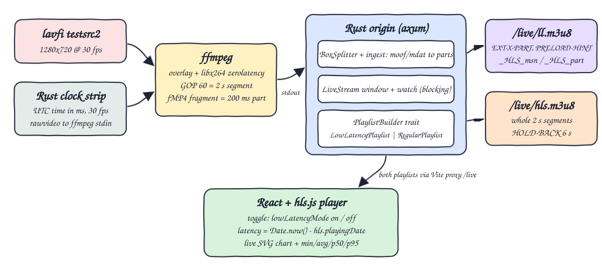
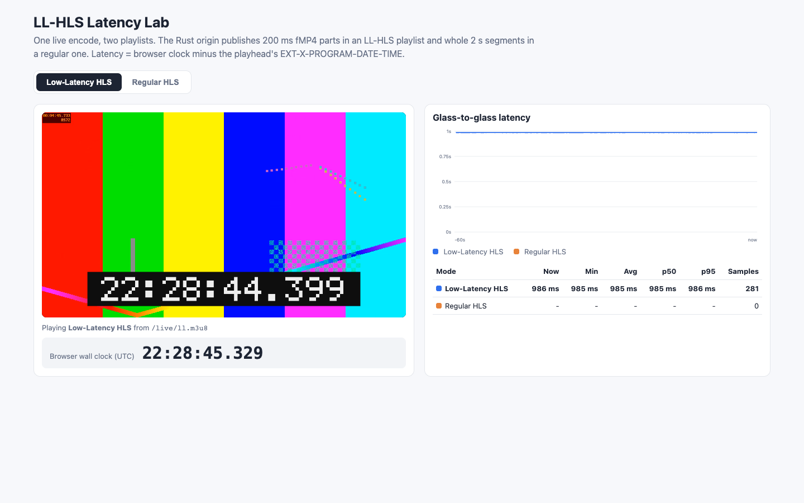
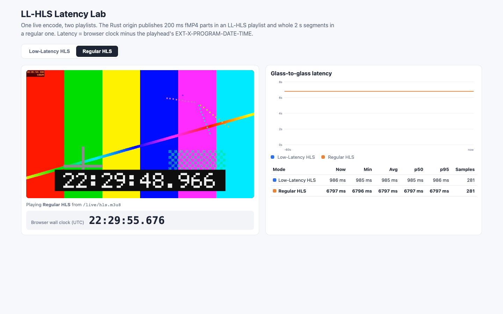

# LL-HLS Simulcast

A live source is published at the same time (simulcast) as **Low-Latency HLS** and **regular HLS** by a Rust origin that builds the playlists itself. A React player with hls.js switches between the two and measures **glass-to-glass latency** live: the wall-clock time each frame was captured is burned into the picture and carried in `EXT-X-PROGRAM-DATE-TIME`, and the player compares it with its own clock.

## How it Works

1. The origin starts `ffmpeg` with two inputs: `lavfi testsrc2` (1280x720, 30 fps) and a 960x120 rawvideo strip on stdin that Rust draws every 33 ms with the current UTC time in milliseconds.
2. ffmpeg overlays the strip, encodes with `libx264 -tune zerolatency` (GOP 60 = 2 s) and writes fragmented MP4 to stdout with `-frag_duration 200000`, so every `moof+mdat` is a 200 ms part.
3. The origin splits stdout into MP4 boxes, parses `mdhd`/`trex`/`tfhd`/`tfdt`/`trun` to get each part's duration and whether it starts on a keyframe, and opens a new 2 s segment on every independent part.
4. Each segment's `EXT-X-PROGRAM-DATE-TIME` = clock start + `tfdt / timescale`, the same instant drawn on its first frame.
5. `LowLatencyPlaylist` lists parts (`EXT-X-PART`), `EXT-X-PRELOAD-HINT` and `EXT-X-SERVER-CONTROL:CAN-BLOCK-RELOAD=YES,PART-HOLD-BACK=0.6`. `RegularPlaylist` lists only complete segments.
6. `_HLS_msn` / `_HLS_part` requests wait on a `tokio::sync::watch` channel until that part exists (400 if too far ahead, 503 after 3 target durations).
7. The player samples `Date.now() - hls.playingDate` every 250 ms and draws both modes on one chart.

## Architecture



## Features

* **Origin-built LL-HLS playlist**: no packager, the Rust code owns every tag, so each spec rule is unit-tested.
* **Blocking playlist reload**: `_HLS_msn`/`_HLS_part` hold the request until the part lands, so players get new parts with no polling.
* **Preload hint parts**: requesting the hinted part blocks until it is produced, as the spec allows.
* **Simulcast of one encode**: the same parts are served as LL-HLS parts and concatenated into regular HLS segments, so the comparison is fair.
* **Burned-in millisecond clock**: you can read latency straight off a screenshot (video clock vs browser clock) as a cross-check of the computed number.
* **Live latency graph**: SVG chart of the last 60 s plus min / avg / p50 / p95 per mode, no chart library.
* **Bounded memory**: sliding window of 12 segments, and parts are only listed for the last 3 target durations.

## Stack

* **Rust 1.99 (edition 2024) + axum + tokio**: async origin that can hold thousands of blocked requests cheaply.
* **thiserror**: typed `Error` enum that maps to HTTP status codes (400/404/503).
* **ffmpeg 8.1 (lavfi, overlay, libx264)**: real-time encoder producing CMAF-style fMP4 fragments.
* **React 19 + TypeScript 7 + Vite 8 + Bun**: small typed UI and dev server with a `/live` proxy.
* **hls.js 1.7**: the only player library; it supports `lowLatencyMode`, parts and blocking reload.
* **Playwright (Chrome channel)**: automated measurement and printscreens. Chrome is used because the bundled Chromium has no H.264.

## Contracts / APIs

All on the origin (port 8104), also proxied by the UI dev server (port 5104).

| Method | Path | Description |
|---|---|---|
| GET | `/live/ll.m3u8` | LL-HLS media playlist. Optional `_HLS_msn=<M>&_HLS_part=<P>` blocks until part P of segment M (or later) exists. `_HLS_part` without `_HLS_msn` -> 400, M more than 2 past the last segment -> 400, no data within 6 s -> 503 |
| GET | `/live/hls.m3u8` | Regular HLS media playlist (complete segments only, `HOLD-BACK=6`) |
| GET | `/live/init.mp4` | fMP4 init segment (`ftyp`+`moov`) |
| GET | `/live/seg<M>.m4s` | Complete 2 s segment (404 while still open) |
| GET | `/live/part<M>.<P>.m4s` | 200 ms part. Blocks if it is the next part to be produced (preload hint) |

LL-HLS playlist excerpt produced by the origin:

```
#EXTM3U
#EXT-X-VERSION:6
#EXT-X-TARGETDURATION:2
#EXT-X-PART-INF:PART-TARGET=0.20000
#EXT-X-SERVER-CONTROL:CAN-BLOCK-RELOAD=YES,PART-HOLD-BACK=0.60000
#EXT-X-MEDIA-SEQUENCE:0
#EXT-X-MAP:URI="init.mp4"
...
#EXTINF:2.00000,
seg4.m4s
#EXT-X-PROGRAM-DATE-TIME:2026-10-16T22:20:58.378Z
#EXT-X-PART:DURATION=0.20000,URI="part5.0.m4s",INDEPENDENT=YES
#EXT-X-PART:DURATION=0.20000,URI="part5.1.m4s"
...
#EXT-X-PRELOAD-HINT:TYPE=PART,URI="part5.9.m4s"
```

## Key data structures and design decisions

* `PlaylistBuilder` trait (`backend/src/playlist.rs`) with `LowLatencyPlaylist` and `RegularPlaylist`: both render from the same `Window`, so the two simulcast outputs can never drift apart.
* `LiveSource` trait (`backend/src/source.rs`): `FfmpegSource` is one implementation; tests feed synthetic fMP4 bytes straight into `ingest` instead.
* `Window` (`backend/src/live.rs`): `VecDeque<Segment>`, each `Segment { msn, program_date_ms, parts, complete }`, each `Part { duration, independent, data: Bytes }`. Segments are built from parts on request, so the media is stored only once.
* `LiveStream` = `Mutex<Window>` + `watch::Sender<u64>` version. Every new part bumps the version, and blocked requests re-check `Window::check` (`Ready` / `Pending` / `TooFar`).
* Segment boundaries come from keyframe flags parsed out of `trun`/`tfhd`, not from counting, so a segment always starts with `INDEPENDENT=YES`.
* PDT comes from `tfdt` and the clock start, not from arrival time, so network or encoder jitter does not leak into the timestamp. The burned-in digits come from the same clock.
* The installed ffmpeg build has **no `drawtext` filter** (no freetype), so the timestamp is drawn by Rust with a 5x7 bitmap font and overlaid with ffmpeg's `overlay`. This is also more accurate: the digits are exactly the capture time of that frame.
* Delta updates (`EXT-X-SKIP`) are not implemented. The playlist is small enough without them.

## Results (measured on this machine)

Measured with `bun run measure` in `frontend/` (Playwright + Google Chrome, headless, localhost; Apple Silicon Mac). For each join the player warms up, then the latency is sampled every 500 ms. Latency is the player's `Date.now()` minus the PDT of the frame at the playhead, i.e. capture to decoded playhead. It does not include the display/compositor frame (about 16 ms).

**Per join (8 joins per mode, 10-60 s of samples each):**

| Mode | min join | median join | max join |
|---|---|---|---|
| Low-Latency HLS (200 ms parts, PART-HOLD-BACK 0.6 s) | **673 ms** | **692 ms** | 985 ms |
| Regular HLS (2 s segments, 3-segment hold back) | 6268 ms | 6911 ms | 7847 ms |

Joins: LL = 688, 985, 684, 741, 775, 691, 673, 692 ms. Regular = 7572, 6796, 6282, 7026, 7847, 6652, 7455, 6268 ms.

* LL-HLS is about **10x lower** than regular HLS (about 0.7 s vs about 6.9 s at the median).
* Within one session latency is flat (p95 - min under 2 ms over 60 s, 120 samples), because the playhead and the wall clock advance at the same rate. The spread between joins depends on where in the part/segment cycle the player joins (hls.js does not speed up playback to catch up by default).
* LL latency is close to the floor `PART-HOLD-BACK (600 ms) + one part in flight`.
* Origin side: a blocking reload for the hinted part was released after a median **199 ms** (max 202 ms, 40 requests), i.e. exactly one part. Each part was published a median **4 ms** (max 7 ms) after its nominal end time, so encode + packaging add only about one frame.
* Visual cross-check: in the regular HLS printscreen the video shows `22:29:48.966` while the browser clock shows `22:29:55.676` (6.71 s), in line with the computed 6797 ms. In the LL-HLS printscreen it is `22:28:44.399` vs `22:28:45.329` (0.93 s vs computed 985 ms). The small gap is the screenshot capture timing.

## How to run

```bash
./scripts/setup.sh
./scripts/start-all.sh
./scripts/ui.sh
./scripts/test-all.sh
./scripts/stop-all.sh
```

Re-run the measurement (app must be running): `cd frontend && bun run measure`. `WARMUP_MS`, `MEASURE_MS` and `SHOTS_DIR` change the warm-up, sampling time and screenshot folder.

Tests: `cargo test` in `backend/` (45 tests: fMP4 parsing, window/segmenting, blocking semantics, playlist spec rules, HTTP status codes) and `bun test` in `frontend/` (8 tests: latency stats and chart scaling).

## Printscreens

### Low-Latency HLS



LL-HLS mode after 70 s. The burned-in clock in the video reads `22:28:44.399` while the browser clock reads `22:28:45.329`. The chart (blue) is flat at about 985 ms for this join and the table shows min/avg/p50/p95 over 281 samples.

### Regular HLS



The same stream 70 s after switching to the regular playlist. The orange line sits flat at about 6.8 s (the earlier LL-HLS samples have scrolled out of the 60 s window). The table keeps both modes' statistics side by side: 985 ms for LL-HLS vs 6797 ms for regular HLS on this run.

## Scripts

All scripts live in `scripts/` and run from any directory of the repository.

| Script | What it does |
|---|---|
| `./scripts/setup.sh` | Installs dependencies and prepares the app |
| `./scripts/start-all.sh` | Starts every service and prints the full link of each one |
| `./scripts/status.sh` | Shows every service port as UP or DOWN |
| `./scripts/test-all.sh` | Runs every test suite |
| `./scripts/ui.sh` | Opens the UI in the browser |
| `./scripts/stop-all.sh` | Stops every service |

Ports are declared in `scripts/ports.env`.

```bash
./scripts/setup.sh
./scripts/start-all.sh
./scripts/status.sh
./scripts/ui.sh
./scripts/stop-all.sh
```
