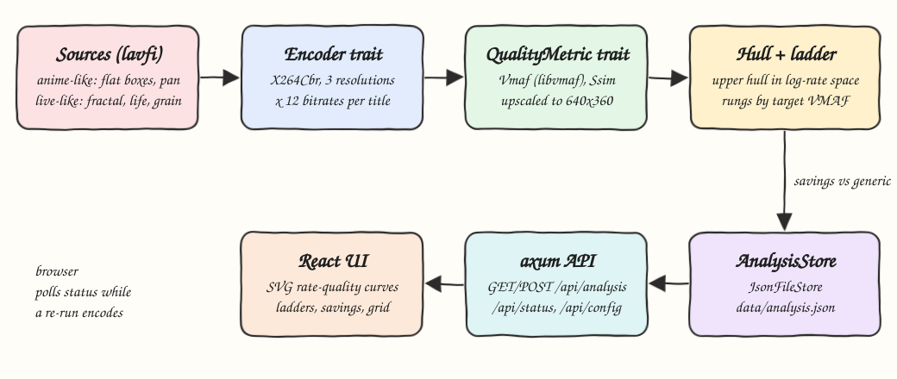
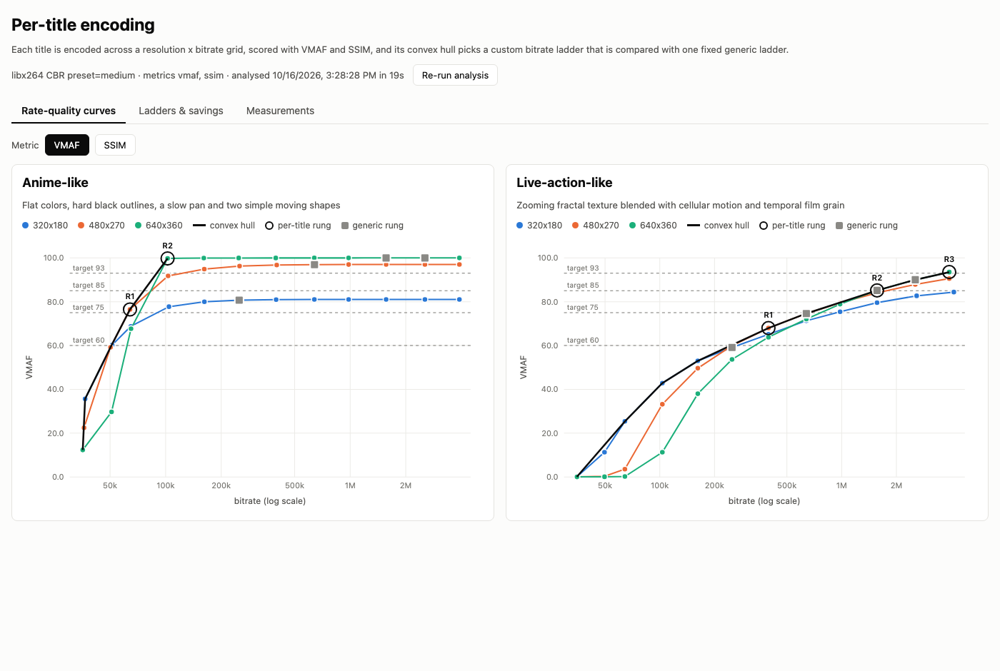
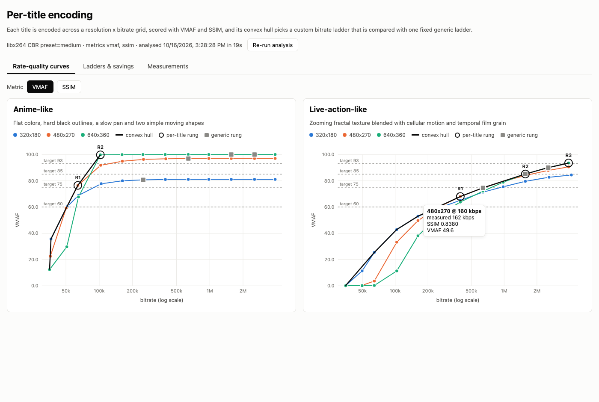
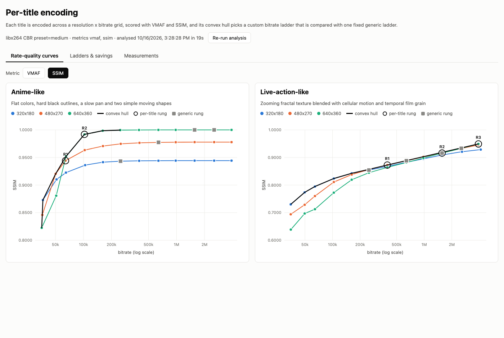
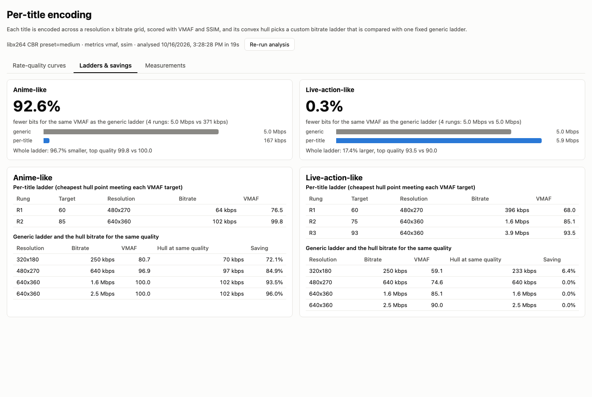
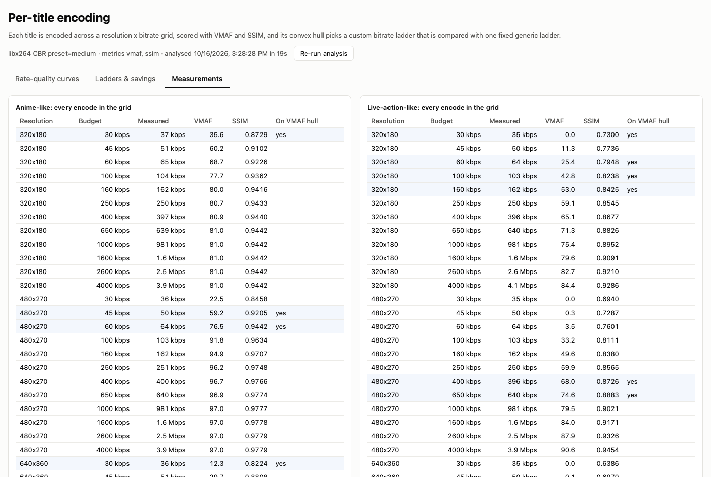

# Per-Title Encoding

A per-title encoding analyser. It generates two short synthetic titles with ffmpeg, an anime-like clip (flat colors, hard outlines, simple motion) and a live-action-like clip (fractal texture, cellular motion, film grain), encodes each one across a resolution x bitrate grid, scores every encode with VMAF and SSIM, computes the rate-quality convex hull, and builds a custom bitrate ladder per title. The UI charts the curves, the hull and the ladder, and compares each per-title ladder with one fixed generic ladder to show the bitrate savings.

## How it Works

1. `setup.sh` builds the Rust backend and runs the analysis once if `data/analysis.json` is missing.
2. Two 4 second 640x360 24 fps sources are rendered from lavfi filter graphs into `data/sources/` (gitignored).
3. Every title is encoded with libx264 in CBR at 3 resolutions (320x180, 480x270, 640x360) x 12 bitrates (30 kbps to 4 Mbps): 72 encodes.
4. Each encode is upscaled back to 640x360 and scored against the source with libvmaf and the ssim filter.
5. The convex hull is the upper concave envelope of all points in (log bitrate, quality) space; points that cost more for less quality, or gain less than a noticeable step (0.5 VMAF), are dropped.
6. The per-title ladder takes, for each target VMAF (60, 75, 85, 93), the cheapest hull point that reaches it.
7. Each generic rung is compared with the hull bitrate needed to reach the same quality, which gives the equal-quality saving.
8. Results are cached as JSON, served by axum, and drawn by React with plain SVG.

## Architecture



## Features

* Two synthetic titles with opposite complexity, so the hull shape and ladder clearly differ per title.
* Pluggable `Encoder`, `QualityMetric`, `SourceGenerator` and `AnalysisStore` traits, so x264 can be swapped for x265 or VMAF for another metric without touching the hull logic.
* CBR encodes, so the measured bitrate matches the rung budget and a fixed ladder pays for every bit it declares.
* Convex hull per metric (VMAF and SSIM), with resolution crossover visible on the chart.
* Per-title ladder chosen by target VMAF, with unreachable targets flagged instead of hidden.
* Equal-quality savings per generic rung and per title, plus whole ladder cost.
* Re-run button with live progress; results cached in `data/analysis.json` so restarts are instant.
* Charts with hover tooltips, a metric switch, and a full measurements table.

## Stack

* Rust 1.99 (edition 2024), axum, tokio, serde, thiserror: small typed backend with one binary for serve and analyze.
* ffmpeg 8.1 with libx264, libvmaf and ssim: the industry tools for encoding and perceptual quality.
* React 19, TypeScript 7, Vite 8, Bun: fast typed UI, charts are hand-written SVG with no chart library.

## Contracts / APIs

| Method | Path | Description |
|---|---|---|
| GET | `/api/health` | `{"status":"ok"}` |
| GET | `/api/config` | Grid resolutions, bitrates, targets, generic ladder, titles and their lavfi graphs |
| GET | `/api/analysis` | Cached `Analysis` JSON, or `404 {"error": ...}` when nothing is cached |
| POST | `/api/analysis` | Starts a re-run in the background, `202` with the run status, `409` when one is already running |
| GET | `/api/status` | `{"state":"idle|running|done|failed","done":n,"total":n,"error":null}` |

The backend binary also has CLI commands: `per-title analyze` (always re-runs) and `per-title analyze-if-missing` (used by setup).

## Key data structures and design decisions

* `Point { resolution, target_kbps, bitrate_kbps, scores: {vmaf, ssim} }`: one encode. `bitrate_kbps` comes from the real file size, not the request.
* `TitleReport { points, hulls: {metric: [Point]}, ladder: [LadderRung], generic: [GenericComparison], savings }`.
* `LadderRung { target, reached, point }`: the cheapest hull point meeting `target`. Targets that land on the same point collapse into one rung.
* `GenericComparison { point, equal_quality_kbps, saving_pct }`: the generic rung, and the hull bitrate (log interpolated) that matches its quality.
* The hull is computed in log-bitrate space because the grid is log spaced and the chart uses a log axis; a linear-space hull would skip most low-bitrate points.
* A `min_gain` per metric (0.5 VMAF, 0.0005 SSIM) stops the hull from climbing for invisible gains such as 99.9 to 100.0 VMAF.
* Equal-quality saving is never negative by construction: the hull dominates every encode, including the generic ones.
* Encodes run on a small worker pool (3 threads) with `std::thread::scope`; the first failure stops the run and surfaces in `/api/status`.

## Results

Measured on this machine with the default config (72 encodes, libx264 `medium`, CBR):

| Title | Hull points | Per-title ladder | Equal-quality saving vs generic | Whole ladder |
|---|---|---|---|---|
| Anime-like | 5 | 480x270 @ 64 kbps (VMAF 76.5), 640x360 @ 102 kbps (VMAF 99.8) | 92.6% (5.0 Mbps vs 371 kbps over 4 rungs) | 167 kbps vs 5.0 Mbps |
| Live-action-like | 9 | 480x270 @ 396 kbps (68.0), 640x360 @ 1.6 Mbps (85.1), 640x360 @ 3.9 Mbps (93.5) | 0.3% | 5.9 Mbps vs 5.0 Mbps, top VMAF 93.5 vs 90.0 |

* Anime-like content saturates near VMAF 100 at 640x360 around 100 kbps; the generic 1.6 and 2.6 Mbps rungs spend 15x to 25x more bits for no visible gain.
* Live-action-like content needs the bits: the generic rungs already sit on its hull, so per-title saves almost nothing, and the per-title ladder adds a higher rung to reach VMAF 93.
* 320x180 wins below about 160 kbps on the grainy clip, 480x270 wins between about 250 and 650 kbps, and 640x360 wins above that. On the anime clip 640x360 wins from about 100 kbps.
* Full analysis took 37 to 40 seconds the first time (including source generation) and about 19 seconds on a re-run. Small VMAF differences of about 1 point show up between runs because x264 multithreading is not bit-exact.

## How to run

```bash
./scripts/setup.sh
./scripts/start-all.sh
./scripts/ui.sh
./scripts/test-all.sh
./scripts/stop-all.sh
```

Tests: `cargo test` in `backend/` (29 tests: hull, ladder, savings, metric parsing, config, pipeline with fake traits, API, and one real ffmpeg encode plus VMAF and SSIM) and `bun test src` in `frontend/` (8 tests for scales, formatting and ladder totals).

## Printscreens

### Rate-quality curves (VMAF)



Every encode is a dot, colored by resolution. The black line is the VMAF convex hull, the rings R1..Rn are the per-title rungs, the grey squares are the generic ladder and the dashed lines are the target VMAF levels. On the anime-like title the hull jumps to 640x360 at about 100 kbps and the generic squares sit far to the right on the flat part of the curve. On the live-action-like title the hull moves from 320x180 to 480x270 to 640x360 and the generic squares sit on it.

### Hover tooltip



Hovering a point shows its resolution, its requested budget, the measured bitrate and both scores.

### Rate-quality curves (SSIM)



The same grid scored with SSIM, with its own hull. The ladder rings stay where VMAF placed them, so the two metrics can be compared.

### Ladders and savings



The top tiles show the equal-quality saving against the generic ladder and the whole ladder cost. The tables list each per-title rung and, for each generic rung, the hull bitrate that reaches the same VMAF.

### Measurements



The raw grid: budget, measured bitrate, VMAF and SSIM for every encode. Rows on the VMAF hull are highlighted.

## Scripts

All scripts live in `scripts/` and run from any directory of the repository.

| Script | What it does |
|---|---|
| `./scripts/setup.sh` | Installs dependencies, builds the backend and runs the analysis when no cache exists |
| `./scripts/start-all.sh` | Starts every service and prints the full link of each one |
| `./scripts/status.sh` | Shows every service port as UP or DOWN |
| `./scripts/test-all.sh` | Runs every test suite |
| `./scripts/ui.sh` | Opens the UI in the browser |
| `./scripts/stop-all.sh` | Stops every service |

Ports are declared in `scripts/ports.env` (backend 8102, frontend 5102).

```bash
./scripts/setup.sh
./scripts/start-all.sh
./scripts/status.sh
./scripts/ui.sh
./scripts/stop-all.sh
```
