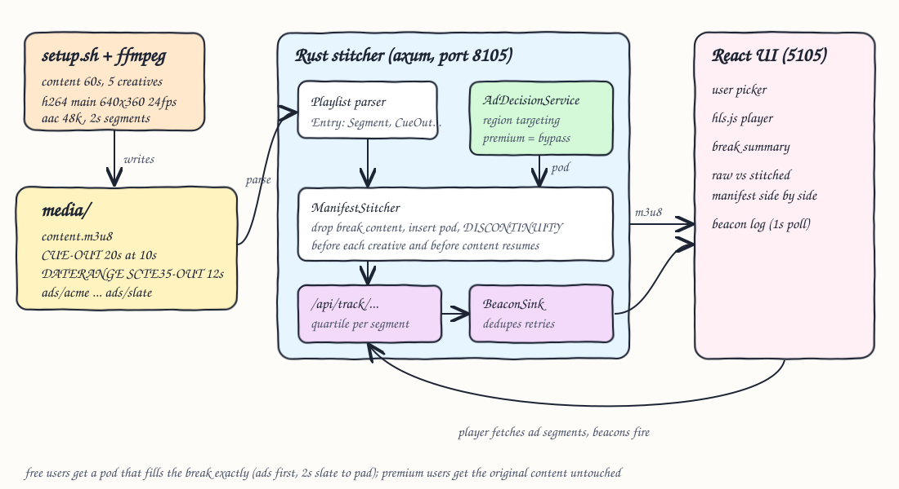
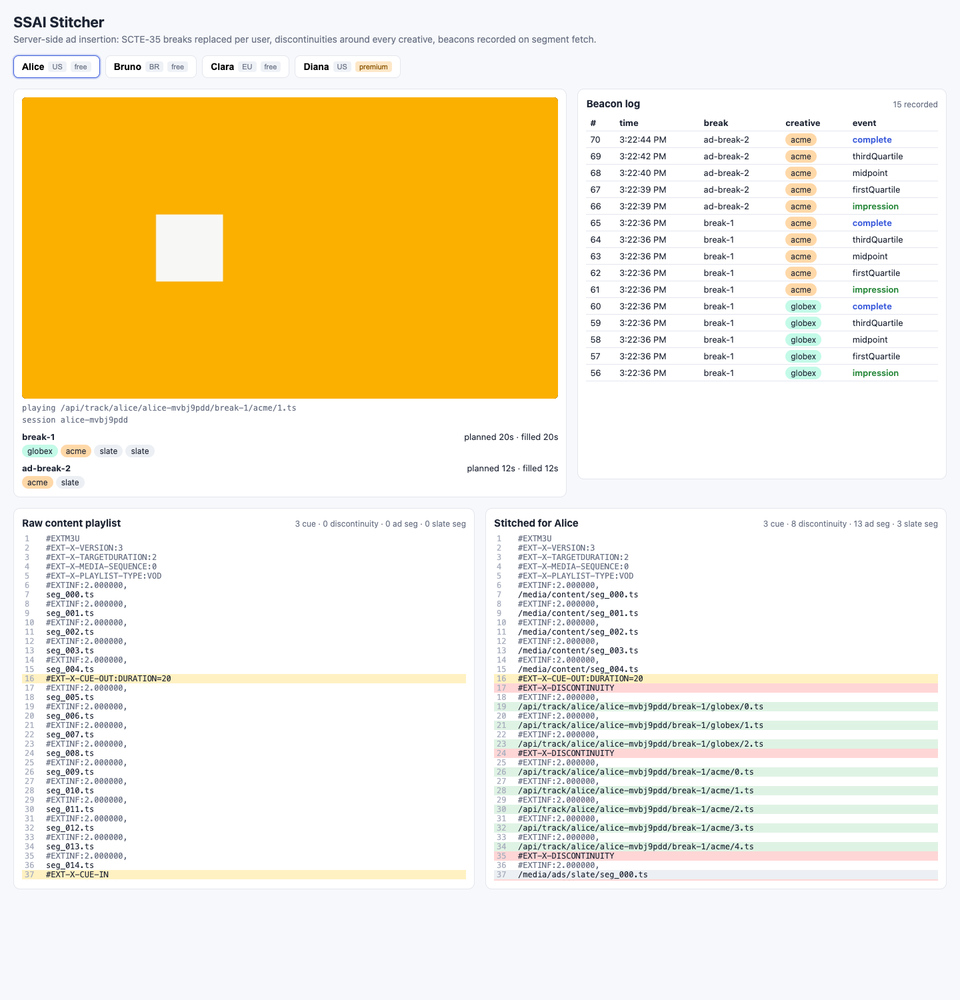
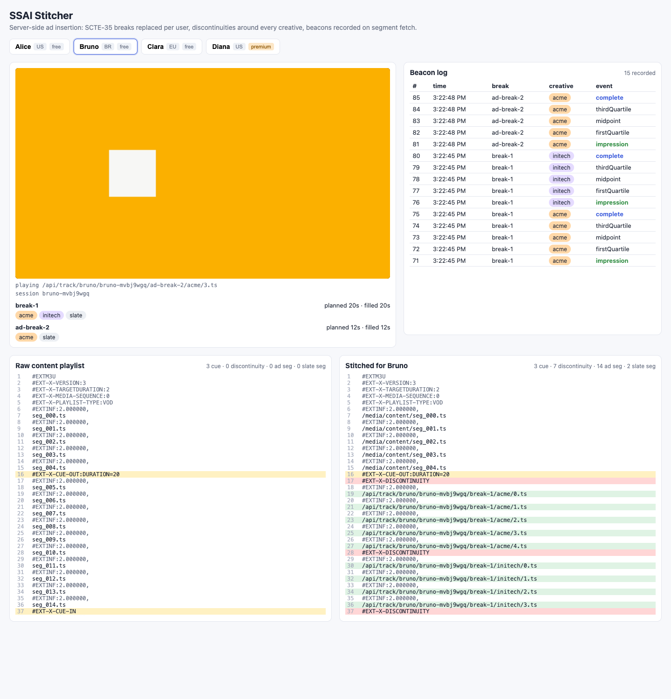
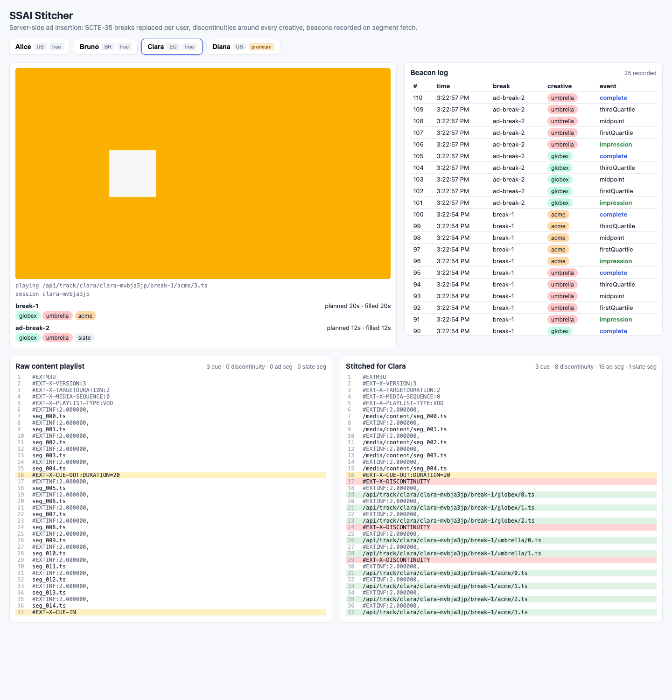
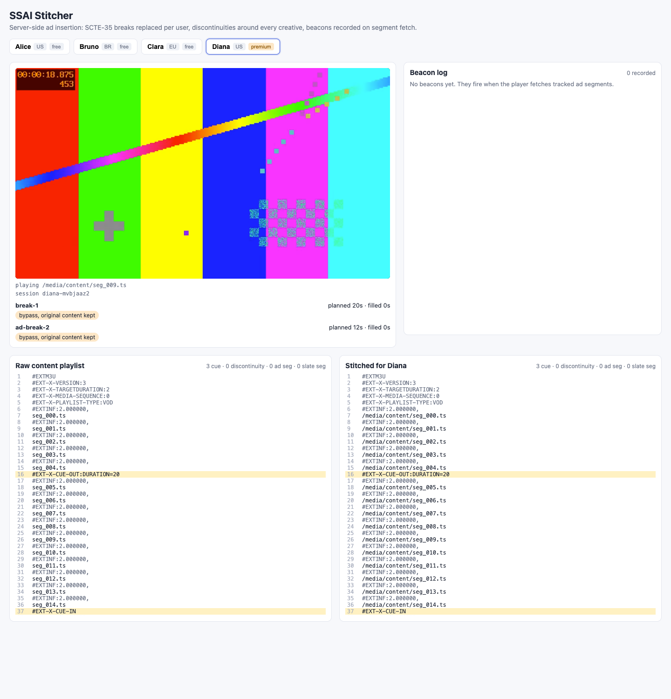

# SSAI Ad Insertion

A server-side ad insertion (SSAI) stitcher. A Rust service reads an HLS content playlist that carries SCTE-35 ad break markers, asks an ad decision service which creatives a given user should see, and returns a personalised playlist where each break is replaced by ad segments wrapped in `EXT-X-DISCONTINUITY` tags. Ad segments are served through tracking URLs, so impression and quartile beacons are recorded on the server when the player fetches them. Premium users bypass ads and get the original content. A React UI plays the stitched stream with hls.js, shows the raw and stitched manifests side by side and the live beacon log.

## How it Works

1. `scripts/setup.sh` uses ffmpeg to encode a 60s content stream and 5 creatives (acme 10s, globex 6s, initech 8s, umbrella 4s, slate 2s) with identical codec parameters: H.264 Main 640x360 24fps, GOP 48, AAC 48kHz stereo, 2s segments.
2. The content playlist is post-processed to carry two breaks: `#EXT-X-CUE-OUT:DURATION=20` / `#EXT-X-CUE-IN` at 10s and `#EXT-X-DATERANGE ... PLANNED-DURATION=12,SCTE35-OUT=...` at 40s.
3. `GET /api/manifest.m3u8?user=alice&session=s1` parses the playlist into typed entries, and for every cue out asks `AdDecisionService` for a pod.
4. `TargetedAdDecision` returns nothing for premium users. For free users it filters creatives by region, rotates them per user and break, packs them greedily into the break and pads the remainder with 2s slate.
5. `ManifestStitcher` drops the content segments covered by the break, inserts a `DISCONTINUITY` before every creative (each one is its own encode, so timestamps restart) and one more before the content resumes.
6. Ad segments point to `/api/track/{user}/{session}/{break}/{creative}/{n}.ts`. That handler works out which quartile events segment `n` covers, records them in a `BeaconSink` that ignores repeats, and serves the bytes.
7. The UI polls `/api/beacons?session=` every second and renders the log.

## Architecture



## Features

* SCTE-35 in both HLS styles: `EXT-X-CUE-OUT/CUE-IN` and `EXT-X-DATERANGE` with `SCTE35-OUT`. Real packagers emit either one.
* Per-user decisions: region targeting plus tier. Premium bypass keeps the original break content, so nobody loses footage.
* Exact break filling: pods add up to the planned duration, so the content after the break keeps its original timeline.
* Discontinuity before every creative and before the content returns. hls.js resets its decoder at each point where PTS restarts.
* Slate filler is not tracked. Padding never shows up as ad billing.
* Server-side beacons (impression, firstQuartile, midpoint, thirdQuartile, complete), recorded once each per session/break/creative even when the player retries.
* UI: user picker, hls.js player, break summary, color-coded raw vs stitched manifests, live beacon log.

## Stack

* Rust 1.99 (edition 2024), axum 0.8, tokio: small async HTTP service with typed errors (`thiserror`).
* ffmpeg 8.1 (libx264 + aac): generates content and creatives with matching codec params, so splicing works.
* React 19.3 + TypeScript 7 + Vite 8.3 on Bun: the UI, with no UI library.
* hls.js 1.7: plays the stitched HLS stream in the browser and handles discontinuities.

## Contracts / APIs

| Method | Path | Description |
|---|---|---|
| GET | `/api/users` | User profiles `{id, name, region, tier}` |
| GET | `/api/catalog` | Ad creatives with regions and segment durations |
| GET | `/api/manifest.m3u8?user=&session=` | Stitched HLS media playlist (`application/vnd.apple.mpegurl`) |
| GET | `/api/stitch?user=&session=` | JSON `{user, session, raw, stitched, breaks[{id, planned, replaced, filled, creatives}]}` |
| GET | `/api/track/{user}/{session}/{break}/{creative}/{n}.ts` | Records the beacons for ad segment `n`, returns the TS bytes |
| GET | `/api/beacons?session=` | Beacon log `[{seq, user, session, breakId, creative, event, atMs}]` |
| DELETE | `/api/beacons` | Clears the log |
| GET | `/media/{path}` | Content and slate segments. Path traversal is rejected |

`session` defaults to the user id and must match `[A-Za-z0-9_-]{1,64}`.

## Key data structures and design decisions

* `playlist::Entry` is `Segment | CueOut{id, duration} | CueIn | Discontinuity | Tag`. Both cue styles become the same `CueOut`, so the stitcher has one code path. `Playlist::render` recomputes `TARGETDURATION` and round-trips unknown tags.
* `trait AdDecisionService { fn decide(&self, user, break) -> Result<Vec<Creative>> }`. An empty pod means bypass. `TargetedAdDecision` is the swappable implementation.
* `trait BeaconSink { record, list, clear }`. `MemoryBeaconSink` dedupes on `session|break|creative|event`.
* A break ends at `CUE-IN` or when the replaced content reaches the planned duration, whichever comes first. The DATERANGE style needs the duration rule because it has no `CUE-IN`.
* Quartile mapping: an event at point `p` fires on the first segment whose end is at or after `p`. Every event fires exactly once for any segmentation (this is tested).
* Beacons are tied to segment fetch, as in real SSAI. The trade-off is covered under Results.

## How to run

```bash
./scripts/setup.sh
./scripts/start-all.sh
./scripts/ui.sh
./scripts/test-all.sh
./scripts/stop-all.sh
```

UI: `http://localhost:5105` (append `?user=diana` to open a specific user). Backend: `http://localhost:8105/api/manifest.m3u8?user=alice`.

## Tests

`cargo test` runs 21 tests:

* `stitcher_test` (8): a discontinuity appears exactly where timestamps reset (content to ad, between creatives, ad to content) and nowhere between content segments. The pod is closed by a discontinuity before `CUE-IN` content. Pods fill each break exactly for us/br/eu users, and total duration equals the content duration. Replaced content never leaks. Premium bypass returns the untouched content with no discontinuities. Region targeting holds. Tracked URIs carry user/session/break and slate is never tracked. A nested cue out is rejected.
* `playlist_test` (5): both cue styles are parsed with their durations. Render round-trips. `TARGETDURATION` grows for longer segments. Bare-second cue out works. Malformed playlists are rejected.
* `tracking_test` (4): quartile placement, each event exactly once for several segmentations, out-of-range segments fire nothing, retries are deduped.
* `http_test` (4): fetching every tracked segment twice gives exactly 5 beacons per ad play. The premium manifest has no tracking or discontinuities. Bad user, bad session, path traversal and out-of-range segments are rejected. The stitch view exposes raw and stitched.

`bun test` runs 4 frontend tests (line classification, discontinuity counting, a new session per playback).

## Results

Measured locally against the generated media (debug build, one sequential client, 2000 requests over 4 users):

| Metric | Value |
|---|---|
| Stitch throughput | ~9650 manifests/s |
| Stitch latency | p50 0.10 ms, p99 0.22 ms |
| Every generated segment | exactly `2.000000`s (content and all ads) |
| Codec params (ffprobe) | identical across content and ads: h264 Main 640x360 24/1, aac LC 48000 2ch |

| User | Region / tier | break-1 (20s) | ad-break-2 (12s) | Discontinuities | Ad segs | Slate segs |
|---|---|---|---|---|---|---|
| alice | us / free | globex + acme + slate x2 | acme + slate | 8 | 13 | 3 |
| bruno | br / free | acme + initech + slate | acme + slate | 7 | 14 | 2 |
| clara | eu / free | globex + umbrella + acme | globex + umbrella + slate | 8 | 15 | 1 |
| diana | us / premium | bypass | bypass | 0 | 0 | 0 |

Finding: hls.js buffers ahead (about 30s by default), so fetch-based beacons fire before the viewer reaches the ad. In the clara capture, the ad-break-2 beacons were recorded while playback was at about 28s. Real SSAI systems have the same skew. Fixing it needs client-side beaconing or player-reported playhead positions. Beacon `seq` is a global counter across all sessions.

## Printscreens

### Alice (US, free)

Playback is in the acme creative (orange) during break-1. The pod is globex + acme + 2 slates = 20s, and break-2 is acme + slate = 12s. The beacon log shows impression to complete for both creatives in break-1 and for acme in break-2.

### Bruno (BR, free)

Region targeting: bruno gets initech (BR only) and never globex. The capture is during ad-break-2, which came from the `EXT-X-DATERANGE SCTE35-OUT` marker.

### Clara (EU, free)

The raw playlist (left) and stitched playlist (right) are side by side. Cue lines are yellow, discontinuities red, tracked ad segments green and slate gray. Each creative starts with its own `EXT-X-DISCONTINUITY`.

### Diana (US, premium)

Premium bypass: both breaks keep the original content (the test pattern keeps playing at 19s), the stitched manifest has 0 discontinuities and 0 ad segments, and no beacons are recorded.

## Scripts

All scripts live in `scripts/` and run from any directory of the repository.

| Script | What it does |
|---|---|
| `./scripts/setup.sh` | Generates media with ffmpeg, builds the backend, installs frontend dependencies |
| `./scripts/start-all.sh` | Starts every service and prints the full link of each one |
| `./scripts/status.sh` | Shows every service port as UP or DOWN |
| `./scripts/test-all.sh` | Runs every test suite |
| `./scripts/ui.sh` | Opens the UI in the browser |
| `./scripts/stop-all.sh` | Stops every service |

`scripts/media.sh` (called by setup) generates the content and creatives into the gitignored `media/` folder and skips this step if they already exist.

Ports are declared in `scripts/ports.env` (backend 8105, frontend 5105).

```bash
./scripts/setup.sh
./scripts/start-all.sh
./scripts/status.sh
./scripts/ui.sh
./scripts/stop-all.sh
```
