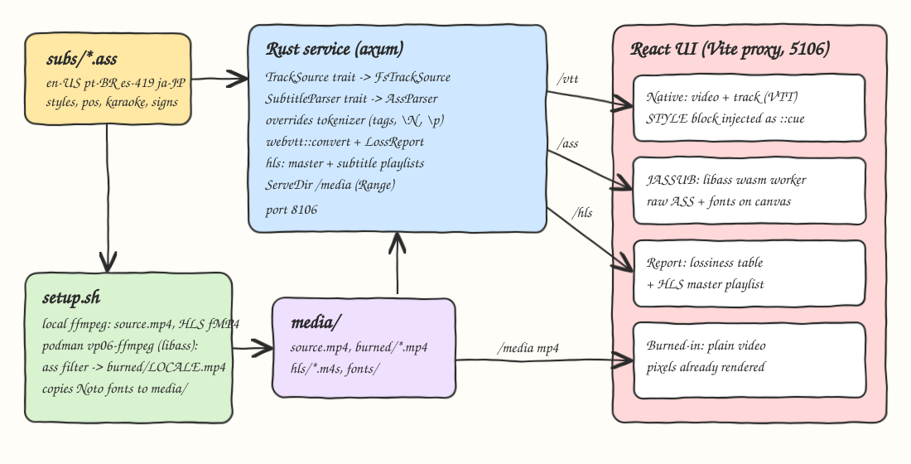
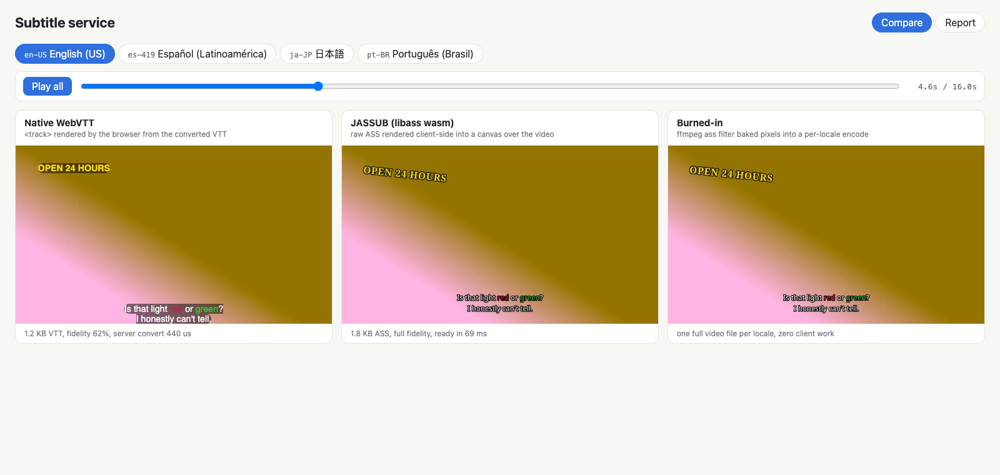
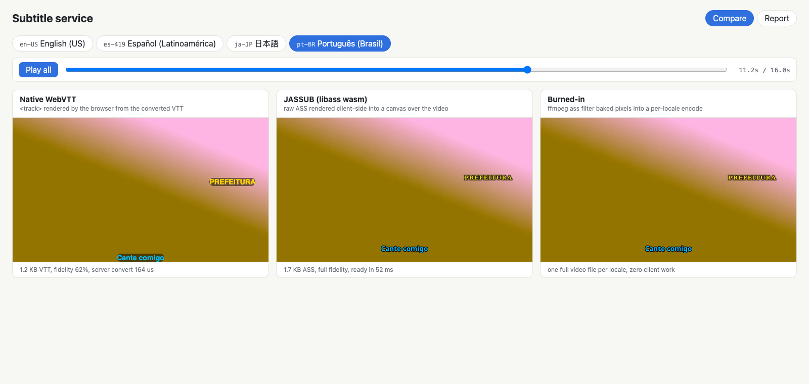
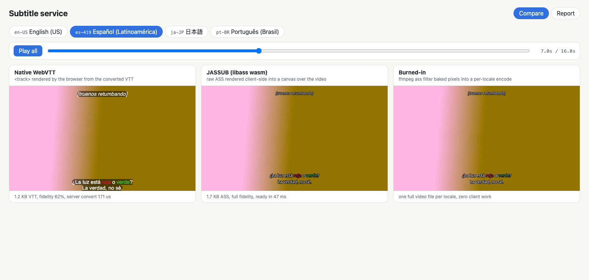
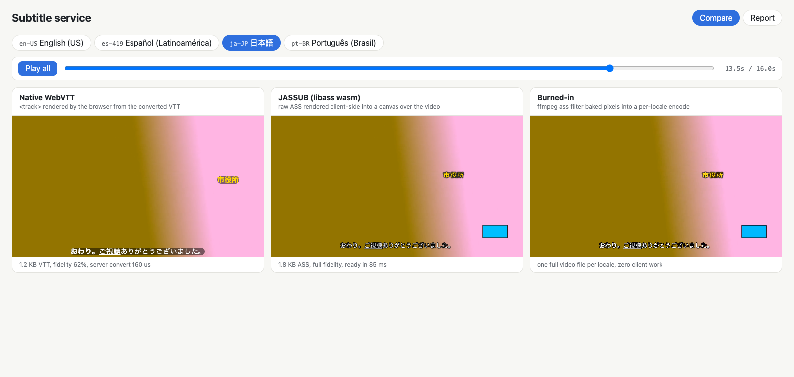
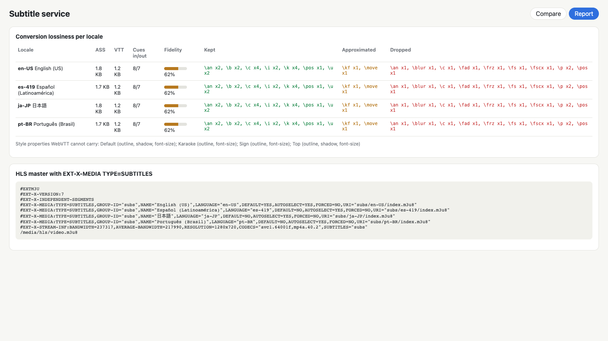

# Subtitle Service

A Rust subtitle service that parses hand-written ASS/SSA files in four locales (en-US, pt-BR, es-419, ja-JP), converts them to WebVTT with a lossiness report, and serves per-locale tracks plus an HLS master playlist with `EXT-X-MEDIA TYPE=SUBTITLES` renditions. A React UI plays the same clip three ways side by side: a native WebVTT `<track>`, client-side ASS rendered by JASSUB (libass compiled to wasm), and a video with the subtitles burned in by ffmpeg.

## How it Works

1. `subs/*.ass` are small hand-written scripts with four styles (Default, Top, Sign, Karaoke), `\pos`, `\an`, colors, `\k` karaoke, a rotated sign, a moving blurred sign, and a vector drawing.
2. At startup the backend loads every file through the `TrackSource` trait, parses it with `AssParser` (behind the `SubtitleParser` trait), and converts it with `webvtt::convert`.
3. The converter keeps what WebVTT can express, approximates some tags, strips the rest, and counts every tag in a `LossReport`.
4. `setup.sh` generates a 16 s clip with the local ffmpeg. It burns each locale in with the `ass` filter inside a podman image that ships libass, because the local ffmpeg build has no `ass`/`subtitles` filter. It also packages the clip as HLS fMP4.
5. The backend serves `/api/tracks/*`, the HLS master and subtitle playlists, and `/media/*` (with Range support).
6. The UI syncs three `<video>` elements to one clock. The native panel uses the VTT. The JASSUB panel feeds the raw ASS to libass-wasm in a worker. The burned panel just plays the per-locale MP4.

## Architecture



## Features

- **Own ASS/SSA parser behind a trait**: it honours the `Format:` field order, legacy SSA `[V4 Styles]` with decimal colors and old alignment numbers, BOMs, comments, and fallback to the Default style. Errors carry line numbers.
- **Override tokenizer**: longest-match tag names (`\fscx` is not read as `\fs`), nested `\t(...)` parentheses, `\N`/`\n`/`\h` that follow WrapStyle, and drawing mode `\p`.
- **WebVTT conversion**:
  - styles become `::cue(.sStyle)` classes in a `STYLE` block
  - `\b \i \u` become tags, `\s` becomes a class, and `\c` becomes a color class
  - `\an`/`\pos` become `line`/`position`/`align` cue settings
  - `\k` becomes inline cue timestamps
- **Lossiness report**: each tag is counted as kept, approximated or dropped, along with the style properties that are lost. The report gives a fidelity score.
- **HLS subtitle rendition**:
  - a master playlist with one `EXT-X-MEDIA TYPE=SUBTITLES` per locale and `SUBTITLES="subs"` on the variant
  - a per-locale subtitle media playlist
  - VTT segments with `X-TIMESTAMP-MAP`
- **Three-way comparison UI**: a locale switcher, synced playback, a seek bar, and a Report tab with the lossiness table and the live master playlist.

## Stack

- **Rust 1.99 (edition 2024) + axum 0.8 + tokio**: a small, fast HTTP service.
- **thiserror**: typed `SubError`. `anyhow` is used only in `main`.
- **tower-http ServeDir**: serves media with Range requests so video seeking works.
- **React 19.3 + TypeScript 7 + Vite 8.3 + Bun 1.4**: the UI. The Vite proxy keeps everything same-origin, and the dev server sets COOP/COEP headers so JASSUB can run multi-threaded.
- **JASSUB 2.5**: libass in WebAssembly, the reference renderer on the client.
- **ffmpeg 8.1 (local) + podman image `vp06-ffmpeg:1` (alpine ffmpeg with libass + Noto fonts)**: builds the source clip, the HLS packaging and the burn-in.
- **Playwright (Chrome channel)**: takes the printscreens and measures CPU through CDP `SystemInfo.getProcessInfo`.

## Contracts / APIs

| Method | Path | Response |
|---|---|---|
| GET | `/api/health` | `ok` |
| GET | `/api/tracks` | `[{locale, name, assBytes, vttBytes, convertMicros, report}]` |
| GET | `/api/tracks/{locale}/ass` | raw ASS, `text/x-ssa` |
| GET | `/api/tracks/{locale}/vtt` | converted WebVTT, `text/vtt` |
| GET | `/api/tracks/{locale}/report` | `LossReport` JSON |
| GET | `/hls/master.m3u8` | master with `EXT-X-MEDIA TYPE=SUBTITLES` x4 and the video variant |
| GET | `/hls/subs/{locale}/index.m3u8` | VOD subtitle media playlist (one segment spanning the video) |
| GET | `/hls/subs/{locale}/subs.vtt` | VTT with `X-TIMESTAMP-MAP=MPEGTS:0,LOCAL:00:00:00.000` |
| GET | `/media/*` | source.mp4, burned/{locale}.mp4, hls/*, fonts/* |

Errors: an unknown locale returns `404`. A missing generated media file returns `503` with a hint to run `setup.sh`.

```json
{
  "cuesIn": 8, "cuesOut": 7,
  "kept": {"an": 2, "b": 2, "c": 4, "i": 2, "k": 4, "pos": 1, "u": 2},
  "approximated": {"kf": 1, "move": 1},
  "dropped": {"an": 1, "blur": 1, "c": 1, "fad": 1, "frz": 1, "fs": 1, "fscx": 1, "p": 2, "pos": 1},
  "styleDropped": {"Sign": ["outline", "font-size"]},
  "fidelity": 0.621
}
```

## Key data structures and design decisions

- `Script { info: ScriptInfo, styles: Vec<Style>, events: Vec<Event> }`. Times are stored as integer milliseconds, so the conversion from ASS centiseconds to VTT milliseconds never drifts.
- `Token = Text | Tags(Vec<Tag>) | LineBreak` decouples parsing the tags from deciding what to do with them. The same tokenizer drives both `strip_overrides` and the converter.
- Each run of text keeps a `RunState` (bold, italic, underline, strike, color). Each run is rendered with its own well-nested tags, so the WebVTT output is always valid even when the ASS toggles overlap.
- `classify(tag) -> Kept | Approximated | Dropped` is the single policy table. Fidelity = (kept + 0.5 x approximated) / all tags. Tags in an event that produces no text (a drawing-only sign) all count as dropped.
- Cue placement:
  - `\pos` becomes a percentage of PlayRes, anchored by the numpad alignment (`line-left`/`center`/`line-right`, `start`/`center`/`end`).
  - Plain alignment uses edge presets.
  - `\move` keeps only its start point.
  - `\kf`/`\ko` sweeps become step timestamps.
- The UI does not depend on browser support for `STYLE` blocks inside a VTT loaded through `<track>`. It reads the block from the same VTT and injects it as `.native-video::cue(...)` CSS.
- The source clip is encoded without B-frames. When it was encoded with them, the copied fMP4 HLS segments started at 66 ms, which shifted every HLS subtitle cue. With `-bf 0`, ffmpeg's HLS demuxer extracts the cues at exactly 0.500 s, 1.000 s, and so on.

## Results (measured)

### Bytes

| Artifact | en-US | pt-BR | es-419 | ja-JP |
|---|---|---|---|---|
| ASS source | 1,811 B (875 B gzip) | 1,745 B (865) | 1,744 B (869) | 1,795 B (944) |
| Converted VTT | 1,221 B (564 B gzip) | 1,231 B (577) | 1,224 B (575) | 1,277 B (639) |
| Burned-in MP4 (16 s, 720p, crf 23) | 1,214,834 B | 1,237,629 B | 1,233,745 B | 1,213,292 B |

- **Same encode without subtitles:** 1,102,132 B. Burning in adds about 10-12 % per locale. More importantly, every locale needs a full extra copy of the video: 4 locales means 4 x 1.2 MB, against about 5 KB of VTT for all four.
- **JASSUB client cost:**
  - wasm 2.18 MB (928 KB gzip) plus about 140 KB of worker JS
  - fonts: 2.6 MB of Latin Noto faces, or a 19.5 MB `NotoSansCJK-Regular.ttc` for ja-JP
  - Fonts dominate. Subsetting or WOFF2 would be the first optimisation.

### Fidelity

| Locale | Cues in/out | Kept | Approximated | Dropped | Fidelity |
|---|---|---|---|---|---|
| all four | 8/7 | an, b, c, i, k, pos, u | kf, move | rotation (frz), blur, fade, fscx, fs, the vector drawing (p + its pos/an/c) | 62 % |

- **JASSUB and the burned-in video** are pixel-for-pixel the same renderer (libass) with the same Noto fonts: rotated serif sign, outlines, the blue drawing box, karaoke sweep, fade.
- **The native track** keeps text, timing, the italic/bold/underline, colors, positions and karaoke steps. It loses outlines (it shows a black background box instead), rotation, blur, fade, scaling, font size and the drawing (that cue is dropped entirely).

### CPU

**Backend conversion:** parse + convert takes 160-440 us per track (debug build, first track includes warm-up).

**Burn-in** (ffmpeg `-benchmark` in the podman image, 480 frames):

| Run | user CPU |
|---|---|
| decode + `null` filter | 0.276 s |
| decode + `ass` filter | 0.367-0.389 s |

That is about 0.1 s of libass for 16 s of video, roughly 0.2 ms per frame. The full burn-in encode (libx264 veryfast) takes 2.5-2.7 s user CPU per locale, and that cost is paid again for every locale and every change to the subtitles.

**Browser playback** (12 s of playback, all Chrome processes summed via CDP, 3 runs each, `frontend/e2e/cpu.ts`):

| Mode | en-US CPU % of one core | ja-JP CPU % of one core |
|---|---|---|
| Native WebVTT | 5.5 - 6.9 | 4.9 - 8.7 |
| JASSUB (libass wasm) | 12.7 - 19.0 | 12.2 - 18.6 |
| Burned-in | 4.4 - 5.5 | 5.7 - 7.7 |

### Trade-offs

- **Burned-in** costs nothing on the client and looks perfect. But it multiplies storage and CDN bytes per locale, cannot be turned off, and every fix means re-encoding.
- **Native WebVTT** is the cheapest to ship (about 1.2 KB) and to render, and it stays accessible (user styling, screen readers). It also fits HLS renditions. But it loses typesetting: signs, rotation, outlines and effects.
- **JASSUB** gives full fidelity from a 1.8 KB file. In exchange it ships about 1 MB of gzipped wasm plus fonts (heavy for CJK), roughly doubles or triples playback CPU, and needs COOP/COEP for threading.

## How to run

```bash
./scripts/setup.sh
./scripts/start-all.sh
./scripts/test-all.sh
./scripts/ui.sh
./scripts/stop-all.sh
```

Tests:

- **Backend (`cargo test`): 38 tests**
  - `timestamps` (5)
  - `parsing` (8)
  - `overrides` (7)
  - `conversion` (12): WebVTT conversion, karaoke, override stripping, HLS playlists
  - `http` (6): router via `tower::oneshot`
- **Frontend (`bun test src`): 5 tests**

Measurements and printscreens (with the app running):

```bash
cd frontend
bun e2e/capture.ts
LOCALE=ja-JP bun e2e/cpu.ts
```

## Printscreens

**Compare, en-US at 4.6 s.**



- **Native (left):** the sign is upright, sans-serif, with no outline. The dialogue sits on a black cue box with the red/green color classes.
- **JASSUB (middle) and burned-in (right):** both show the rotated serif "OPEN 24 HOURS" sign with a dark outline, and outlined dialogue with no box.

**Compare, pt-BR at 11.2 s.**



The karaoke line and the moving "PREFEITURA" sign. In the native panel the sign is pinned at the `\move` start point with no blur. libass animates it and applies `\blur2` and `\fscx120`.

**Compare, es-419 at 7.0 s.**



The top-aligned `[truenos retumbando]` SDH line (style Top, italic) is on screen at the same time as the two-line dialogue with its colored words. The native panel places it with `line:5%` on a cue box. libass draws it small and outlined, and fades it in and out with `\fad`.

**Compare, ja-JP at 13.5 s.**



Japanese uses Noto Sans CJK in every panel. The blue box is an ASS vector drawing (`\p1`). WebVTT cannot express it, so the converter drops that cue and the native panel does not show it.

**Report tab.**



- **Lossiness table:** for each locale, the bytes, the cues in and out, the fidelity meter, and the kept/approximated/dropped tag counts.
- **Live HLS master:** four `EXT-X-MEDIA TYPE=SUBTITLES` renditions (en-US is the default) and the video variant with `SUBTITLES="subs"`.

## Scripts

All scripts live in `scripts/` and run from any directory of the repository.

| Script | What it does |
|---|---|
| `./scripts/setup.sh` | Builds the libass ffmpeg image, generates the clip, burned-in videos, HLS and fonts, then builds the backend and installs the frontend |
| `./scripts/start-all.sh` | Starts every service and prints the full link of each one |
| `./scripts/status.sh` | Shows every service port as UP or DOWN |
| `./scripts/test-all.sh` | Runs every test suite |
| `./scripts/ui.sh` | Opens the UI in the browser |
| `./scripts/stop-all.sh` | Stops every service |

Ports are declared in `scripts/ports.env` (backend 8106, frontend 5106).

```bash
./scripts/setup.sh
./scripts/start-all.sh
./scripts/status.sh
./scripts/ui.sh
./scripts/stop-all.sh
```
