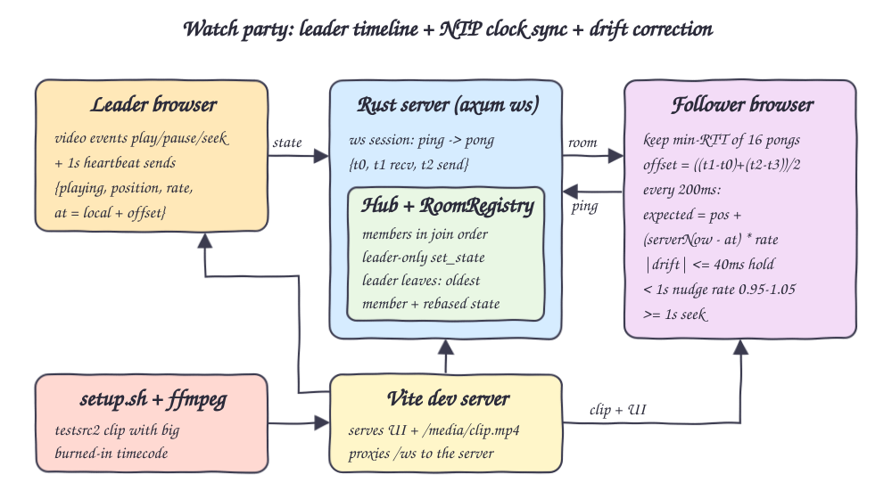
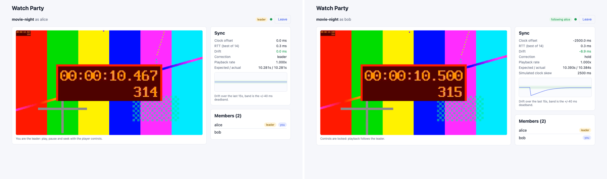
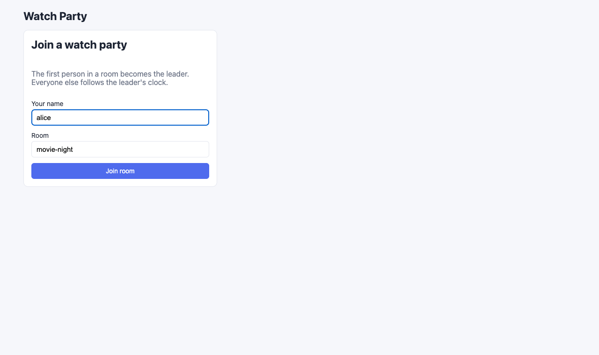
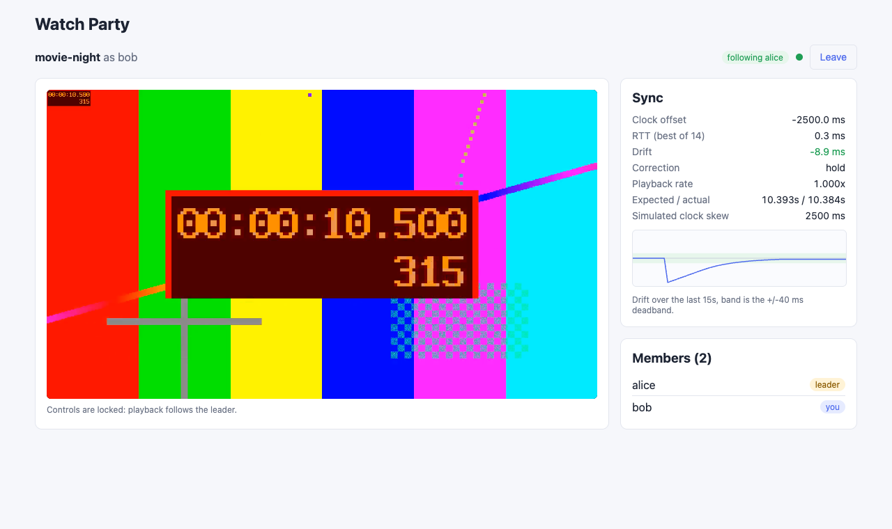
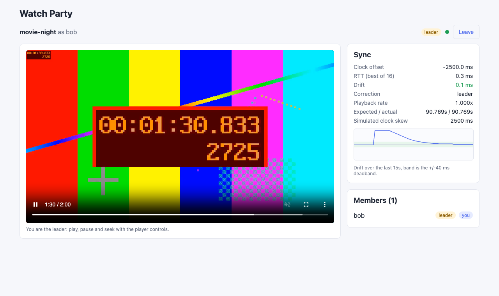

# Watch Party

A synchronized watch party: everyone in a room watches the same clip at the same frame. A Rust WebSocket server keeps rooms and an authoritative playback timeline owned by a leader (the host). Followers sync their clocks to the server NTP-style and steer their own player towards the leader's timeline, nudging the playback rate for small drift and seeking for large drift. If the leader disconnects, leadership is handed to the oldest member without a hiccup in the timeline.

## How it Works

1. `setup.sh` renders a 120s clip with ffmpeg `testsrc2`, with its timecode and frame number blown up in the middle of the frame, so sync is visible by eye.
2. A browser joins a room over `/ws` with a name. The first member is the leader; members are kept in join order.
3. Every client sends `ping {t0}`, the server answers `pong {t0, t1, t2}` (receive and send server times), and the client stamps `t3`. `offset = ((t1-t0)+(t2-t3))/2`, `rtt = (t3-t0)-(t2-t1)`. A burst of 8 pings on connect, then one every 2s; the sample with the minimum RTT out of the last 16 wins because its error is bounded by `rtt/2`.
4. The leader publishes `{playing, position, rate, at}` on play, pause, seek, rate change and every 1s, with `at = localNow + offset` (server time). The server rejects state from anyone else and clamps `at` to never be in the future.
5. Followers compute `expected = position + (serverNow - at) * rate` every 200ms and `drift = actual - expected`.
6. `|drift| <= 40ms` holds; `40ms < |drift| < 1s` nudges `playbackRate` to `rate * clamp(1 - drift_s * 0.5, 0.95, 1.05)` until drift is back under 10ms (hysteresis); `|drift| >= 1s` seeks.
7. When the leader leaves, the server picks the oldest remaining member and rebases the state to `now`, so the timeline continues exactly where it was.

## Architecture



## Features

* Rooms with a member list: one party per room name, rooms are created on first join and removed when empty.
* Leader-authoritative timeline: only the leader can change playback, so followers never fight over the position.
* Leader handoff: the oldest member takes over and the state is rebased, so nobody sees a jump.
* NTP-style clock sync with min-RTT selection over a sliding window: robust to jittery samples and still follows a drifting clock.
* Two-tier drift correction: invisible 0.95x-1.05x rate nudges for small drift, a seek for large drift.
* Live stats: clock offset, RTT, drift, correction mode, playback rate, expected vs actual position and a drift chart.
* `?skew=<ms>` URL parameter shifts a client's clock on purpose to prove the offset estimate recovers it.

## Stack

* Rust 1.99 (edition 2024), axum 0.8 with `ws` and tokio: small async WebSocket server.
* thiserror for the domain error enum, anyhow only in `main`.
* React 19.3, TypeScript 7, Vite 8.3, Bun 1.4: UI, dev server, proxy and tests.
* ffmpeg `testsrc2` + `crop`/`scale`/`overlay`: burned-in timecode without needing fonts.
* Playwright (run through bun, outside the project) with two browser contexts for printscreens and measurements.

## Contracts / APIs

HTTP

| Method | Path | Description |
|---|---|---|
| GET | `/health` | Returns `ok` |
| GET | `/ws` | WebSocket upgrade, JSON text frames |

Client to server

```json
{"type":"join","room":"movie-night","name":"alice"}
{"type":"ping","t0":1760640000123.4}
{"type":"state","playing":true,"position":12.5,"rate":1,"at":1760640000200.1}
```

Server to client

```json
{"type":"welcome","you":1}
{"type":"pong","t0":1760640000123.4,"t1":1760640000124.0,"t2":1760640000124.1}
{"type":"room","view":{"room":"movie-night","leader":1,"members":[{"id":1,"name":"alice","joinedAt":1760640000000.0}],"state":{"playing":true,"position":12.5,"rate":1.0,"at":1760640000200.1}}}
{"type":"error","message":"only the leader can change playback"}
```

All times are milliseconds since the Unix epoch on the server clock; positions are seconds.

## Key data structures and design decisions

* `PlaybackState { playing, position, rate, at }` (`backend/src/playback.rs`): the timeline is a point plus a slope, so any member can compute the current position from server time alone. `expected_position` never rewinds when `now < at`, and `rebased(now)` produces an equivalent state anchored at `now`.
* `RoomRegistry` trait (`backend/src/room.rs`) with `InMemoryRooms`: join, leave, set_state, view. Room logic is pure and takes `now_ms` as an argument, so handoff and timing are unit tested without sockets or sleeps.
* `Clock` trait (`backend/src/clock.rs`): the hub reads server time through it.
* `Hub` (`backend/src/hub.rs`): registry behind a mutex plus one unbounded channel per connected member; every mutation broadcasts the full room view (small, idempotent, no ordering bugs).
* Pong is written straight from the socket task with `t1` taken at receive and `t2` right before send, so server queueing is excluded from RTT.
* Client sync logic is pure TypeScript (`frontend/src/sync/clock.ts`, `frontend/src/sync/drift.ts`) and unit tested with `bun test`; the React hook only wires it to the `<video>` element.
* Follower controls are disabled; the video is muted so browsers allow programmatic play.
* Hysteresis on the rate nudge (start above 40ms, stop under 10ms): without it followers parked right at the 40ms edge (measured ~37ms steady drift before, ~10ms after).

## How to run

```bash
./scripts/setup.sh
./scripts/start-all.sh
./scripts/ui.sh
```

Open the UI in two browser windows (or one normal and one private), join the same room with different names, press play on the leader. Add `?skew=2500` to one URL to simulate a client clock 2.5s ahead.

Tests:

```bash
./scripts/test-all.sh
```

* Backend: 16 tests (`cargo test`): playback math (rate, pause, no rewind, rebase equivalence, clamping, validation), room rules (first member leads, leader-only state, handoff to oldest with rebased timeline, follower leave, empty room reset, isolation), and WebSocket integration (pong timestamps, state fan-out, follower refusal, handoff on disconnect).
* Frontend: 16 tests (`bun test`): NTP offset/RTT math, min-RTT selection, sliding window, expected position, hold/nudge/seek decisions, nudge cap, hysteresis.

## Results

Measured locally with two Chrome contexts in the same room, follower with `?skew=2500`:

| Measurement | Result |
|---|---|
| Recovered clock offset for a 2500ms skewed client | -2500.0 ms |
| Best RTT (loopback) | 0.3 ms |
| Steady follower drift over 5s of playback | avg 10.1 ms, max 17.2 ms |
| Leader seeks 10s -> 75s, follower back within 40ms | 388 ms (one seek + nudge) |
| Follower pushed 300ms ahead, back within 40ms | 5.8 s at 0.95x |
| Leader context closed, follower promoted | ~100 ms, kept playing |

## Printscreens

Two contexts side by side (leader on the left, follower with a simulated +2500ms clock skew on the right). Both show the same timecode; the screenshots were taken one after another so the burned-in timecodes differ by about one frame. The follower's offset is -2500ms, drift is -8.9ms and the correction is `hold`.



Join form: pick a name and a room; the first one in becomes the leader.



Leader view: native player controls are enabled, drift is measured against its own published state, member list marks the leader and you.


Follower view: controls are locked, offset and RTT come from the min-RTT pong sample, the drift chart shows the startup dip converging into the deadband band.



Follower nudge: the follower was pushed 300ms ahead; it is at 287ms drift, the correction is `nudge` and the playback rate is 0.950x, so it slowly falls back onto the leader's timeline without a visible jump.


Leader handoff: the leader's browser context was closed; the server promoted bob, who now has the controls and keeps playing from the rebased timeline.



## Scripts

All scripts live in `scripts/` and run from any directory of the repository.

| Script | What it does |
|---|---|
| `./scripts/setup.sh` | Builds the backend, installs frontend deps and generates the timecode clip |
| `./scripts/start-all.sh` | Starts every service and prints the full link of each one |
| `./scripts/status.sh` | Shows every service port as UP or DOWN |
| `./scripts/test-all.sh` | Runs every test suite |
| `./scripts/ui.sh` | Opens the UI in the browser |
| `./scripts/stop-all.sh` | Stops every service |

Ports are declared in `scripts/ports.env` (backend 8114, frontend 5114).

```bash
./scripts/setup.sh
./scripts/start-all.sh
./scripts/status.sh
./scripts/ui.sh
./scripts/stop-all.sh
```
